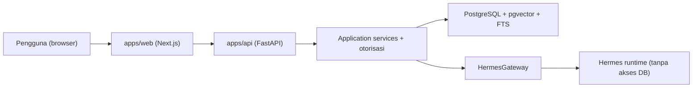

# Ringkasan Proyek SUNOVATE

**Status:** DRAFT
**Last Updated:** 2026-10-01

## Purpose

Dokumen ini memberi gambaran singkat tentang SUNOVATE: apa yang dibangun, untuk siapa, dalam periode berapa lama, dengan arsitektur apa, dan apa yang sudah tersedia di scaffold saat ini. Rincian setiap topik ada di dokumen terkait.

## Identitas Proyek

| Atribut | Isi | Label |
|---|---|---|
| Nama | SUNOVATE, SUN Integrated Management and Knowledge Platform | **CONFIRMED** (sumber: brief sesi 2026-10-01) |
| Instansi | Direktorat Surat Utang Negara (Dit. SUN), Direktorat Jenderal Pengelolaan Pembiayaan dan Risiko (DJPPR), Kementerian Keuangan RI | **CONFIRMED** (sumber: brief sesi 2026-10-01) |
| Pengembang | Peserta MagangHub, posisi Artificial Intelligence & Data Engineering, Web Development & UI/UX | **CONFIRMED** (sumber: brief sesi 2026-10-01) |
| Periode | 21 September 2026 sampai 20 Maret 2027 | **CONFIRMED** (sumber: brief sesi 2026-10-01) |
| Tim kerja awal | PPSUN, AKPSUN, PSUN, PPPSUN, DHTV, SUN Tematik | **CONFIRMED** sebagai arahan (sumber: brief sesi 2026-10-01); daftar resmi masih OQ-02 |

## Latar Belakang

**CONFIRMED** Dit. SUN membutuhkan cara untuk menjaga institutional memory dan memudahkan pencarian dokumen, regulasi, kajian, SOP, playbook, lesson learned, bahan rapat, dan arsip (sumber: brief sesi 2026-10-01).

**PROPOSED** Pengetahuan tim kerja saat ini tersebar di berbagai dokumen dan pada pengalaman individu, sehingga sulit ditemukan kembali ketika dibutuhkan atau ketika terjadi pergantian personel. Uraian masalah rinci ada di [prd.md](../01-product/prd.md) dan perlu divalidasi mentor.

## Apa yang Dibangun

**CONFIRMED** Delapan tujuan dari brief sesi 2026-10-01:

1. Knowledge Repository berbasis web.
2. AI Knowledge Assistant bernama Hermes.
3. Menjaga institutional memory Dit. SUN.
4. Pencarian dokumen, regulasi, kajian, SOP, playbook, lesson learned, bahan rapat, dan arsip.
5. Monitoring pekerjaan dan output tim kerja.
6. Dashboard sesuai hak akses.
7. Document automation berbasis template yang disetujui.
8. Fondasi integrasi Telegram dan WhatsApp pada fase lanjutan.

Pemetaan tujuan ke sasaran terukur ada di [vision-and-objectives.md](vision-and-objectives.md).

## Apa yang Tidak Dibangun

**CONFIRMED** SUNOVATE tidak menggantikan sistem transaksi SUN resmi, tidak mengambil keputusan keuangan, dan tidak memberikan akses dokumen tanpa otorisasi (sumber: brief sesi 2026-10-01).

**CONFIRMED** SUNOVATE bukan SUN Job Monitor (sumber: `14_NEW_SESSION_HANDOFF_PROMPT.txt`). Batasan lengkap ada di [scope-and-boundaries.md](scope-and-boundaries.md).

## Peran Tim Kerja dalam Platform

**CONFIRMED** Setiap tim kerja berperan sebagai knowledge owner, process owner, repository user, document reviewer, sumber data dashboard, dan konteks otorisasi Hermes (sumber: brief sesi 2026-10-01). Lihat [stakeholder-map.md](stakeholder-map.md) dan [team-work-scope.md](../02-business/team-work-scope.md).

## Arsitektur Singkat

- **CONFIRMED** Modular monolith; frontend Next.js App Router, TypeScript strict, Tailwind; backend FastAPI, Pydantic v2, SQLAlchemy 2, Alembic; PostgreSQL dengan pgvector dan full-text search; Docker Compose untuk lokal; pnpm workspace (sumber: brief sesi 2026-10-01).
- **CONFIRMED** Hermes hanya menerima konteks yang sudah diotorisasi melalui HermesGateway (ADR-004).
- **PROPOSED** Runtime scaffold memakai `DATA_BACKEND=simulated` (penyimpanan in-memory dari dataset `SIMULATED_DATA`). Skema PostgreSQL, migrasi, dan seed sudah ada dan tervalidasi, tetapi repository berbasis SQLAlchemy belum diimplementasikan (ADR-007).

Rincian di [container-architecture.md](../03-architecture/container-architecture.md) dan [architecture-decisions.md](../03-architecture/architecture-decisions.md).

## Status Scaffold per 2026-10-01

| Area | Status |
|---|---|
| Login pengembangan (token HMAC untuk pengguna simulasi) | Tersedia, hanya untuk development (ADR-005, PROPOSED) |
| Otorisasi permission, team scope, klasifikasi | Tersedia di API, matriks masih PROPOSED |
| Knowledge, dokumen, versi, pencarian, dashboard, monitoring kerja, audit, approval | Endpoint tersedia di `/api/v1` dengan data simulasi |
| Hermes | Pipeline lengkap dengan provider deterministik ekstraktif, tanpa model eksternal (ADR-008) |
| Pencarian semantik | Belum aktif; embedding provider nonaktif |
| Integrasi produksi | Nonaktif seluruhnya |

Keterbatasan lengkap ada di [known-limitations.md](../13-handover/known-limitations.md).

## Risiko Utama

- R-01 Asumsi proses bisnis tanpa validasi.
- R-02 Kebocoran data melalui pencarian atau Hermes.
- R-06 Scope melebihi periode enam bulan.
- R-10 Simulated store disangka persistence produksi.

Register lengkap di [risk-register.md](../12-governance/risk-register.md).

## Related Documents

- [vision-and-objectives.md](vision-and-objectives.md)
- [scope-and-boundaries.md](scope-and-boundaries.md)
- [open-questions.md](open-questions.md)
- [prd.md](../01-product/prd.md)
- [product-roadmap.md](../01-product/product-roadmap.md)

## Last Updated

2026-10-01
