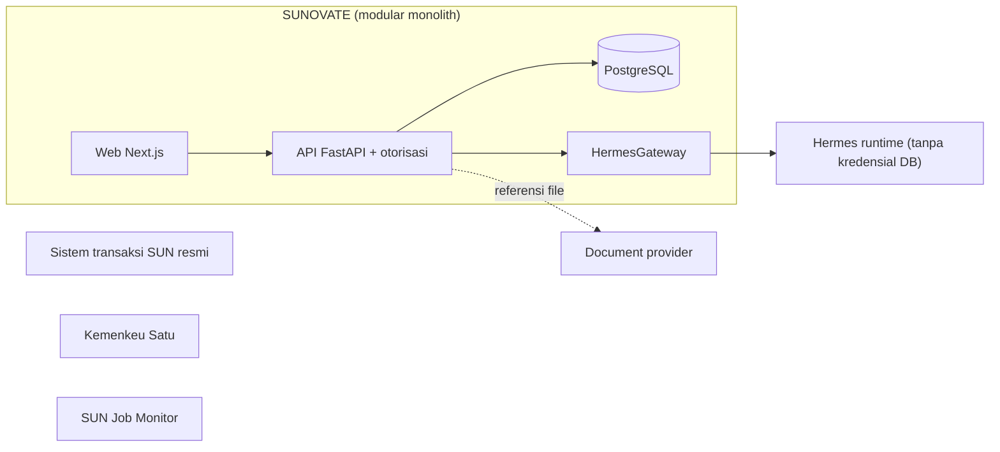

# Ruang Lingkup dan Batasan

**Status:** PROPOSED
**Last Updated:** 2026-10-01

## Purpose

Dokumen ini menetapkan apa yang termasuk dan tidak termasuk dalam SUNOVATE pada periode 21 September 2026 sampai 20 Maret 2027, serta batas sistem yang tidak boleh dilanggar oleh desain maupun kode.

## Dalam Scope

| Area | Keterangan | Label |
|---|---|---|
| Knowledge Repository | Knowledge entry, referensi dokumen, versi, tag, relasi antarperaturan. | **CONFIRMED** sebagai tujuan (sumber: brief sesi 2026-10-01) |
| Pencarian | Pencarian dokumen, regulasi, kajian, SOP, playbook, lesson learned, bahan rapat, arsip. | **CONFIRMED** sebagai tujuan (sumber: brief sesi 2026-10-01) |
| Hermes | AI Knowledge Assistant dengan sitasi, hanya atas konten terotorisasi. | **CONFIRMED** sebagai tujuan (sumber: brief sesi 2026-10-01) |
| Monitoring kerja | Work output, tugas, milestone, pending matter, follow-up per tim kerja. | **CONFIRMED** sebagai tujuan (sumber: brief sesi 2026-10-01) |
| Dashboard | Ringkasan sesuai hak akses. | **CONFIRMED** sebagai tujuan (sumber: brief sesi 2026-10-01) |
| Document automation | Berbasis template yang disetujui; prioritas P1. | **CONFIRMED** sebagai tujuan; prioritas **PROPOSED** (sumber: Proposal v2.4, slide 11) |
| RBAC, klasifikasi, audit log | Kontrol akses dan jejak audit di API. | **CONFIRMED** prinsip (sumber: brief sesi 2026-10-01); matriks **PROPOSED** |
| Enam tim kerja awal | PPSUN, AKPSUN, PSUN, PPPSUN, DHTV, SUN Tematik. | **CONFIRMED** sebagai arahan (sumber: brief sesi 2026-10-01); lihat OQ-02 |
| Fondasi Telegram dan WhatsApp | Abstraksi provider saja, tanpa kanal produksi. | **CONFIRMED** sebagai tujuan fase lanjutan (sumber: brief sesi 2026-10-01) |

## Di Luar Scope

| Area | Alasan | Label |
|---|---|---|
| Menggantikan sistem transaksi SUN resmi | Batasan proyek. | **OUT OF SCOPE** (sumber: brief sesi 2026-10-01) |
| Mengambil atau merekomendasikan keputusan keuangan | Batasan proyek. | **OUT OF SCOPE** (sumber: brief sesi 2026-10-01) |
| Tabel bisnis SUN (instrumen, lelang, transaksi, yield, setelmen) | Belum tervalidasi; dihapus dari skema scaffold (ADR-013). | **OUT OF SCOPE** fase ini; SUN Business tetap OPEN QUESTION |
| Fungsi SUNOVATE sebagai SUN Job Monitor | Pilot terpisah yang dibekukan. | **OUT OF SCOPE** (sumber: `14_NEW_SESSION_HANDOFF_PROMPT.txt`) |
| Korespondensi resmi | Kemenkeu Satu adalah sistem korespondensi resmi. | **OUT OF SCOPE** (sumber: `20_NEW_CHAT_MASTER_PROMPT.txt`) |
| Sinkronisasi SharePoint produksi, SSO organisasi, Power BI, Telegram, WhatsApp, data pasar resmi, integrasi Kemenkeu Satu | Prioritas P2, hanya setelah validasi, bukan janji. | **OUT OF SCOPE** MVP (sumber: Proposal v2.4, slide 11) |
| Penyimpanan file sebagai BLOB di database | File tetap di document provider. | **OUT OF SCOPE** (ADR-003) |
| Data asli atau data keuangan internal | Hanya `SIMULATED_DATA` selama pengembangan. | **OUT OF SCOPE** (lihat [simulated-data-policy.md](../04-data/simulated-data-policy.md)) |
| Turborepo, Kubernetes, microservices, Redis, message broker | Tidak ada kebutuhan tervalidasi. | **OUT OF SCOPE** (sumber: brief sesi 2026-10-01) |
| Perilaku khusus SUN Tematik | Fungsi tim belum diketahui. | **OPEN QUESTION** (OQ-01) |

## Batasan Sistem

1. **CONFIRMED** SUNOVATE bukan SUN Job Monitor. Pola dari SUN Job Monitor tidak dipakai ulang tanpa keputusan (OQ-19) (sumber: `14_NEW_SESSION_HANDOFF_PROMPT.txt`).
2. **CONFIRMED** SUNOVATE bukan sistem transaksi dan tidak menyimpan data transaksi SUN resmi (sumber: brief sesi 2026-10-01).
3. **CONFIRMED** SUNOVATE dan Hermes tidak mengambil keputusan keuangan. Jawaban Hermes adalah bantuan penelusuran pengetahuan, bukan keputusan (sumber: brief sesi 2026-10-01).
4. **CONFIRMED** Kemenkeu Satu tetap menjadi sistem korespondensi resmi. SUNOVATE dapat menyimpan referensi atau metadata dokumen, tidak menggantikan alur surat resmi (sumber: `20_NEW_CHAT_MASTER_PROMPT.txt`).
5. **CONFIRMED** File tetap berada di document provider. Database hanya menyimpan referensi, metadata, checksum SHA-256, versi, klasifikasi, dan lokasi provider (sumber: brief sesi 2026-10-01, ADR-003). Peran SharePoint sebagai sumber utama atau referensi adalah OQ-06.
6. **CONFIRMED** Hermes tidak mengakses database secara langsung dan tidak memegang kredensial database. Semua akses melalui HermesGateway dan application service yang memeriksa izin pengguna (sumber: brief sesi 2026-10-01, ADR-004).
7. **CONFIRMED** Otorisasi ditegakkan di API: permission, team scope, dan klasifikasi data, deny by default. Menyembunyikan menu di frontend hanya kosmetik (ADR-006).
8. **PROPOSED** Aksi tulis yang diminta melalui Hermes tidak pernah dieksekusi langsung; sistem membuat approval request berstatus PENDING (lihat [human-approval.md](../05-ai-rag/human-approval.md)).

## Diagram Batas Sistem

Sistem transaksi SUN resmi, Kemenkeu Satu, dan SUN Job Monitor sengaja digambar tanpa koneksi ke SUNOVATE. Koneksi ke document provider hanya berupa referensi; provider produksi belum aktif.

## Open Questions

- OQ-01 Fungsi SUN Tematik.
- OQ-02 Daftar dan nama resmi tim kerja dalam scope.
- OQ-06 SharePoint sebagai sumber utama atau referensi.
- OQ-08 Izin penggunaan Telegram dan WhatsApp.
- OQ-19 Hubungan dengan SUN Job Monitor.

## Risks

- R-01 Asumsi proses bisnis tanpa validasi.
- R-05 Akses integrasi produksi tidak tersedia.
- R-06 Scope melebihi periode enam bulan.
- R-12 Perbedaan daftar tim kerja.

## Acceptance Criteria

- Setiap fitur baru dapat dipetakan ke salah satu baris "Dalam Scope" atau disetujui melalui [change-management.md](../12-governance/change-management.md).
- Tidak ada kode yang membuat koneksi database dari runtime Hermes.
- Tidak ada skema atau data yang merepresentasikan transaksi SUN resmi.

## Related Documents

- [project-overview.md](project-overview.md)
- [mvp-scope.md](../01-product/mvp-scope.md)
- [integration-boundaries.md](../03-architecture/integration-boundaries.md)
- [system-context.md](../03-architecture/system-context.md)

## Last Updated

2026-10-01
