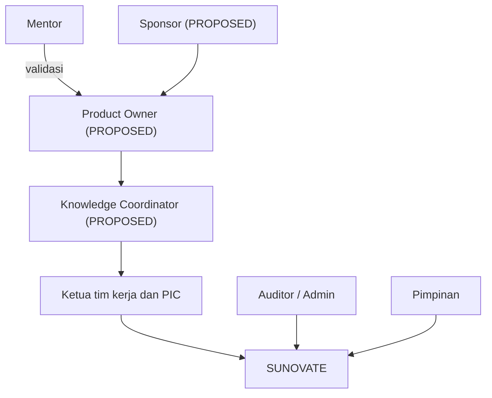

# Peta Pemangku Kepentingan

**Status:** NEEDS MENTOR VALIDATION
**Last Updated:** 2026-10-02

## Purpose

Dokumen ini memetakan pemangku kepentingan SUNOVATE berdasarkan peran, bukan nama orang. Tidak ada nama, jabatan, jumlah anggota tim, atau nomor surat tugas yang dicantumkan. Kewenangan nyata setiap peran harus ditetapkan oleh mentor atau pejabat yang berwenang.

## Instansi dan Konteks

**CONFIRMED** SUNOVATE dikembangkan untuk Direktorat Surat Utang Negara (Dit. SUN), DJPPR, Kementerian Keuangan RI, oleh peserta MagangHub (sumber: brief sesi 2026-10-01).

**CONFIRMED** Mentor memberi arahan proyek dan menjadi pihak yang memvalidasi asumsi, prioritas, dan jawaban atas pertanyaan terbuka (sumber: brief sesi 2026-10-01). Identitas mentor tidak dicatat di dokumentasi ini.

**CONFIRMED (knowledge owner, deck v1_ slide 24)** Pada deck proposal versi tetap `v1_`, slide 24 berjudul "Keputusan yang memerlukan konfirmasi knowledge owner" dan delapan pertanyaannya dijawab oleh knowledge owner (sebelumnya berjudul "konfirmasi mentor"). Identitas knowledge owner tidak dicatat. **OPEN QUESTION** Pengakuan mentor atas jawaban tersebut belum ada (OQ-24).

## Peran Tata Kelola

**PROPOSED** Peran berikut berasal dari Proposal v2.4, slide 18. Penunjukan orang untuk setiap peran adalah OPEN QUESTION. Deck `v1_` memperluas dua label: "Pengelola MP / Product Owner / Ketua Tim" dan "Knowledge Coordinator / PMP". Deck tidak menguraikan PMP; kemungkinan Program dan Manajemen Pengetahuan (Subdirektorat pada bagan Pengayaan 6 Mei 2026), perlu konfirmasi (OQ-25).

| Peran | Tanggung jawab (usulan) | Label |
|---|---|---|
| Sponsor | Direktur SUN atau pejabat yang ditetapkan; memberi arah dan dukungan. | **PROPOSED** |
| Pengelola MP / Product Owner / Ketua Tim | Mengelola prioritas produk dan backlog; label "Ketua Tim" ditambahkan pada deck `v1_` slide 18. | **PROPOSED** (label deck `v1_`) |
| Knowledge Coordinator / PMP | Mengoordinasikan kurasi, review, dan publikasi knowledge lintas tim; label "PMP" ditambahkan pada deck `v1_` slide 18. | **PROPOSED** (label deck `v1_`); kepanjangan PMP OPEN QUESTION (OQ-25) |
| SME / Knowledge Owner | Pemilik substansi knowledge di tim kerja. | **PROPOSED** (peran). Knowledge owner dan reviewer per tim adalah ketua tim dan PIC yang ditunjuk: **CONFIRMED (knowledge owner, deck v1_ slide 24)**; orangnya tidak dicatat |
| Administrator sistem | Mengelola pengguna, peran, dan konfigurasi. | **PROPOSED** (peran pendukung) |
| Data steward | Menjaga kualitas metadata dan data. | **PROPOSED** (peran pendukung) |
| Security/compliance reviewer | Meninjau keamanan dan kepatuhan. | **PROPOSED** (peran pendukung) |
| Pengelola integrasi | Mengelola integrasi yang disetujui. | **PROPOSED** (peran pendukung) |
| Pengguna / pemberi feedback | Memakai sistem dan memberi masukan. | **PROPOSED** (peran pendukung) |

Siapa yang berwenang memutuskan publikasi knowledge adalah OQ-12.

## Tim Kerja dalam Scope Awal

**CONFIRMED** Enam tim kerja awal dan enam peran setiap tim dalam platform (sumber: brief sesi 2026-10-01). Deskripsi singkat berstatus NEEDS MENTOR VALIDATION (sumber: Proposal v2.4, slide 10).

| Kode | Nama | Deskripsi singkat (NEEDS MENTOR VALIDATION) |
|---|---|---|
| PPSUN | Pengelolaan Portofolio SUN | Portofolio, transaksi SUN, pelaporan, dokumen transaksi. |
| AKPSUN | Analisis Keuangan dan Pasar SUN | Analisis keuangan, fiskal, pasar SUN, pricing, dukungan analisis. |
| MONEV | Monitoring dan Evaluasi | Fungsi rinci NEEDS MENTOR VALIDATION; ditambahkan 2026-10-20 (DEC-20261020-01). |
| PSUN | Peraturan SUN | Kepatuhan, pemrosesan regulasi, kajian hukum, dukungan penyusunan peraturan. |
| PPPSUN | Pengembangan dan Pendalaman Pasar SUN | Kelembagaan pasar, basis investor, strategi pemasaran, layanan publik, edukasi. |
| DHTV | Dokumen Hukum Transaksi Valas | Dokumen hukum transaksi valas dan engagement letter. |
| SUN Tematik | SUN Tematik | **OPEN QUESTION** (OQ-01); knowledge product dan proses menunggu konfirmasi (mentor atau knowledge owner). |

**CONFIRMED (knowledge owner, deck v1_ slide 24)** Pilot pertama adalah "6 tim" (OQ-03). Deck tidak menyebut nama tim; kesamaannya dengan enam tim di atas adalah **PROPOSED**.

**OPEN QUESTION** Deck Pengayaan 6 Mei 2026 menampilkan lebih banyak tim kerja dan nama yang sedikit berbeda (OQ-02 RESOLVED 2026-10-20 untuk cakupan pilot tujuh tim termasuk MONEV, DEC-20261020-01; nama resmi dan fungsi rinci tim lainnya tetap NEEDS MENTOR VALIDATION).

### Peran Setiap Tim dalam Platform

**CONFIRMED** (sumber: brief sesi 2026-10-01)

| Peran tim | Arti di SUNOVATE |
|---|---|
| Knowledge owner | Pemilik knowledge entry dan referensi dokumen tim (`owner_team_id`). |
| Process owner | Pemilik proses kerja yang dipantau di modul monitoring kerja. |
| Repository user | Pengguna yang membaca dan mencari konten sesuai hak akses. |
| Document reviewer | Peninjau konten sebelum publikasi. |
| Sumber data dashboard | Data work output, tugas, dan pending matter tim menjadi bahan dashboard. |
| Konteks otorisasi Hermes | Keanggotaan tim membatasi chunk yang boleh diambil Hermes. |

## Kelompok Pengguna

**PROPOSED** Kelompok pengguna dari Proposal v2.4, slide 9 (versi `v1_`: "Enam tim kerja dan SME" menjadi "Ketua tim kerja", dan "Pengelola Knowledge" menjadi "Pengelola Knowledge / PIC"). Persona rinci ada di [user-personas.md](../01-product/user-personas.md).

| Kelompok | Kebutuhan utama (usulan) | Peran pengembangan terkait (PROPOSED) |
|---|---|---|
| Pimpinan | Ringkasan kinerja dan pending matters sesuai hak akses. | Belum dipetakan; OPEN QUESTION |
| Ketua tim kerja | Menyimpan, mencari, dan meninjau knowledge; memantau pekerjaan tim; mengubah/mengunggah data (jawaban OQ-05). | team_lead (PROPOSED); role pendukung tim: knowledge_owner, reviewer, staff, read_only |
| Pengelola Knowledge / PIC | Kurasi, review, dan publikasi lintas tim; PIC yang ditunjuk per tim juga dapat mengubah/mengunggah data (jawaban OQ-05). | knowledge_coordinator; PIC tim: knowledge_owner (PROPOSED, OQ-25) |
| Auditor / Admin | Audit jejak aktivitas dan administrasi sistem. | auditor, system_admin |

Pemetaan kelompok Pimpinan ke peran sistem belum ditetapkan karena kewenangan dan kebutuhan datanya belum divalidasi.

## Diagram Hubungan

## Open Questions

- OQ-01, OQ-02 Fungsi SUN Tematik dan daftar tim resmi.
- OQ-09 (ANSWERED, knowledge owner) Knowledge owner dan reviewer adalah ketua tim dan PIC yang ditunjuk; penunjukan orang dan pemetaan role di OQ-25.
- OQ-24 Pengakuan mentor atas jawaban knowledge owner.
- OQ-12 Alur dan kewenangan persetujuan publikasi.
- OQ-20 Pengguna uji UAT yang ditunjuk.

## Risks

- R-08 Ketergantungan pada satu pengembang.
- R-12 Perbedaan daftar tim kerja.
- R-16 Ketergantungan pada jawaban knowledge owner yang belum diakui mentor.

## Related Documents

- [team-work-scope.md](../02-business/team-work-scope.md)
- [knowledge-governance.md](../12-governance/knowledge-governance.md)
- [permission-matrix.md](../06-security/permission-matrix.md)

## Last Updated

2026-10-02
