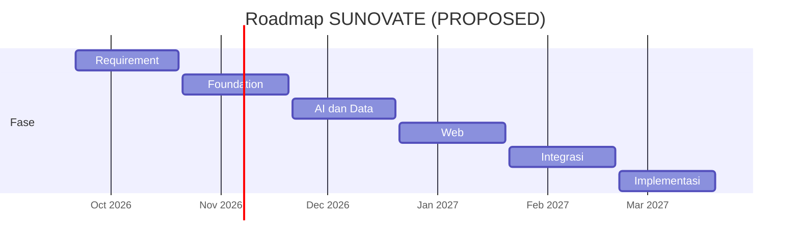

# Roadmap Produk

**Status:** NEEDS MENTOR VALIDATION
**Last Updated:** 2026-10-01

## Purpose

Dokumen ini memetakan roadmap enam bulan dari Proposal v2.4, slide 21, ke kalender periode magang 21 September 2026 sampai 20 Maret 2027. Periode berstatus CONFIRMED (sumber: brief sesi 2026-10-01). Isi setiap bulan, pemetaan kalender, dan gate berstatus PROPOSED.

## Pemetaan Bulan ke Kalender

Bulan dihitung dari tanggal mulai magang, bukan bulan kalender.

| Bulan | Periode (PROPOSED) | Fokus (sumber: Proposal v2.4, slide 21) | Keluaran utama (PROPOSED) |
|---|---|---|---|
| 1 | 21 Sep 2026 sampai 20 Okt 2026 | Requirement | Dokumentasi awal, scaffold, daftar pertanyaan terbuka, sesi validasi mentor. |
| 2 | 21 Okt 2026 sampai 20 Nov 2026 | Foundation: database, auth, RBAC, Knowledge Hub | Repository SQLAlchemy menggantikan simulated store, otorisasi teruji, knowledge dan dokumen di PostgreSQL. |
| 3 | 21 Nov 2026 sampai 20 Des 2026 | AI & Data: ingestion, search, RAG, Hermes bersitasi | Ingestion dokumen simulasi, FTS, pencarian semantik bila model disetujui, evaluasi RAG awal. |
| 4 | 21 Des 2026 sampai 20 Jan 2027 | Web: workflow, dashboard, reporting, API | Alur review dan publikasi lengkap di UI, monitoring kerja, dashboard, reporting P1. |
| 5 | 21 Jan 2027 sampai 20 Feb 2027 | Integrasi: document automation, UX, integrasi yang disetujui | Document automation P1, perbaikan UX, notifikasi dalam aplikasi, integrasi yang sudah divalidasi saja. Target feature-complete pada akhir bulan 5. |
| 6 | 21 Feb 2027 sampai 20 Mar 2027 | Implementasi: UAT, security test, bug fixing, dokumentasi, handover | UAT, uji keamanan, perbaikan bug, dokumentasi final, serah terima. |

**CONFIRMED** Akhir periode adalah 20 Maret 2027 (sumber: brief sesi 2026-10-01). **PROPOSED** Feature-complete pada akhir bulan 5, yaitu sekitar 20 Februari 2027 (sumber: Proposal v2.4, slide 21).

## Linimasa

## Gate Validasi Mentor

**PROPOSED** Setiap gate harus dilewati sebelum pekerjaan bulan berikutnya dianggap siap. Bila gate belum terpenuhi, pekerjaan tetap berlanjut dengan asumsi yang tercatat di [assumptions.md](../00-project/assumptions.md), dan risikonya dicatat.

| Gate | Waktu | Syarat | Pertanyaan terkait |
|---|---|---|---|
| G1 Requirement | Akhir bulan 1 | Mentor meninjau scope, daftar tim, pilot, klasifikasi, dan prioritas P0. | OQ-01, OQ-02, OQ-03, OQ-05 |
| G2 Foundation | Akhir bulan 2 | Matriks izin disetujui; uji otorisasi lulus di PostgreSQL; mekanisme login target diketahui. | OQ-07, OQ-09, OQ-12, OQ-14 |
| G3 AI dan Data | Akhir bulan 3 | Dokumen yang boleh masuk RAG disetujui; model AI dan embedding disetujui atau diputuskan tetap ekstraktif; evaluasi RAG awal ditinjau. | OQ-04, OQ-11 |
| G4 Web | Akhir bulan 4 | Indikator dashboard dan format laporan disetujui. | OQ-10, OQ-15 |
| G5 Feature-complete | Akhir bulan 5 | Template document automation disetujui; hanya integrasi yang tervalidasi yang aktif; lingkungan UAT tersedia. | OQ-06, OQ-08, OQ-16, OQ-20 |
| G6 Handover | Akhir bulan 6 | UAT selesai, nol bug P0 terbuka, dokumentasi serah terima lengkap. | OQ-13 |

## Status Saat Ini

Per 2026-10-01 proyek berada di bulan 1. Scaffold yang sudah ada mendahului sebagian pekerjaan bulan 2 sampai 4 (otorisasi, endpoint, pipeline Hermes pengembangan), tetapi masih memakai simulated store. Rincian di [mvp-scope.md](mvp-scope.md).

## Yang Tidak Dijanjikan

- **OUT OF SCOPE** Integrasi P2 (SharePoint production sync, SSO organisasi, Power BI, Telegram, WhatsApp, data pasar resmi, Kemenkeu Satu) tidak dijadwalkan. Bulan 5 hanya mencakup integrasi yang sudah disetujui (sumber: Proposal v2.4, slide 11 dan 21).
- **OUT OF SCOPE** Deployment produksi tidak dijanjikan dalam periode ini kecuali hosting disetujui (OQ-07).

## Risks

- R-05 Akses integrasi produksi tidak tersedia.
- R-06 Scope melebihi periode enam bulan. Mitigasi usulan: P1 dapat digeser bila gate G2 atau G3 terlambat; P0 tetap diprioritaskan.
- R-08 Ketergantungan pada satu pengembang. Mitigasi usulan: dokumentasi serah terima diperbarui setiap bulan, bukan hanya di bulan 6.

## Acceptance Criteria

- Mentor menyetujui pemetaan kalender dan gate, atau mencatat revisi di [decision-log.md](../12-governance/decision-log.md).
- Setiap perubahan jadwal yang memengaruhi P0 dicatat melalui [change-management.md](../12-governance/change-management.md).

## Related Documents

- [prd.md](prd.md)
- [mvp-scope.md](mvp-scope.md)
- [future-development.md](../13-handover/future-development.md)
- [uat-plan.md](../10-testing/uat-plan.md)

## Last Updated

2026-10-01
