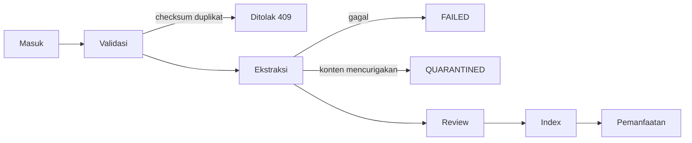

# Siklus Hidup Dokumen

**Status:** PROPOSED
**Last Updated:** 2026-10-01

## Purpose

Dokumen ini menjelaskan alur dokumen dari masuk hingga dimanfaatkan, struktur data `document_references` dan `document_versions`, pencegahan duplikasi, status ekstraksi, karantina, dan penggantian versi.

## Confirmed Information

- **CONFIRMED**: File tidak disimpan sebagai BLOB di database. Sistem hanya menyimpan referensi, metadata, checksum SHA-256, versi, klasifikasi, dan lokasi provider (sumber: brief sesi 2026-10-01; ADR-003).
- **CONFIRMED**: Repository dokumen eksternal (misalnya SharePoint) menjadi sumber kebenaran file bila sesuai; integrasi produksinya belum tersedia (sumber: 20_NEW_CHAT_MASTER_PROMPT.txt; OQ-06).
- **CONFIRMED**: Alur intake dokumen pada Proposal v2.4 terdiri atas tahap masuk, validasi, ekstraksi, review, index, dan pemanfaatan (sumber: Proposal v2.4, slide 12, sebagaimana dirangkum dalam brief penulisan dokumentasi).

## Alur Intake

| Tahap | Perilaku sistem | Status |
|---|---|---|
| Masuk | Pengguna mendaftarkan `document_references`: judul, tim pemilik, klasifikasi, lokasi provider. File tetap di penyimpanan eksternal atau `LOCAL_STORAGE_PATH` pada pengembangan. | PROPOSED |
| Validasi | Metadata wajib diperiksa; checksum SHA-256 dihitung; pasangan (`document_reference_id`, `checksum_sha256`) yang sudah ada ditolak. | PROPOSED |
| Ekstraksi | Teks diekstrak untuk pencarian; hasil dicatat pada `extraction_status`. | PROPOSED |
| Review | Isi terkait ditinjau melalui knowledge entry dan alur approval. | PROPOSED |
| Index | Teks dipecah menjadi `document_chunks` dan diindeks dengan full-text search PostgreSQL. Embedding belum aktif. | PROPOSED |
| Pemanfaatan | Chunk dari knowledge `PUBLISHED` yang diotorisasi dipakai `GET /search` dan Hermes dengan sitasi. | PROPOSED |

- **PROPOSED**: Pipeline ekstraksi dan indexing otomatis belum diimplementasikan penuh di scaffold; data chunk saat ini berasal dari dataset `SIMULATED_DATA`. Lihat [ingestion-pipeline](../05-ai-rag/ingestion-pipeline.md).
- **PROPOSED**: `EMBEDDING_PROVIDER=disabled`. Retrieval semantik menunggu persetujuan model embedding (OQ-11; ADR-008, ADR-009).

## Struktur Data

| Tabel | Isi | Status |
|---|---|---|
| `document_references` | Identitas dokumen logis: metadata, `owner_team_id`, `owner_user_id`, `classification_code`, `sharing_scope`, lokasi provider, `revision`, `deleted_at`, `data_origin` | PROPOSED |
| `document_versions` | Setiap versi file: nomor versi, `checksum_sha256`, `extraction_status`, waktu registrasi | PROPOSED |
| `document_chunks` | Potongan teks per versi untuk pencarian dan sitasi | PROPOSED |
| `embedding_references` | Referensi vektor dengan `model_name` dan `dimensions`; kolom vektor tanpa tipe tetap dan tanpa indeks ANN | PROPOSED |

Rincian kolom: [database-schema](../04-data/database-schema.md) dan [metadata-schema](../04-data/metadata-schema.md).

## Pencegahan Duplikasi

- **PROPOSED**: Constraint unik (`document_reference_id`, `checksum_sha256`) mencegah versi identik didaftarkan dua kali.
- **PROPOSED**: `POST /documents/{id}/versions` dengan checksum yang sudah ada mengembalikan 409 `DUPLICATE_CHECKSUM`.
- **PROPOSED**: Duplikasi ingestion termasuk skenario uji wajib (sumber: Proposal v2.4, slide 20).
- **OPEN QUESTION**: Apakah file identik di bawah dua `document_references` berbeda perlu dideteksi sebagai isu kualitas data.

## Status Ekstraksi

| `extraction_status` | Arti | Masuk index |
|---|---|---|
| `PENDING` | Menunggu ekstraksi | Tidak |
| `EXTRACTED` | Teks berhasil diekstrak | Ya, setelah syarat publikasi terpenuhi |
| `FAILED` | Ekstraksi gagal; perlu ditangani pemilik | Tidak |
| `QUARANTINED` | Ditahan karena alasan keamanan atau kualitas | Tidak |
| `NOT_APPLICABLE` | Dokumen tidak memerlukan ekstraksi teks | Tidak |

## Karantina

- **PROPOSED**: Versi dokumen diberi `QUARANTINED` bila ditemukan indikasi yang membuatnya tidak aman diproses, misalnya teks berpola instruksi kepada AI (prompt injection), atau klasifikasi tidak sesuai.
- **PROPOSED**: Terlepas dari status karantina, filter injeksi Hermes tetap mengecualikan chunk yang berisi teks berpola instruksi saat query (lihat [prompt-injection-defense](../05-ai-rag/prompt-injection-defense.md)).
- **PROPOSED**: Pelepasan karantina memerlukan tinjauan manusia dan tercatat di audit. Siapa yang berwenang melepas karantina adalah OPEN QUESTION.
- **PROPOSED**: Temuan karantina dicatat sebagai `data_quality_issues`.

## Versi dan Penggantian

- **PROPOSED**: Versi baru didaftarkan melalui `POST /documents/{id}/versions` dan memerlukan permission `document:version`. Aksi audit: `VERSION_REGISTER`.
- **PROPOSED**: Versi lama tidak dihapus; tetap tersedia untuk jejak dan sitasi historis.
- **PROPOSED**: Bila dokumen menggantikan regulasi atau knowledge lain, knowledge lama menjadi `SUPERSEDED` dan relasi `SUPERSEDES` dicatat di `regulation_relations` bila relevan.
- **PROPOSED**: Penghapusan memakai soft delete (`deleted_at`). Retensi file dan referensi adalah OQ-13.
- **OPEN QUESTION**: Apakah pendaftaran versi untuk dokumen `PUBLISHED` memerlukan `approval_requests` bertipe `DOCUMENT_VERSION` pada setiap kasus.

## Risks

- R-03 Data asli atau sensitif masuk repository atau log.
- R-07 Prompt injection dari dokumen.
- R-11 Kualitas metadata rendah.

## Acceptance Criteria

- Tidak ada kolom binary file di skema.
- Pendaftaran versi dengan checksum duplikat menghasilkan 409 `DUPLICATE_CHECKSUM`.
- Chunk dari versi `QUARANTINED`, `FAILED`, atau `PENDING` tidak muncul di pencarian dan Hermes.

## Related Documents

- [knowledge-lifecycle](knowledge-lifecycle.md)
- [document-ownership](../12-governance/document-ownership.md)
- [chunking-strategy](../05-ai-rag/chunking-strategy.md)
- [sharepoint-proposal](../08-integrations/sharepoint-proposal.md)
- [data-retention](../04-data/data-retention.md)
