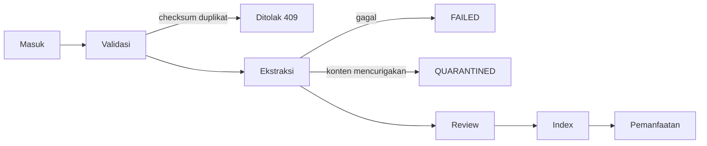
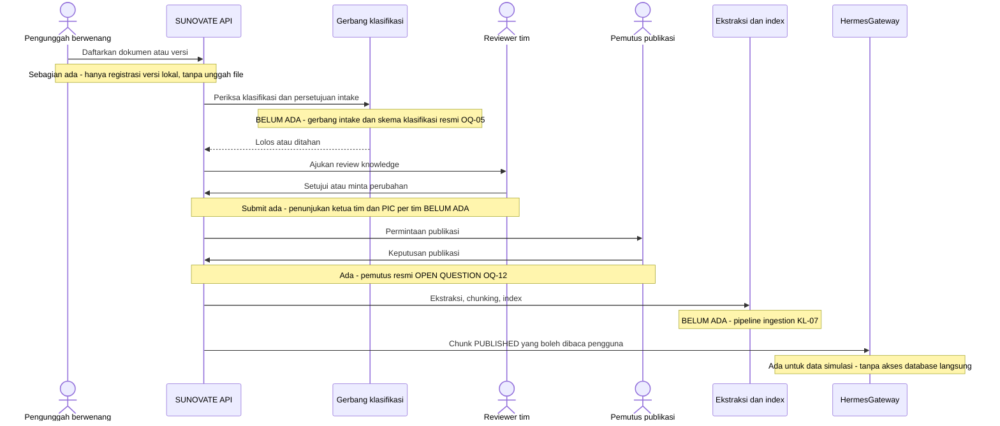

# Siklus Hidup Dokumen

**Status:** PROPOSED
**Last Updated:** 2026-10-06

## Purpose

Dokumen ini menjelaskan alur dokumen dari masuk hingga dimanfaatkan, struktur data `document_references` dan `document_versions`, pencegahan duplikasi, status ekstraksi, karantina, dan penggantian versi.

## Confirmed Information

- **CONFIRMED**: File tidak disimpan sebagai BLOB di database. Sistem hanya menyimpan referensi, metadata, checksum SHA-256, versi, klasifikasi, dan lokasi provider (sumber: brief sesi 2026-10-01; ADR-003).
- **CONFIRMED**: Repository dokumen eksternal (misalnya SharePoint) menjadi sumber kebenaran file bila sesuai; integrasi produksinya belum tersedia (sumber: 20_NEW_CHAT_MASTER_PROMPT.txt; OQ-06).
- **CONFIRMED**: Alur intake dokumen pada Proposal v2.4 terdiri atas tahap masuk, validasi, ekstraksi, review, index, dan pemanfaatan (sumber: Proposal v2.4, slide 12, sebagaimana dirangkum dalam brief penulisan dokumentasi).

- **CONFIRMED (knowledge owner, deck v1_ slide 24)**: Dokumen yang boleh masuk repository dan RAG adalah "semua dokumen yang diusulkan tim kerja" (OQ-04, DEC-20261002-02). Yang dapat mengubah data atau mengunggah adalah ketua tim, kasubdit PMP, Kasi MP, dan PIC yang ditunjuk (OQ-05, DEC-20261002-03). Pengakuan mentor tertunda (OQ-24).
- **CONFIRMED**: Slide 12 (alur dokumen) tidak berubah pada deck `v1_`; tahap Masuk, Validasi, Ekstraksi, Review, Index, dan Pemanfaatan di bawah tetap sama. Yang berubah hanya pelaku dan syarat masuk (bagian "Pelaku dan Gerbang Intake").
- **PROPOSED**: Jawaban "semua dokumen" adalah jawaban cakupan, bukan izin memuat data asli. Dokumen asli tetap memerlukan klasifikasi (OQ-05) dan persetujuan eksplisit; `CONFIDENTIAL` tidak diproses Hermes; sampai itu hanya `SIMULATED_DATA` yang dimuat (FR-53, BR-35).

## Alur Intake

| Tahap | Perilaku sistem | Status |
|---|---|---|
| Masuk | Pengguna mendaftarkan `document_references`: judul, tim pemilik, klasifikasi, lokasi provider. File tetap di penyimpanan eksternal atau `LOCAL_STORAGE_PATH` pada pengembangan. | PROPOSED |
| Validasi | Metadata wajib diperiksa; checksum SHA-256 dihitung; pasangan (`document_reference_id`, `checksum_sha256`) yang sudah ada ditolak. | PROPOSED |
| Ekstraksi | Teks diekstrak untuk pencarian; hasil dicatat pada `extraction_status`. | PROPOSED |
| Review | Isi terkait ditinjau melalui knowledge entry dan alur approval. | PROPOSED |
| Index | Teks dipecah menjadi `document_chunks` dan diindeks dengan full-text search PostgreSQL. Embedding belum aktif. | PROPOSED |
| Pemanfaatan | Chunk dari knowledge `PUBLISHED` yang diotorisasi dipakai `GET /search` dan Hermes dengan sitasi. | PROPOSED |

- **PROPOSED**: Pipeline ekstraksi dan indexing otomatis belum diimplementasikan penuh di scaffold; data chunk saat ini berasal dari dataset `SIMULATED_DATA`. Lihat [ingestion-pipeline](../05-ai-rag/ingestion-pipeline.md).
- **PROPOSED**: `EMBEDDING_PROVIDER=disabled`. Retrieval semantik menunggu persetujuan model embedding (OQ-11; ADR-008, ADR-009).

## Struktur Data

| Tabel | Isi | Status |
|---|---|---|
| `document_references` | Identitas dokumen logis: metadata, `owner_team_id`, `owner_user_id`, `classification_code`, `sharing_scope`, lokasi provider, `revision`, `deleted_at`, `data_origin` | PROPOSED |
| `document_versions` | Setiap versi file: nomor versi, `checksum_sha256`, `extraction_status`, waktu registrasi | PROPOSED |
| `document_chunks` | Potongan teks per versi untuk pencarian dan sitasi | PROPOSED |
| `embedding_references` | Referensi vektor dengan `model_name` dan `dimensions`; kolom vektor tanpa tipe tetap dan tanpa indeks ANN | PROPOSED |

Rincian kolom: [database-schema](../04-data/database-schema.md) dan [metadata-schema](../04-data/metadata-schema.md).

## Pencegahan Duplikasi

- **PROPOSED**: Constraint unik (`document_reference_id`, `checksum_sha256`) mencegah versi identik didaftarkan dua kali.
- **PROPOSED**: `POST /documents/{id}/versions` dengan checksum yang sudah ada mengembalikan 409 `DUPLICATE_CHECKSUM`.
- **PROPOSED**: Duplikasi ingestion termasuk skenario uji wajib (sumber: Proposal v2.4, slide 20).
- **OPEN QUESTION**: Apakah file identik di bawah dua `document_references` berbeda perlu dideteksi sebagai isu kualitas data.

## Status Ekstraksi

| `extraction_status` | Arti | Masuk index |
|---|---|---|
| `PENDING` | Menunggu ekstraksi | Tidak |
| `EXTRACTED` | Teks berhasil diekstrak | Ya, setelah syarat publikasi terpenuhi |
| `FAILED` | Ekstraksi gagal; perlu ditangani pemilik | Tidak |
| `QUARANTINED` | Ditahan karena alasan keamanan atau kualitas | Tidak |
| `NOT_APPLICABLE` | Dokumen tidak memerlukan ekstraksi teks | Tidak |

## Karantina

- **PROPOSED**: Versi dokumen diberi `QUARANTINED` bila ditemukan indikasi yang membuatnya tidak aman diproses, misalnya teks berpola instruksi kepada AI (prompt injection), atau klasifikasi tidak sesuai.
- **PROPOSED**: Terlepas dari status karantina, filter injeksi Hermes tetap mengecualikan chunk yang berisi teks berpola instruksi saat query (lihat [prompt-injection-defense](../05-ai-rag/prompt-injection-defense.md)).
- **PROPOSED**: Pelepasan karantina memerlukan tinjauan manusia dan tercatat di audit. Siapa yang berwenang melepas karantina adalah OPEN QUESTION.
- **PROPOSED**: Temuan karantina dicatat sebagai `data_quality_issues`.

## Versi dan Penggantian

- **PROPOSED**: Versi baru didaftarkan melalui `POST /documents/{id}/versions` dan memerlukan permission `document:version`. Aksi audit: `VERSION_REGISTER`.
- **PROPOSED**: Versi lama tidak dihapus; tetap tersedia untuk jejak dan sitasi historis.
- **PROPOSED**: Bila dokumen menggantikan regulasi atau knowledge lain, knowledge lama menjadi `SUPERSEDED` dan relasi `SUPERSEDES` dicatat di `regulation_relations` bila relevan.
- **CONFIRMED (sumber: Kompilasi Peraturan SUN, PMK 111/2024, Menimbang huruf c, hal. 34)**: Pola SUPERSEDES terbaca dari konsiderans: PMK 111/2024 menyatakan perlu melakukan pengaturan kembali atas PMK 212/PMK.08/2016. Di kompilasi pola ini selalu berpasangan dengan pasal pencabutan.
- **CONFIRMED (sumber: Kompilasi Peraturan SUN, PMK 111/2024, Pasal 30 angka 2 sampai 4, hal. 47)**: Pencabutan dapat bersifat sebagian, yaitu hanya Pasal atau ayat tertentu pada PMK 168/PMK.08/2021, PMK 114/2023, PMK 168/2019, dan PMK 165/2022.
- **PROPOSED**: Pencabutan sebagian tidak menjadikan knowledge target `SUPERSEDED`. Catat relasi `REVOKES` dengan cakupan Pasal/ayat (desain kolom cakupan: [logical-data-model](../04-data/logical-data-model.md), belum diimplementasikan). Status siklus hidup `SUPERSEDED` adalah status knowledge di SUNOVATE dan tidak sama dengan status hukum regulasi.
- **PROPOSED**: Ketentuan peralihan yang mempertahankan regulasi lama untuk hal tertentu (contoh: Kompilasi Peraturan SUN, PMK 168/2019, Pasal 28, hal. 154-155) bukan pencabutan dan tidak dipakai untuk menurunkan status.
- **OPEN QUESTION**: Status hukum akhir regulasi yang dicabut sebagian atau terdampak ketentuan peralihan: **NEEDS LEGAL CONFIRMATION** (OQ-29). Status hukum tidak diturunkan otomatis dari teks (BR-40, BR-42).
- **PROPOSED**: Penghapusan memakai soft delete (`deleted_at`). Retensi file dan referensi adalah OQ-13.
- **OPEN QUESTION**: Apakah pendaftaran versi untuk dokumen `PUBLISHED` memerlukan `approval_requests` bertipe `DOCUMENT_VERSION` pada setiap kasus.

## Pelaku dan Gerbang Intake

Tabel di bawah memetakan tahap alur ke pelaku menurut jawaban knowledge owner dan membandingkannya dengan kode per 2026-10-06. Pemetaan jabatan ke role sistem adalah **PROPOSED** (OQ-25).

| Tahap | Pelaku menurut jawaban | Label | Keadaan kode saat ini |
|---|---|---|---|
| Masuk (mendaftarkan dokumen atau versi) | Ketua tim, kasubdit PMP, Kasi MP, PIC yang ditunjuk | CONFIRMED (knowledge owner, deck v1_ slide 24, OQ-05) | Hanya registrasi versi (`POST /documents/{id}/versions`, `document:version`, referensi `local://`) yang ada; `staff` tidak memiliki `document:version`. Endpoint membuat referensi dokumen dan unggah file belum ada (KL-07); `staff` memiliki `document:create` pada matriks tetapi tanpa endpoint. Belum sesuai: `staff` masih dapat membuat knowledge (PD-1) |
| Validasi (sumber, pemilik, tipe, versi, klasifikasi) | Pengunggah dan pengelola knowledge atau owner | PROPOSED (slide 12 tidak berubah) | Klasifikasi dibatasi clearance pembuat; checksum ganda ditolak; belum ada gerbang persetujuan intake |
| Review | Ketua tim dan PIC tim pemilik (knowledge owner dan reviewer per tim) | CONFIRMED (peran, OQ-09); role sistem PROPOSED | Submit membuat approval `KNOWLEDGE_PUBLICATION`; penunjukan ketua tim dan PIC per tim belum dicatat (FR-51) |
| Keputusan publikasi | Belum ditentukan | OPEN QUESTION (OQ-12) | Saat ini hanya `knowledge_coordinator` yang dapat menyetujui (memerlukan `approval:decide` dan `knowledge:publish`); pemutus tidak boleh sama dengan pengaju |
| Ekstraksi dan index | Sistem | PROPOSED | Belum ada pipeline; chunk berasal dari dataset `SIMULATED_DATA` |
| Pemanfaatan | Pengguna sesuai scope dan clearance; Hermes lewat HermesGateway | CONFIRMED (prinsip) | Berjalan; knowledge baru yang dibuat lewat API tidak memiliki chunk sehingga dapat ditemukan di `GET /search` (judul dan ringkasan) tetapi tidak diambil Hermes (retrieval Hermes bekerja pada chunk) |

- **PROPOSED**: Bila ketua tim dan PIC adalah reviewer sekaligus pengunggah, review atas unggahan sendiri melanggar separation of duties (BR-06). Reviewer harus orang lain di antara ketua tim dan PIC tim yang sama atau peran lintas tim; aturan pastinya adalah OPEN QUESTION bersama OQ-12.
- **PROPOSED**: Gerbang intake menahan dokumen sampai klasifikasi ada dan, untuk dokumen asli, persetujuan eksplisit tercatat. Dokumen tahanan tidak diekstrak, tidak diindeks, dan tidak diambil Hermes.

## Alur Ujung ke Ujung (PROPOSED)

Diagram berikut adalah alur sasaran. Catatan pada diagram menandai bagian yang belum diimplementasikan; tidak ada integrasi dokumen produksi yang diklaim tersedia.

## Risks

- R-03 Data asli atau sensitif masuk repository atau log.
- R-14 Cakupan "semua dokumen yang diusulkan tim kerja" berjalan tanpa klasifikasi dan persetujuan per dokumen.
- R-07 Prompt injection dari dokumen.
- R-11 Kualitas metadata rendah.

## Acceptance Criteria

- Tidak ada kolom binary file di skema.
- Pendaftaran versi dengan checksum duplikat menghasilkan 409 `DUPLICATE_CHECKSUM`.
- Chunk dari versi `QUARANTINED`, `FAILED`, atau `PENDING` tidak muncul di pencarian dan Hermes.

## Related Documents

- [knowledge-lifecycle](knowledge-lifecycle.md)
- [document-ownership](../12-governance/document-ownership.md)
- [chunking-strategy](../05-ai-rag/chunking-strategy.md)
- [sharepoint-proposal](../08-integrations/sharepoint-proposal.md)
- [data-retention](../04-data/data-retention.md)
