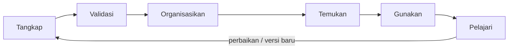
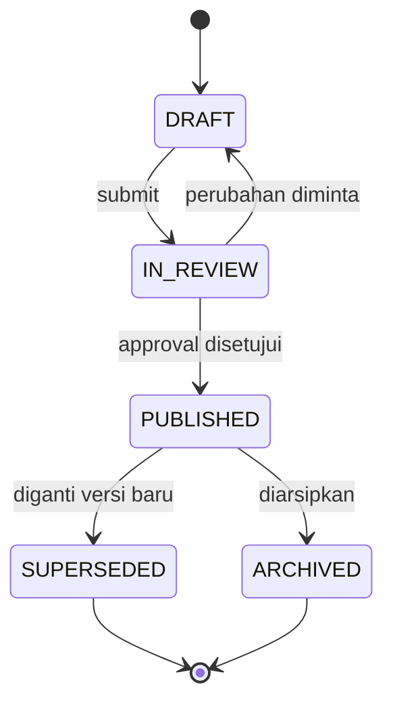

# Siklus Hidup Knowledge

**Status:** PROPOSED
**Last Updated:** 2026-10-01

## Purpose

Dokumen ini memetakan siklus knowledge pada Proposal v2.4 ke status data `lifecycle_status` di SUNOVATE, sehingga perilaku sistem pada setiap tahap jelas bagi pengembang, reviewer, dan mentor.

## Confirmed Information

- **CONFIRMED**: Proposal v2.4 menguraikan siklus knowledge enam tahap: Tangkap, Validasi, Organisasikan, Temukan, Gunakan, Pelajari (sumber: Proposal v2.4, slide 6). Status isi deck adalah usulan.
- **CONFIRMED**: Tujuan SUNOVATE mencakup menjaga institutional memory Dit. SUN dan pencarian dokumen, regulasi, kajian, SOP, playbook, lesson learned, bahan rapat, dan arsip (sumber: brief sesi 2026-10-01).

## Enam Tahap Siklus

## Pemetaan Tahap ke Sistem

| Tahap | Perilaku sistem | Status data | Permission terkait | Status |
|---|---|---|---|---|
| Tangkap | Pengguna membuat entri knowledge dan mendaftarkan referensi dokumen (file tetap di luar sistem) | `DRAFT` | `knowledge:create`, `document:create` | PROPOSED |
| Validasi | Pemilik mengajukan review; reviewer memeriksa isi, metadata, dan klasifikasi; perubahan dapat diminta | `IN_REVIEW`, kembali ke `DRAFT` bila perlu perubahan | `knowledge:submit`, `knowledge:review`, `approval:decide` | PROPOSED |
| Organisasikan | Melengkapi tipe knowledge, tag, klasifikasi, `sharing_scope`, dan relasi regulasi | Berlangsung pada `DRAFT`/`IN_REVIEW` | `knowledge:update` | PROPOSED |
| Temukan | Knowledge yang disetujui masuk pencarian default | `PUBLISHED` | `knowledge:publish` (melalui approval), `search:query` | PROPOSED |
| Gunakan | Knowledge dikutip Hermes dengan sitasi dan dipakai pengguna | `PUBLISHED` | `hermes:query`, `knowledge:read` | PROPOSED |
| Pelajari | Umpan balik Hermes, isu kualitas data, lesson learned, dan versi pengganti | `PUBLISHED` menjadi `SUPERSEDED` atau `ARCHIVED` | `hermes:feedback`, `data_quality:manage`, `knowledge:archive` | PROPOSED |

## Status `lifecycle_status`

| Status | Arti | Masuk pencarian default dan Hermes |
|---|---|---|
| `DRAFT` | Sedang disusun atau diperbaiki | Tidak |
| `IN_REVIEW` | Menunggu keputusan review/approval | Tidak |
| `PUBLISHED` | Disetujui dan berlaku | Ya, sesuai otorisasi |
| `SUPERSEDED` | Digantikan knowledge lain | Tidak (tetap dapat dibuka untuk jejak) |
| `ARCHIVED` | Tidak lagi dipakai | Tidak |

- **PROPOSED**: Hanya `PUBLISHED` yang masuk pencarian default dan retrieval Hermes (BR-04 di [business-rules](business-rules.md)).
- **PROPOSED**: Perpindahan ke `PUBLISHED` hanya terjadi melalui `approval_requests` bertipe `KNOWLEDGE_PUBLICATION` yang berstatus `APPROVED` (lihat [review-and-approval](../12-governance/review-and-approval.md)).
- **PROPOSED**: Setiap perubahan status dicatat di `audit_logs` (`CREATE`, `UPDATE`, `SUBMIT`, `APPROVE`, `REJECT`).
- **PROPOSED**: Pembaruan memakai `revision`; pembaruan dengan revision lama ditolak 409 `REVISION_CONFLICT`.
- **PROPOSED**: Transisi `PUBLISHED` ke `SUPERSEDED`/`ARCHIVED` serta endpoint terkait belum tersedia di scaffold. Endpoint yang ada saat ini: `POST /knowledge`, `PATCH /knowledge/{id}`, `POST /knowledge/{id}/submit`, `POST /approvals/{id}/decision`.

## Pelaku per Tahap

Semua penetapan pelaku di bawah adalah PROPOSED dan berbasis role pengembangan, bukan jabatan.

| Tahap | Role pengembangan yang dapat bertindak |
|---|---|
| Tangkap | knowledge_owner, staff, team_lead, knowledge_coordinator |
| Validasi | reviewer, team_lead, knowledge_coordinator (tidak boleh pengaju sendiri) |
| Organisasikan | knowledge_owner, team_lead, knowledge_coordinator |
| Temukan / Gunakan | Semua role dengan `search:query` / `hermes:query` sesuai lingkup dan klasifikasi |
| Pelajari | Pengguna Hermes (feedback), knowledge_coordinator (kualitas data, arsip) |

- **OPEN QUESTION (OQ-12)**: Siapa yang berwenang memutuskan publikasi knowledge, dan apakah team_lead boleh mempublikasikan.
- **OPEN QUESTION (OQ-09)**: Penunjukan knowledge owner dan reviewer per tim.
- **OPEN QUESTION (OQ-13)**: Retensi knowledge yang `SUPERSEDED` atau `ARCHIVED`.

## Jenis Knowledge

`REGULATION`, `POLICY`, `STUDY`, `SOP`, `PLAYBOOK`, `REPORT`, `MEETING_MATERIAL`, `CLOSE_OUT_NOTE`, `LESSON_LEARNED`, `TACIT_KNOWLEDGE`, `DECISION_RECORD`, `ARCHIVE`, `REFERENCE`, `OTHER` (PROPOSED).

- **NEEDS MENTOR VALIDATION**: Tacit Knowledge SME, Close Out Note, dan Playbook Proses Bisnis disebut deck sebagai arah MP-DSUN (sumber: Proposal v2.4, slide 7).
- **PROPOSED**: Repository Regulasi dan Decision & Meeting Record adalah pengembangan SUNOVATE (sumber: Proposal v2.4, slide 7).

## Acceptance Criteria

- Knowledge `DRAFT`, `IN_REVIEW`, `SUPERSEDED`, `ARCHIVED` tidak muncul pada `GET /search` default dan tidak diambil Hermes.
- Pengaju tidak dapat memutuskan approval atas pengajuannya sendiri.
- Setiap transisi status menghasilkan entri audit.

## Related Documents

- [document-lifecycle](document-lifecycle.md)
- [business-rules](business-rules.md)
- [knowledge-governance](../12-governance/knowledge-governance.md)
- [review-and-approval](../12-governance/review-and-approval.md)
- [retrieval-strategy](../05-ai-rag/retrieval-strategy.md)
