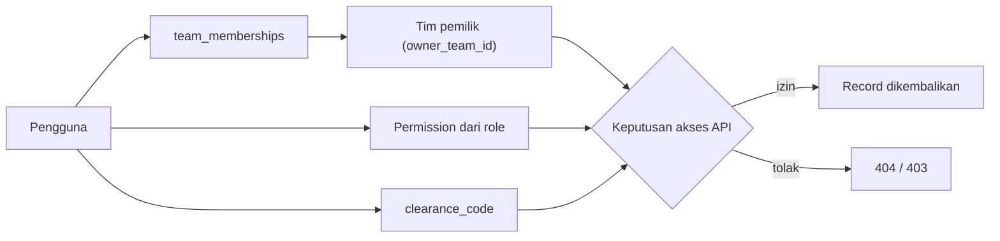

# Cakupan Tim Kerja

**Status:** NEEDS MENTOR VALIDATION
**Last Updated:** 2026-10-20

## Purpose

Dokumen ini mencatat tim kerja Dit. SUN yang masuk cakupan awal SUNOVATE, peran setiap tim terhadap sistem, dan cara sistem merepresentasikan peran tersebut melalui data dan otorisasi. Dokumen ini tidak menetapkan struktur organisasi, jabatan, atau kewenangan pegawai.

## Confirmed Information

- **CONFIRMED**: Cakupan awal terdiri atas enam tim kerja: PPSUN, AKPSUN, PSUN, PPPSUN, DHTV, dan SUN Tematik (sumber: brief sesi 2026-10-01).
- **CONFIRMED (project lead, 2026-10-20)**: Cakupan pilot menjadi tujuh tim dengan penambahan MONEV (Monitoring dan Evaluasi) sebagai pembaruan setelah rapat 6 Oktober 2026 (DEC-20261020-01; OQ-02 RESOLVED). Nama resmi AKPSUN adalah TK Analisis Keuangan dan Pasar SUN.
- **CONFIRMED**: Fungsi SUN Tematik adalah OPEN QUESTION dan tidak boleh diasumsikan (sumber: brief sesi 2026-10-01; AGENTS.md).
- **CONFIRMED**: Setiap tim berperan sebagai knowledge owner, process owner, repository user, document reviewer, dashboard data source, dan Hermes authorization context (sumber: brief sesi 2026-10-01).
- **CONFIRMED (knowledge owner, deck v1_ slide 24)**: Pilot pertama adalah "6 tim" (OQ-03). Deck tidak menyebut nama tim dan tidak menjawab bagian "proses". Kesamaan "6 tim" dengan enam tim di bawah adalah **PROPOSED**. Pengakuan mentor masih tertunda (OQ-24).
- **CONFIRMED (knowledge owner, deck v1_ slide 24)**: Knowledge owner dan reviewer pada setiap tim adalah ketua tim dan PIC yang ditunjuk (OQ-09).

## Daftar Tim

Deskripsi singkat berasal dari Proposal v2.4 slide 10. Deck menyatakan enam tim mengikuti arahan mentor, tetapi uraian fungsi tetap NEEDS MENTOR VALIDATION.

| Kode | Nama | Deskripsi singkat | Status deskripsi |
|---|---|---|---|
| PPSUN | Pengelolaan Portofolio SUN | Portofolio, transaksi SUN, pelaporan, dokumen transaksi | NEEDS MENTOR VALIDATION (sumber: Proposal v2.4, slide 10) |
| AKPSUN | Analisis Keuangan dan Pasar SUN | Analisis keuangan, fiskal, pasar SUN, pricing, dukungan analisis | NEEDS MENTOR VALIDATION (sumber: Proposal v2.4, slide 10) |
| PSUN | Peraturan SUN | Kepatuhan, pemrosesan regulasi, kajian hukum, dukungan penyusunan peraturan | NEEDS MENTOR VALIDATION (sumber: Proposal v2.4, slide 10) |
| PPPSUN | Pengembangan dan Pendalaman Pasar SUN | Kelembagaan pasar, basis investor, strategi pemasaran, layanan publik, edukasi | NEEDS MENTOR VALIDATION (sumber: Proposal v2.4, slide 10) |
| DHTV | Dokumen Hukum Transaksi Valas | Dokumen hukum transaksi valas dan engagement letter | NEEDS MENTOR VALIDATION (sumber: Proposal v2.4, slide 10) |
| SUN Tematik | SUN Tematik | Knowledge product dan proses rinci menunggu konfirmasi (mentor atau knowledge owner) | OPEN QUESTION (OQ-01) |
| MONEV | Monitoring dan Evaluasi | Kepatuhan dan kewajiban pihak ketiga terkait Surat Utang Negara | NEEDS MENTOR VALIDATION (sumber: Proposal v2.5, slide 10; project lead 2026-10-20) |

Nama tim di atas mengikuti brief sesi. Nama resmi dapat berbeda (lihat catatan OQ-02).

## Peran Tim terhadap Sistem

| Peran tim | Makna dalam SUNOVATE | Representasi sistem | Status |
|---|---|---|---|
| Knowledge owner | Tim memiliki dan bertanggung jawab atas isi knowledge | `knowledge_entries.owner_team_id`, `owner_user_id` | PROPOSED |
| Process owner | Tim memiliki proses bisnis yang didokumentasikan (SOP, playbook) | Knowledge bertipe `SOP`, `PLAYBOOK`, `CLOSE_OUT_NOTE` dengan `owner_team_id` tim tersebut | PROPOSED |
| Repository user | Anggota tim membaca dan mencari knowledge | `team_memberships` + permission `knowledge:read`, `document:read`, `search:query` | PROPOSED |
| Document reviewer | Anggota tim meninjau knowledge sebelum publikasi | Permission `knowledge:review`, `approval:decide` dibatasi lingkup tim | PROPOSED |
| Dashboard data source | Output, tugas, dan pending matters tim menjadi bahan dashboard | `work_outputs`, `tasks`, `pending_matters` dengan `owner_team_id` | PROPOSED |
| Hermes authorization context | Tim menentukan knowledge mana yang boleh dipakai Hermes untuk pengguna | Retrieval memfilter chunk berdasarkan tim pengguna, `sharing_scope`, dan klasifikasi sebelum scoring | PROPOSED |

## Representasi Lingkup Tim

- **PROPOSED**: Setiap record bisnis memiliki `owner_team_id`. Keanggotaan pengguna dicatat di `team_memberships`.
- **CONFIRMED (prinsip)**: Akses ditentukan oleh permission AND lingkup tim AND klasifikasi data, deny by default, dan ditegakkan di API (sumber: brief sesi 2026-10-01; ADR-006).
- **PROPOSED**: Pengguna tanpa `scope:all_teams` hanya mengakses record milik tim tempat ia menjadi anggota, kecuali record berstatus `PUBLISHED` dengan `sharing_scope = DIRECTORATE`.
- **PROPOSED**: `scope:all_teams` diberikan kepada `system_admin`, `knowledge_coordinator`, dan `auditor`. Permission ini tetap tunduk pada batas klasifikasi (`clearance_code`).
- **PROPOSED**: Record di luar lingkup pengguna dikembalikan sebagai 404 agar keberadaannya tidak bocor.
- **OPEN QUESTION (OQ-14)**: Kebijakan berbagi lintas tim untuk konten `INTERNAL`.
- **CONFIRMED (knowledge owner, deck v1_ slide 24)**: Knowledge owner dan reviewer pada masing-masing tim adalah ketua tim dan PIC yang ditunjuk (OQ-09). Nama orang tidak dicatat; pemetaan ke role sistem adalah PROPOSED (OQ-25).
- **CONFIRMED (knowledge owner, deck v1_ slide 24)**: Yang dapat mengubah data atau mengunggah adalah ketua tim, kasubdit PMP, Kasi MP, dan PIC yang ditunjuk (OQ-05). Pembatasan ini belum diterapkan pada matriks izin; lihat usulan di [permission-matrix](../06-security/permission-matrix.md).

## Pengguna Simulasi per Tim

Pengguna berikut fiktif dan berlabel `SIMULATED_DATA` (sumber: seed pengembangan; PROPOSED).

| Tim | Pengguna simulasi | Role |
|---|---|---|
| PSUN | sim.lead.psun | team_lead |
| PPSUN | sim.owner.ppsun | knowledge_owner |
| AKPSUN | sim.reviewer.akpsun | reviewer |
| PPPSUN | sim.staff.pppsun | staff |
| DHTV | sim.readonly.dhtv | read_only |
| SUN Tematik | Belum ada | OPEN QUESTION |

## Catatan Perbedaan Daftar Tim (OQ-02)

- **CONFIRMED**: Deck Pengayaan 6 Mei 2026 menampilkan bagan tim kerja Dit. SUN 2026 yang lebih banyak daripada enam tim dalam cakupan, antara lain Evaluasi Kualitas Kewajiban Panel Agen Penjual & Konsultan Hukum SUN Valas; Monev Transaksi dan Kewajiban Pihak Ketiga; Respon Cepat dan Penugasan Tertentu; Sistem Informasi Pengelolaan Transaksi SUN; DHE; serta Riset Pasar Keuangan & SUN (sumber: Pengayaan 6 Mei 2026).
- **CONFIRMED**: Beberapa nama sedikit berbeda dengan brief, misalnya "Analis Pasar Keuangan dan Pasar SUN" (sumber: Pengayaan 6 Mei 2026).
- **RESOLVED (OQ-02, 2026-10-20)**: Cakupan pilot menjadi tujuh tim dengan MONEV (DEC-20261020-01). Nama resmi dan fungsi rinci tetap NEEDS MENTOR VALIDATION.
- **IMPLEMENTED (2026-10-20)**: Seed memuat tujuh tim termasuk MONEV, tanpa data kerja atau knowledge simulasi untuk MONEV dan SUN Tematik. Tabel `teams` dirancang agar tim tambahan dapat ditambahkan tanpa perubahan skema.

## Risks

- R-01 Asumsi proses bisnis tanpa validasi.
- R-12 Perbedaan daftar tim kerja.

Lihat [risk-register](../12-governance/risk-register.md).

## Acceptance Criteria

- Tujuh tim tersedia di seed: enam kode di atas ditambah MONEV (DEC-20261020-01).
- Tidak ada fungsi SUN Tematik yang diimplementasikan atau dideskripsikan.
- Setiap endpoint terlindungi menegakkan lingkup tim di API.

## Related Documents

- [stakeholder-map](../00-project/stakeholder-map.md)
- [authorization-rbac](../06-security/authorization-rbac.md)
- [permission-matrix](../06-security/permission-matrix.md)
- [document-ownership](../12-governance/document-ownership.md)
- [open-questions](../00-project/open-questions.md)
