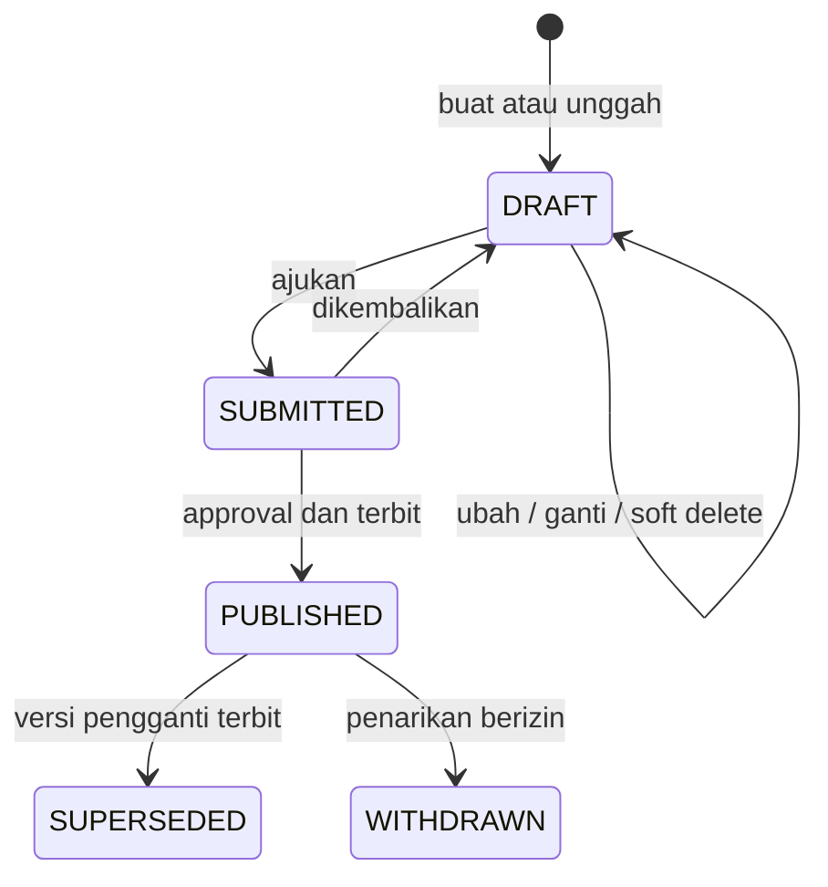

# Draft Workspace File Pekerjaan

**Status:** NEEDS MENTOR VALIDATION
**Last Updated:** 2026-10-11

## Purpose

Mendefinisikan rancangan tahap berikutnya untuk lampiran hasil pekerjaan staf Direktorat SUN. Dokumen ini adalah **PROPOSED**, belum mengubah API, database, permission aktif, atau UI SUNOVATE. Implementasi menunggu keputusan OQ-35.

## Batas Konsep

- *Unggah* berarti memindahkan file ke penyimpanan dan membuat rekaman `DRAFT`; unggah bukan publikasi.
- *Terbit* berarti versi telah melewati review dan approval lalu menjadi `PUBLISHED` yang immutable.
- Lampiran kerja tidak otomatis menjadi sumber Knowledge Hub atau SAVI AI. Promosi ke knowledge memerlukan alur intake, klasifikasi, dan publikasi knowledge tersendiri.
- File tidak disimpan sebagai BLOB di PostgreSQL. Database menyimpan metadata, checksum, status, dan referensi provider.
- Semua contoh dan pengujian sebelum izin data asli memakai `SIMULATED_DATA`.

## Alur Status

| Status | Isi dapat diubah | Dapat dihapus | Keterangan |
|---|---|---|---|
| `DRAFT` | Ya, oleh pemilik berizin | Soft delete | Belum resmi dan tidak masuk SAVI |
| `SUBMITTED` | Tidak | Tidak | Beku selama review; dapat dikembalikan ke DRAFT |
| `PUBLISHED` | Tidak | Tidak | Immutable; checksum dan metadata inti terkunci |
| `SUPERSEDED` | Tidak | Tidak | Digantikan versi baru; tetap tersedia untuk audit |
| `WITHDRAWN` | Tidak | Tidak | Ditandai ditarik dengan alasan; bukti tetap disimpan |

## Tindakan dan Kontrol

| Tindakan | Kontrol wajib | Audit event kandidat |
|---|---|---|
| Membuat draft | permission, team scope, clearance | `WORK_FILE_DRAFT_CREATE` |
| Mengganti file draft | pemilik, permission, revision cocok, validasi file | `WORK_FILE_DRAFT_UPDATE` |
| Menghapus draft | pemilik, permission, soft delete | `WORK_FILE_DRAFT_DELETE` |
| Mengajukan | checksum tersedia, klasifikasi terisi, file lolos validasi | `WORK_FILE_SUBMIT` |
| Mengembalikan | reviewer berbeda dari pengaju, alasan wajib | `WORK_FILE_RETURN` |
| Menerbitkan | approval disetujui, separation of duties | `WORK_FILE_PUBLISH` |
| Membuat koreksi | versi baru, tautan ke versi lama | `WORK_FILE_REVISION_CREATE` |
| Menarik | permission khusus, alasan dan approval | `WORK_FILE_WITHDRAW` |
| Memberi akses | scope dan masa berlaku wajib | `ACCESS_GRANT_CREATE` |

Admin sistem mengelola akun, konfigurasi, dan grant. Admin sistem tidak otomatis boleh mengubah isi file terbit.

## Validasi Sebelum Submit

- MIME type dan ekstensi harus konsisten dan termasuk allowlist.
- Ukuran maksimum ditetapkan oleh administrator setelah kapasitas penyimpanan diketahui.
- SHA-256 dihitung server-side; file identik dalam konteks yang sama ditolak atau ditandai sebagai duplikat.
- Pemindaian malware selesai dengan hasil aman.
- Pemilik tim dan klasifikasi wajib terisi.
- Lokasi provider harus menggunakan skema yang disetujui, bukan URL bebas dari klien.
- Nama file tampilan disanitasi; nama objek penyimpanan dibuat oleh sistem.
- Dokumen mencurigakan dikarantina dan tidak dapat diajukan.

## Model Data Kandidat

### `work_attachments`

| Kolom | Tujuan |
|---|---|
| `id` | UUID lampiran logis |
| `work_output_id`, `task_id` | Salah satu induk pekerjaan; aturan final perlu diputuskan |
| `title`, `description` | Metadata tampilan |
| `owner_team_id`, `owner_user_id` | Scope dan pemilik |
| `classification_code` | Plafon akses |
| `lifecycle_status` | DRAFT sampai WITHDRAWN |
| `current_version_id` | Versi aktif |
| `revision` | Optimistic concurrency metadata |
| `submitted_at`, `published_at`, `withdrawn_at` | Waktu transisi |
| `withdrawal_reason` | Alasan penarikan, tidak boleh menghapus bukti |
| `deleted_at` | Hanya untuk DRAFT |

### `work_attachment_versions`

| Kolom | Tujuan |
|---|---|
| `id`, `work_attachment_id`, `version_number` | Identitas versi immutable |
| `provider_code`, `provider_locator` | Referensi file eksternal |
| `display_filename`, `mime_type`, `size_bytes` | Metadata file |
| `checksum_sha256` | Integritas dan duplikasi |
| `scan_status` | PENDING, SAFE, REJECTED, QUARANTINED |
| `replaces_version_id` | Hubungan koreksi |
| `created_by`, `created_at` | Jejak pembuatan |

### `user_permission_grants`

Tabel kandidat untuk delegasi per akun: `user_id`, `permission_code`, `team_id`, `classification_ceiling`, `valid_from`, `valid_until`, `granted_by`, `reason`, `revoked_at`, dan `revoked_by`. Constraint harus mencegah grant tanpa batas scope dan grant oleh pemberi yang tidak berwenang.

## Kontrak API Kandidat

Semua endpoint di bawah **PROPOSED** dan belum tersedia.

| Method | Path | Hasil |
|---|---|---|
| GET | `/work-attachments` | Daftar sesuai scope, filter status/induk/pemilik |
| GET | `/work-attachments/{id}` | Detail dan riwayat versi yang boleh dilihat |
| POST | `/work-attachments` | Membuat metadata DRAFT |
| POST | `/work-attachments/{id}/versions` | Mengunggah/mendaftarkan file versi draft |
| PATCH | `/work-attachments/{id}` | Mengubah metadata DRAFT dengan `revision` |
| DELETE | `/work-attachments/{id}` | Soft delete, hanya DRAFT |
| POST | `/work-attachments/{id}/submit` | DRAFT ke SUBMITTED dan membuat approval |
| POST | `/work-attachments/{id}/return` | SUBMITTED ke DRAFT dengan alasan |
| POST | `/work-attachments/{id}/publish` | Mengunci versi setelah approval |
| POST | `/work-attachments/{id}/revisions` | Membuat DRAFT koreksi dari PUBLISHED |
| POST | `/work-attachments/{id}/withdraw` | Menandai WITHDRAWN setelah approval |
| GET/POST/DELETE | `/access-grants` | Kelola delegasi per akun; pihak berwenang masih OQ-35 |

Upload file sebaiknya memakai multipart atau presigned upload dari provider yang disetujui. Pilihan final bergantung pada SharePoint/Azure/sandbox yang disediakan, batas ukuran, dan kebijakan TIK.

## UI Kandidat

- **Draft Saya:** tambah file, simpan, ganti, hapus draft, dan ajukan.
- **Menunggu Review:** daftar beku dengan aksi kembalikan atau rekomendasikan terbit.
- **Telah Terbit:** versi aktif, riwayat, checksum, penerbit, dan waktu terbit.
- **Ditarik/Digantikan:** alasan dan tautan ke versi pengganti.
- Dialog konfirmasi publikasi wajib menyatakan bahwa versi tidak dapat diedit atau dihapus setelah terbit.
- Permission management menampilkan siapa memperoleh izin, scope tim, klasifikasi maksimum, pemberi, alasan, dan masa berlaku.

## Open Questions dan Gate

Implementasi database, API, dan UI tidak dimulai sebelum OQ-35 menjawab minimal:

1. Pihak yang boleh mengelola grant per akun.
2. Pihak yang boleh review, publish, dan withdraw.
3. Apakah staf biasa boleh membuat draft dan mengajukan.
4. Aturan retensi dan legal hold.
5. Provider file pilot serta batas tipe dan ukuran.
6. Apakah publikasi memerlukan satu atau dua tingkat approval.

## Related Documents

- [document-lifecycle.md](document-lifecycle.md)
- [work-monitoring-flow.md](work-monitoring-flow.md)
- [functional-requirements.md](../01-product/functional-requirements.md)
- [permission-matrix.md](../06-security/permission-matrix.md)
- [open-questions.md](../00-project/open-questions.md)

