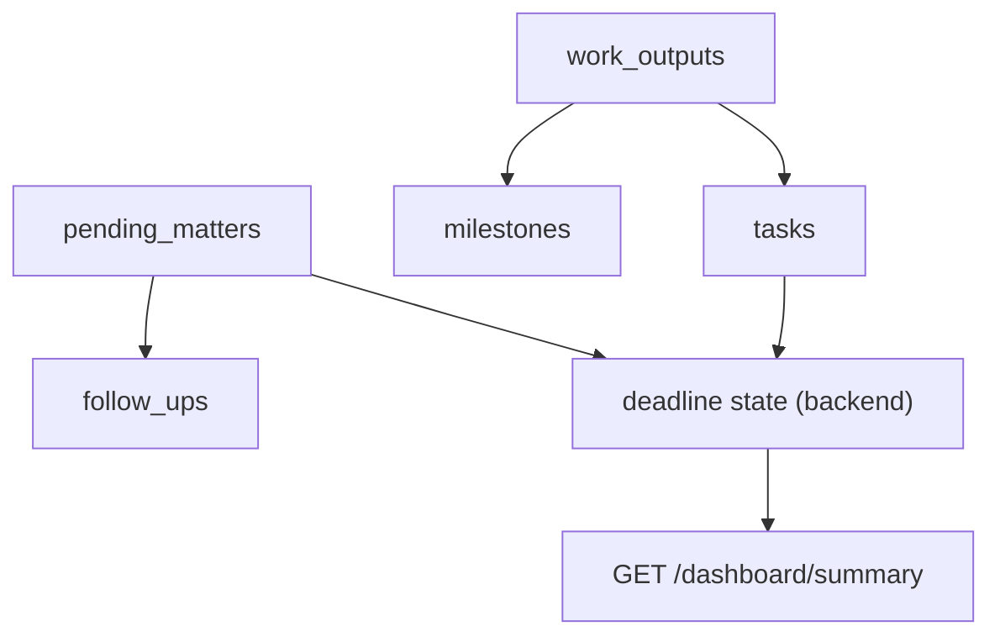

# Alur Monitoring Pekerjaan

**Status:** PROPOSED
**Last Updated:** 2026-10-06

## Purpose

Dokumen ini menjelaskan cara SUNOVATE merekam output tim kerja, tugas, milestone, pending matters, dan tindak lanjut, serta cara status tenggat dihitung untuk dashboard.

## Confirmed Information

- **CONFIRMED**: Monitoring pekerjaan dan output tim kerja serta dashboard sesuai hak akses termasuk tujuan SUNOVATE (sumber: brief sesi 2026-10-01).
- **CONFIRMED**: SUNOVATE bukan SUN Job Monitor; SUN Job Monitor adalah pilot terpisah yang dibekukan (sumber: 14_NEW_SESSION_HANDOFF_PROMPT.txt; 20_NEW_CHAT_MASTER_PROMPT.txt). Pola yang boleh dipakai ulang adalah OQ-19.
- **CONFIRMED (prioritas usulan)**: Kinerja dan pending matters dasar termasuk P0 MVP pada proposal (sumber: Proposal v2.4, slide 11; status usulan).

## Struktur Data

| Tabel | Makna | Status |
|---|---|---|
| `work_outputs` | Output yang menjadi tanggung jawab tim (misalnya kajian, laporan, dokumen) | PROPOSED |
| `tasks` | Langkah kerja untuk menghasilkan output | PROPOSED |
| `milestones` | Titik capaian pada output | PROPOSED |
| `pending_matters` | Hal yang belum selesai dan perlu dipantau | PROPOSED |
| `follow_ups` | Tindak lanjut atas pending matter | PROPOSED |

Setiap record membawa `owner_team_id`, `owner_user_id`, `classification_code`, `revision`, dan `data_origin`. Data saat ini berlabel `SIMULATED_DATA`.

## Status Tugas

Diadopsi dari blueprint lama (sumber: SUNOVATE_WEB_IMPLEMENTATION_BLUEPRINT_v0.1.md; PROPOSED).

| Status | Arti |
|---|---|
| `NOT_STARTED` | Belum dimulai |
| `IN_PROGRESS` | Sedang dikerjakan |
| `WAITING_INTERNAL` | Menunggu pihak internal |
| `WAITING_EXTERNAL` | Menunggu pihak eksternal |
| `ON_HOLD` | Ditunda |
| `COMPLETED` | Selesai |
| `CANCELLED` | Dibatalkan |

- **OPEN QUESTION (OQ-15)**: Definisi status output dan tugas yang benar-benar dipakai tim; status untuk `work_outputs`, `milestones`, dan `pending_matters` belum divalidasi.

## Status Tenggat

- **PROPOSED**: Status tenggat dihitung hanya oleh backend; frontend tidak menghitung ulang (BR-12 di [business-rules](business-rules.md)).

| Deadline state | Kondisi |
|---|---|
| `COMPLETED` | Status tugas `COMPLETED` |
| `OVERDUE` | Tenggat sudah lewat dan belum selesai |
| `DUE_TODAY` | Tenggat hari ini |
| `DUE_SOON` | Tenggat dalam `DEADLINE_DUE_SOON_DAYS` hari (default 7) |
| `SAFE` | Tenggat lebih jauh dari ambang |

- **OPEN QUESTION (OQ-15)**: Ambang "jatuh tempo dekat"; nilai 7 hari hanya default pengembangan.
- **OPEN QUESTION**: Perlakuan tugas `CANCELLED` dan `ON_HOLD` terhadap deadline state, serta zona waktu acuan.

## Endpoint

| Endpoint | Permission | Catatan |
|---|---|---|
| `GET /work-outputs`, `GET /work-outputs/{id}` | `work:read` | Dibatasi lingkup tim dan klasifikasi |
| `GET /tasks` | `work:read` | |
| `PATCH /tasks/{id}` | `work:update` | Wajib `revision`; konflik 409 `REVISION_CONFLICT` |
| `GET /milestones` | `work:read` | |
| `GET /pending-matters`, `GET /follow-ups` | `pending:read` | |
| `GET /dashboard/summary` | sesuai permission baca | Ringkasan hanya dari record yang boleh dibaca pengguna |

- **PROPOSED**: Pembuatan output dan pengelolaan pending matters (`work:create`, `pending:manage`) belum memiliki endpoint tulis di scaffold.

## Pelaku dan Batas Data (jawaban knowledge owner)

- **CONFIRMED (knowledge owner, deck v1_ slide 24)**: Yang dapat mengubah data atau mengunggah adalah ketua tim, kasubdit PMP, Kasi MP, dan PIC yang ditunjuk (OQ-05). Deck tidak menyebut apakah "data" mencakup work output, tugas, dan pending matters atau hanya knowledge dan dokumen.
- **OPEN QUESTION (OQ-25)**: Cakupan "mengubah data" untuk data kerja. Sampai dijawab, alur pada dokumen ini tidak diubah: role `staff` masih memiliki `work:update` (dipakai `PATCH /tasks/{id}`) dan `work:create`, dan usulan PD-1 tidak mencabut keduanya.
- **PROPOSED**: Ketua tim memantau output, tugas, milestone, dan pending matters timnya (slide 9 `v1_`: "Ketua tim kerja ... pemantauan output sesuai proses masing-masing"). Pembuatan output dan pengelolaan pending matters belum memiliki endpoint tulis di scaffold, sehingga tidak ada perubahan perilaku yang perlu dipetakan sekarang.
- **CONFIRMED**: Slide 11 (kinerja dan pending matters dasar sebagai P0) tidak berubah pada deck `v1_`.
- **CONFIRMED (knowledge owner, deck v1_ slide 24)**: Indikator dashboard yang diminta adalah "yield" dan "kepemilikan SBN" (OQ-10). **OPEN QUESTION**: sumber data, definisi, dan hak lihat (OQ-21). Sesuai BR-36 dan ADR-013 keduanya tidak dihitung dari `work_outputs`, `tasks`, atau tabel lain, dan tidak ditampilkan sebagai angka; dashboard seharusnya hanya menyatakan sumber data belum tersedia (PROPOSED, FR-54; teks itu belum ada di UI). Deadline state di atas tidak berhubungan dengan kedua indikator.

## Item Perhatian Dashboard

- **PROPOSED**: Dashboard menonjolkan tugas `OVERDUE`, `DUE_TODAY`, dan `DUE_SOON`; pending matters yang belum ditindaklanjuti; serta approval `PENDING` yang dapat diputuskan pengguna.
- **PROPOSED**: Agregasi dihitung setelah filter otorisasi, sehingga angka ringkasan tidak membocorkan keberadaan record tim lain.
- **OPEN QUESTION (OQ-10)**: Format laporan dan indikator dashboard yang benar-benar dibutuhkan. Lihat [dashboard-requirements](../09-ui-ux/dashboard-requirements.md).

## Di Luar Skema Saat Ini

- **OUT OF SCOPE (saat ini)**: Pelacakan pemeriksaan BPK, BPKP, dan Itjen serta pencatatan rapat yang ada pada blueprint lama tidak termasuk skema saat ini. Keduanya menjadi kandidat fase berikutnya dan memerlukan validasi mentor (sumber: SUNOVATE_WEB_IMPLEMENTATION_BLUEPRINT_v0.1.md).
- **PROPOSED**: Notulen dan bahan rapat dapat disimpan sebagai knowledge bertipe `MEETING_MATERIAL` atau `DECISION_RECORD` tanpa modul rapat khusus.
- **OUT OF SCOPE**: Notifikasi eksternal; `NOTIFICATION_PROVIDER=disabled`.

## Acceptance Criteria

- Deadline state berasal dari respons API, bukan dihitung di browser.
- Pengguna hanya melihat output, tugas, dan pending matters dalam lingkup tim dan klasifikasinya.
- `PATCH /tasks/{id}` dengan revision lama ditolak 409.

## Related Documents

- [business-rules](business-rules.md)
- [team-work-scope](team-work-scope.md)
- [dashboard-requirements](../09-ui-ux/dashboard-requirements.md)
- [endpoint-catalog](../07-api/endpoint-catalog.md)
- [open-questions](../00-project/open-questions.md)
