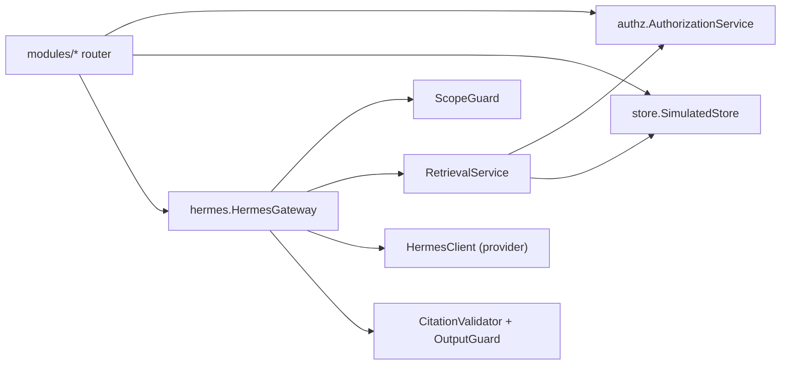

# Component Architecture

**Status:** PROPOSED
**Last Updated:** 2026-10-01

## Purpose
Memetakan komponen di dalam backend dan frontend beserta aturan dependensinya. Isi dokumen ini sesuai kode pada 2026-10-01.

## Backend (`apps/api/sunovate_api`)
| Paket | Isi |
|---|---|
| `core/` | `config` (settings bertipe, guard production), `logging` (JSON + request id), `errors` (envelope error), `responses` (envelope, paginasi, camelCase), `security` (token HMAC dev) |
| `authz/` | `catalog` (role dan permission PROPOSED), `principal`, `service` (AuthorizationService), `dependencies` (FastAPI `require`) |
| `store/` | `records` (dataclass), `dataset` (SIMULATED_DATA deterministik, `sid()`), `simulated` (store in-memory + audit append-only) |
| `providers/` | `interfaces` (Protocol), `development` (implementasi dev), `registry` (wiring dan status) |
| `hermes/` | `text`, `scope_guard`, `retrieval` (filter otorisasi lalu skor, reranker, filter injeksi), `guards` (CitationValidator, OutputGuard), `gateway` (HermesGateway) |
| `modules/` | Router per modul: `health`, `auth`, `identity`, `knowledge`, `documents`, `search`, `dashboard`, `work`, `pending`, `audit`, `approvals`, `hermes`, `system` |
| `db/` | `models` (30 tabel), `session`, `seed` |
| `context.py`, `domain.py`, `main.py` | Wiring dependensi, aturan deadline, app factory |

## Aturan dependensi
- **PROPOSED** Router tidak saling memanggil kecuali helper bersama (`modules/_common.py`, `work.with_deadline`).
- **CONFIRMED (implementasi)** `HermesClient` hanya menerima `ContextPassage` yang sudah diotorisasi; ia tidak menerima store, sesi DB, atau principal.
- **CONFIRMED (implementasi)** Semua mutasi melalui router yang memanggil `require(...)` dan `AuthorizationService.can_write`, lalu menulis audit.
- **CONFIRMED (implementasi)** Status tenggat dihitung hanya di `domain.deadline_state` (BR-12).

## Frontend (`apps/web/src`)
| Lokasi | Isi |
|---|---|
| `app/login` | Halaman, form RHF + Zod, server action login/logout |
| `app/(workspace)` | Layout terautentikasi, dashboard, knowledge, detail, search, work-monitoring, hermes, admin, error, loading |
| `app/api/hermes` | Route handler proxy ke `/hermes/query` dan feedback |
| `components/` | `app-shell`, `page-elements`, `task-status-chart` (Recharts), `hermes-chat` (TanStack Query) |
| `lib/` | `api` (klien server), `session`, `navigation`, `format`, `zod-resolver` |

## Related Documents
- [provider-abstraction.md](provider-abstraction.md)
- [authorization-rbac.md](../06-security/authorization-rbac.md)
- [hermes-overview.md](../05-ai-rag/hermes-overview.md)
