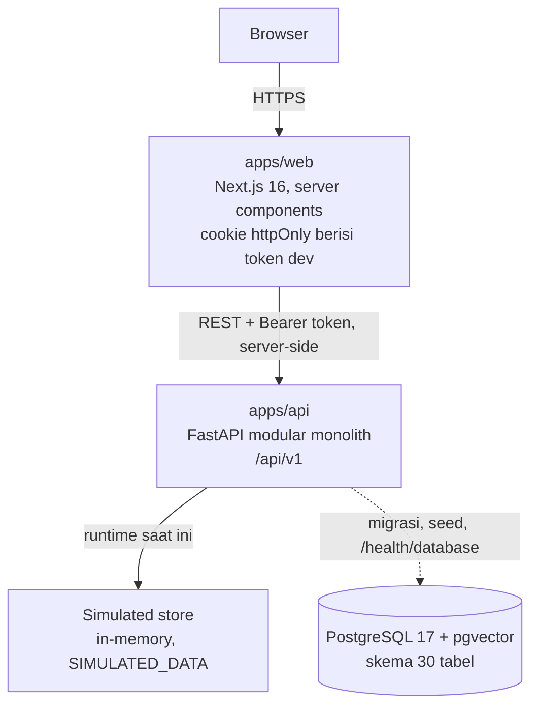

# Container Architecture

**Status:** PROPOSED
**Last Updated:** 2026-10-01

## Purpose
Menjelaskan unit yang dapat dijalankan (container) dan cara keduanya berkomunikasi.

## Confirmed Information
- **CONFIRMED** Modular monolith; frontend Next.js App Router, backend FastAPI, PostgreSQL + pgvector + FTS (sumber: brief sesi 2026-10-01, ADR-001, ADR-002, ADR-003).
- **CONFIRMED** Tidak memakai Turborepo, Kubernetes, microservices, Redis, atau message broker (sumber: brief sesi 2026-10-01).

## Diagram

## Container
| Container | Tanggung jawab | Status |
|---|---|---|
| `apps/web` | UI, login dev (server action), memanggil API dari server; proxy `/api/hermes` | Implemented (scaffold) |
| `apps/api` | Validasi, otorisasi, use case, audit, Hermes pipeline, OpenAPI | Implemented (scaffold) |
| Simulated store | Data runtime in-memory yang dimuat ulang tiap restart | Implemented (ADR-007) |
| PostgreSQL | Skema, migrasi, seed, FTS, pgvector | Skema tervalidasi; belum dipakai runtime |

- **PROPOSED** Langkah berikut: repository SQLAlchemy menggantikan simulated store tanpa mengubah kontrak API.
- **CONFIRMED (implementasi)** Browser tidak memanggil API langsung dan tidak membaca token; seluruh panggilan berasal dari server Next.js.

## Risks
R-10 simulated store disangka persistence produksi. Mitigasi: label `dataBackend` di `/health`, `meta.dataLabel` di setiap respons, config menolak `DATA_BACKEND=simulated` di production.

## Related Documents
- [component-architecture.md](component-architecture.md)
- [deployment-architecture.md](deployment-architecture.md)
- [data-architecture.md](../04-data/data-architecture.md)
