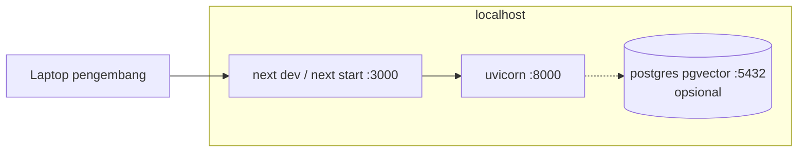
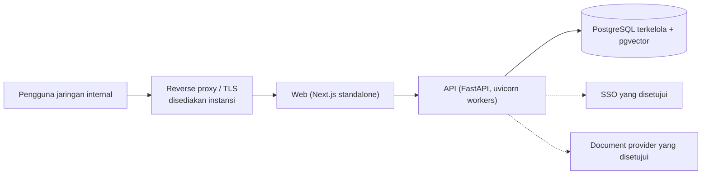

# Deployment Architecture

**Status:** NEEDS MENTOR VALIDATION
**Last Updated:** 2026-10-01

## Purpose
Menjelaskan deployment lokal yang sudah ada dan usulan deployment yang menunggu keputusan hosting.

## Confirmed Information
- **CONFIRMED** Hosting, SSO, storage, dan model AI menunggu persetujuan instansi (sumber: Proposal v2.4, slide 14; OQ-07).
- **CONFIRMED (implementasi)** Lingkungan lokal: web `:3000`, API `:8000`, PostgreSQL via `docker-compose.yml` di `127.0.0.1:5432`.
- **CONFIRMED (fakta mesin)** Docker tidak terpasang di mesin pengembang saat sesi ini; migrasi divalidasi dengan PostgreSQL sementara (`pnpm db:check`).

## Lokal (implemented)

## Usulan target (PROPOSED)

- **PROPOSED** Web dan API dideploy terpisah tetapi tetap satu boundary aplikasi; `next.config.ts` sudah memakai `output: "standalone"`.
- **PROPOSED** Prasyarat sebelum deploy apa pun: repository SQLAlchemy, identity provider produksi, secret store, backup, logging terpusat, security review.
- **OUT OF SCOPE** Kubernetes, multi-region, atau autoscaling pada fase magang.

## Open Questions
OQ-07 hosting dan login; OQ-11 lokasi pemrosesan AI; OQ-20 lingkungan UAT.

## Related Documents
- [deployment-runbook.md](../11-operations/deployment-runbook.md)
- [local-development.md](../11-operations/local-development.md)
- [technology-stack.md](technology-stack.md)
