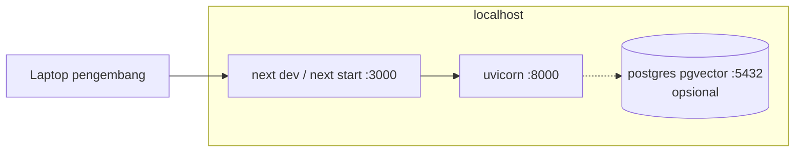
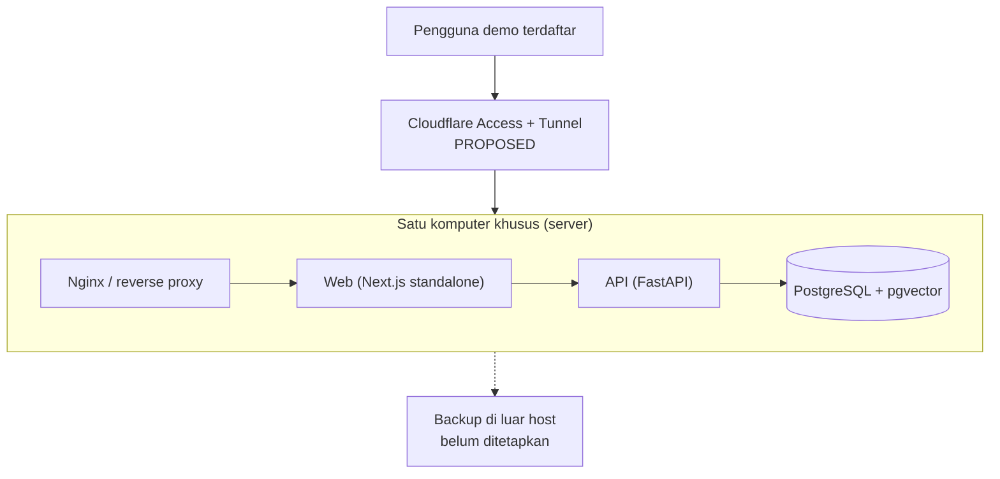
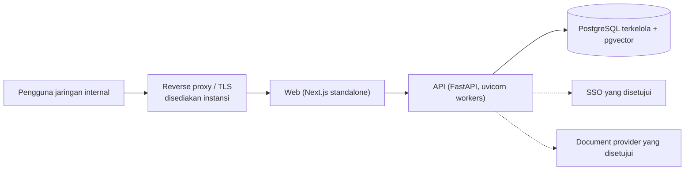

# Deployment Architecture

**Status:** NEEDS MENTOR VALIDATION
**Last Updated:** 2026-10-09

## Purpose
Menjelaskan deployment lokal yang sudah ada dan usulan deployment yang menunggu keputusan hosting.

## Confirmed Information
- **CONFIRMED** Hosting, SSO, storage, dan model AI menunggu persetujuan instansi (sumber: Proposal v2.4, slide 14; OQ-07).
- **CONFIRMED (knowledge owner, deck v1_ slide 24)** Hosting dijawab: "pakai computer tersendiri sebagai server" (OQ-07, DEC-20261002-05). Jawaban ini tidak menyebut lokasi, jaringan, sistem operasi, backup, administrator, siapa yang boleh mengakses, atau TLS, dan tidak menjawab mekanisme login. Pengakuan mentor masih tertunda (OQ-24).
- **CONFIRMED (implementasi)** Lingkungan lokal: web `:3000`, API `:8000`, PostgreSQL via `docker-compose.yml` di `127.0.0.1:5432`.
- **CONFIRMED (fakta mesin)** Docker tidak terpasang di mesin pengembang saat sesi ini; migrasi divalidasi dengan PostgreSQL sementara (`pnpm db:check`).

## Lokal (implemented)

## Demo Terbatas Sekitar 25 Pengguna (PROPOSED)

Jawaban knowledge owner diterjemahkan menjadi satu komputer kantor khusus. Target sekitar 25 pengguna dan pemakaian Cloudflare Tunnel/Access berasal dari arahan project lead sesi 2026-10-09. Semua detail di bawah adalah usulan teknis; aktivasi jaringan eksternal tetap menunggu persetujuan mentor serta TIK/keamanan.

- **PROPOSED** Web, API, dan PostgreSQL berjalan pada satu host; file dokumen tetap berupa referensi (ADR-003) dan bukan BLOB.
- **PROPOSED** Satu host adalah titik kegagalan tunggal (R-13): ketersediaan, backup di luar host, patching, serta akses fisik dan jaringan harus dirancang sebelum data asli masuk.
- **OPEN QUESTION (OQ-23)** Lokasi dan akses jaringan, sistem operasi, apakah Docker boleh dipasang, backup, siapa yang mengadministrasi, siapa yang boleh mengakses, dan TLS.
- **OPEN QUESTION (OQ-07)** Mekanisme login di server ini. Sampai dijawab, `POST /auth/dev/login` tetap hanya untuk development dan aplikasi menolak start bila `APP_ENV=production` dengan dev auth aktif.
- **PROPOSED** Tidak ada data asli, data pribadi, atau data keuangan di server sampai klasifikasi (OQ-05) dan persetujuan eksplisit ada.
- **PROPOSED** Cloudflare Access menjadi lapisan pembatas akses demo, bukan identity provider bisnis SUNOVATE. Tunnel tidak membuka port inbound langsung, tetapi tetap merupakan jalur pihak ketiga yang harus masuk threat review, logging, daftar akun, dan prosedur pencabutan akses.
- **PROPOSED** Target sekitar 25 pengguna wajib dibuktikan dengan load test berdasarkan spesifikasi host aktual; angka ini bukan klaim kapasitas.
- **NEEDS APPROVAL** Domain/subdomain, akun Cloudflare milik instansi, egress firewall, administrator, daftar pengguna, durasi demo, dan penghentian tunnel.

## Usulan target (PROPOSED)

- **PROPOSED** Web dan API dideploy terpisah tetapi tetap satu boundary aplikasi; `next.config.ts` sudah memakai `output: "standalone"`.
- **PROPOSED** Prasyarat sebelum deploy apa pun: repository SQLAlchemy, identity provider produksi, secret store, backup, logging terpusat, security review.
- **OUT OF SCOPE** Kubernetes, multi-region, atau autoscaling pada fase magang.
- **PROPOSED FUTURE** Produksi memilih private cloud/Azure/internal data center/hybrid melalui keputusan instansi. Komputer kantor dan Cloudflare Tunnel tidak diperlakukan sebagai baseline produksi.
- **DEFERRED** Go/Rust hanya dipisahkan menjadi service setelah metrik membuktikan kebutuhan. Mobile/PWA menggunakan boundary API yang sama dan tidak mengubah sumber kebenaran data.

## Open Questions
OQ-07 login (hosting dijawab sebagian: komputer tersendiri sebagai server); OQ-23 persyaratan server; OQ-11 lokasi pemrosesan AI; OQ-20 lingkungan UAT; OQ-24 pengakuan mentor; OQ-34 persetujuan tunnel dan target demo 25 pengguna.

## Related Documents
- [deployment-runbook.md](../11-operations/deployment-runbook.md)
- [local-development.md](../11-operations/local-development.md)
- [technology-stack.md](technology-stack.md)
