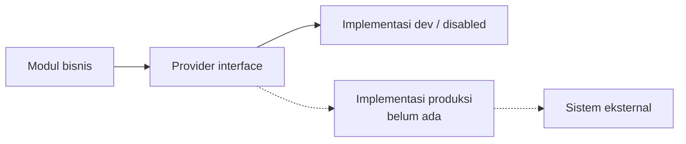

# Integration Boundaries

**Status:** PROPOSED
**Last Updated:** 2026-10-02

## Purpose
Menetapkan sumber kebenaran (source of truth) per jenis data dan aturan melewati batas sistem.

## Source of truth
| Data | Sumber kebenaran | Peran SUNOVATE | Status |
|---|---|---|---|
| File dokumen resmi | Document provider yang disetujui (SharePoint atau lainnya). Jawaban knowledge owner untuk pilot: "Sandbox server" (ambigu, OQ-22) | Menyimpan referensi, metadata, checksum, versi, klasifikasi | CONFIRMED (prinsip), OQ-06 PARTIAL, OQ-22 |
| Korespondensi resmi | Kemenkeu Satu | Tidak menyimpan; mungkin referensi di masa depan | CONFIRMED (prinsip) |
| Identitas pegawai | Identity provider instansi | Dev identity saja; mekanisme login produksi belum dijawab | OQ-07 |
| Knowledge metadata, ringkasan, relasi | PostgreSQL SUNOVATE | Pemilik data | PROPOSED |
| Output, tugas, pending matters | PostgreSQL SUNOVATE | Pemilik data | PROPOSED |
| Audit log | PostgreSQL SUNOVATE (append-only) | Pemilik data | PROPOSED |
| Chunk FTS dan embedding | Data turunan; dapat dibangun ulang | Indeks | PROPOSED |
| Data transaksi, yield, lelang | Sistem resmi | Tidak disimpan pada scaffold (ADR-013). Indikator "yield" dan "kepemilikan SBN" diminta knowledge owner (OQ-10) tetapi sumber datanya belum ada (OQ-21) | OUT OF SCOPE |

## Aturan batas
1. **PROPOSED** Satu provider interface per sistem eksternal; tidak ada panggilan API eksternal di dalam modul bisnis.
2. **CONFIRMED (implementasi)** Semua provider produksi tidak ada; `GET /api/v1/providers` melaporkan `productionReady=false` untuk semua.
3. **PROPOSED** Setiap sinkronisasi dicatat di `integration_sync_logs` dengan `is_production`.
4. **CONFIRMED** Hermes tidak melewati batas API; tidak memegang kredensial DB.
5. **PROPOSED** Data RESTRICTED ke atas tidak dikirim ke kanal eksternal (Telegram/WhatsApp) secara default. Jawaban knowledge owner "bisa" untuk penggunaan internal (OQ-08) tidak mengubah aturan ini.
6. **PROPOSED** SUNOVATE berjalan pada satu komputer khusus sebagai server (jawaban OQ-07); hanya komponen SUNOVATE yang berada di host tersebut. Batas ke sistem lain tetap melalui provider interface.

## Related Documents
- [provider-abstraction.md](provider-abstraction.md)
- [integration-overview.md](../08-integrations/integration-overview.md)
- [integration-readiness-checklist.md](../08-integrations/integration-readiness-checklist.md)
