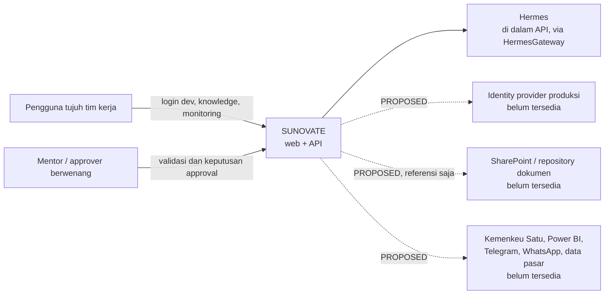

# System Context

**Status:** PROPOSED
**Last Updated:** 2026-10-02

## Purpose
Menggambarkan posisi SUNOVATE terhadap pengguna dan sistem lain, serta batas yang tidak boleh dilanggar.

## Confirmed Information
- **CONFIRMED** SUNOVATE tidak menggantikan sistem transaksi SUN resmi, tidak mengambil keputusan keuangan, dan tidak memberi akses dokumen tanpa otorisasi (sumber: brief sesi 2026-10-01).
- **CONFIRMED** Kemenkeu Satu adalah sistem korespondensi resmi; SharePoint/document repository menjadi sumber file bila sesuai (sumber: `14_NEW_SESSION_HANDOFF_PROMPT.txt`).
- **CONFIRMED** Hermes tidak mengakses database secara langsung (sumber: brief sesi 2026-10-01).
- **CONFIRMED** Tidak ada integrasi produksi yang tersedia saat ini (sumber: brief sesi 2026-10-01).

## Diagram konteks

Garis putus-putus berarti usulan; tidak ada koneksi yang diimplementasikan.

## Aktor dan peran
| Aktor | Interaksi | Status |
|---|---|---|
| Pengguna PPSUN, AKPSUN, PSUN, PPPSUN, DHTV, SUN Tematik, MONEV | Mencari knowledge, bertanya ke SAVI AI, memantau kerja | CONFIRMED (tujuh tim, DEC-20261020-01), PROPOSED (peran) |
| SUN Tematik | Terdaftar sebagai tim; fungsi belum diketahui | OPEN QUESTION (OQ-01) |
| Knowledge coordinator, reviewer | Review dan keputusan publikasi | PROPOSED (OQ-09, OQ-12) |
| Auditor | Membaca audit log | PROPOSED |
| Mentor | Memvalidasi requirement | CONFIRMED |

## Open Questions
OQ-06 (SharePoint; PARTIAL "Sandbox server"), OQ-07 (login; hosting dijawab komputer tersendiri sebagai server), OQ-08 (kanal; dijawab "bisa"), OQ-11 (model AI), OQ-23 (persyaratan server).

## Related Documents
- [container-architecture.md](container-architecture.md)
- [integration-boundaries.md](integration-boundaries.md)
- [scope-and-boundaries.md](../00-project/scope-and-boundaries.md)
