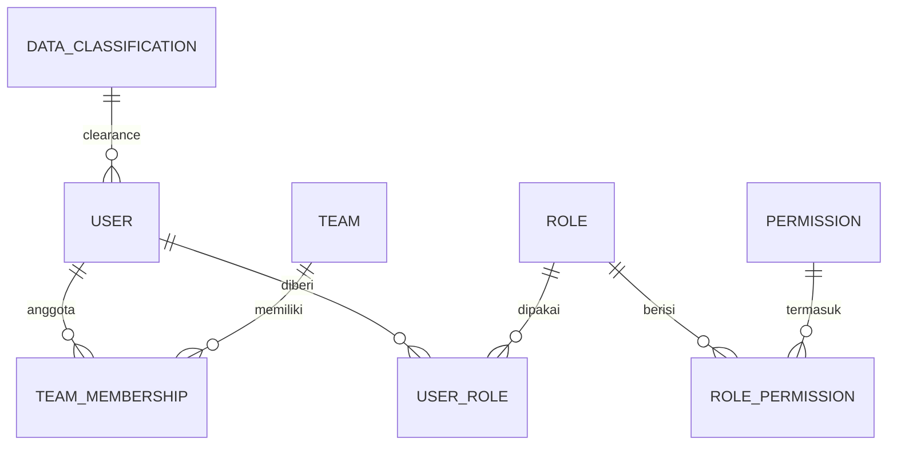
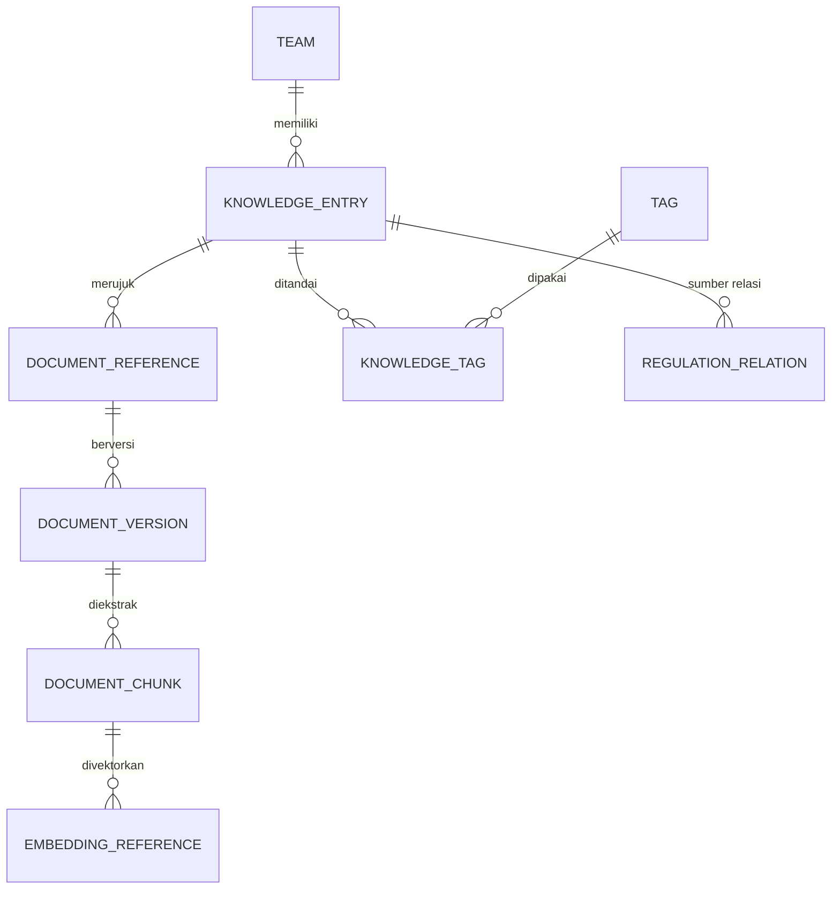
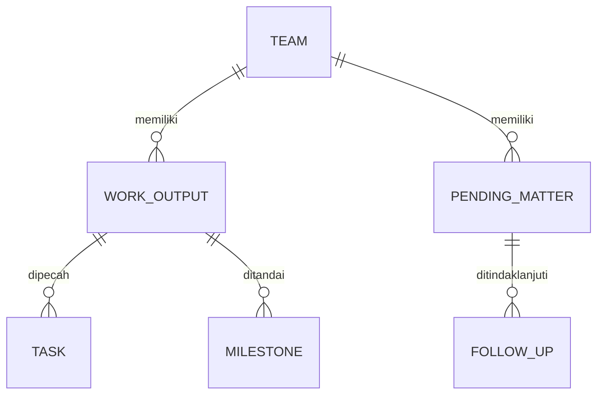
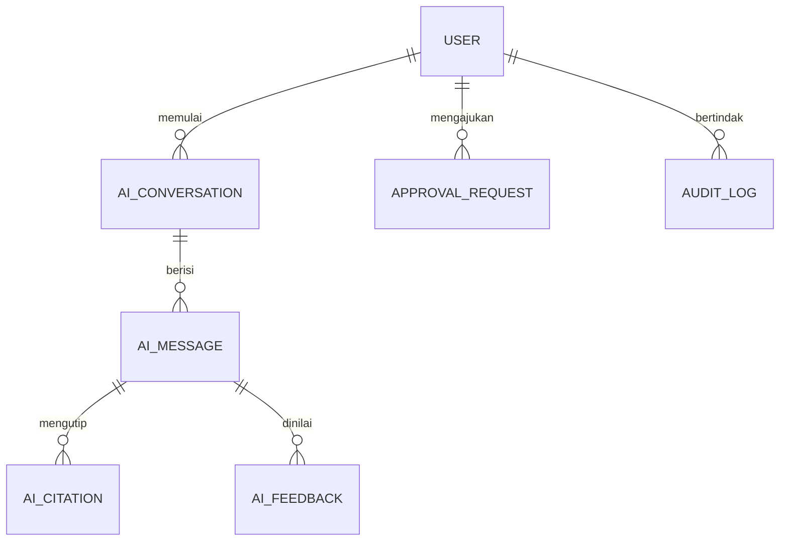

# Conceptual Data Model

**Status:** PROPOSED
**Last Updated:** 2026-10-06

## Purpose
Gambaran entitas utama dan hubungannya tanpa detail kolom. Dibagi per area agar diagram tetap kecil.

## Identitas dan akses

## Knowledge dan dokumen

## Kerja

## Hermes dan tata kelola

Entitas pendukung: `notifications`, `integration_sync_logs`, `data_quality_issues`.

## Catatan
- **PROPOSED (belum diimplementasikan)** Penunjukan ketua tim dan PIC per tim (jawaban knowledge owner, OQ-09) belum menjadi entitas. Hubungan konseptual yang diusulkan: `TEAM` memiliki penunjukan yang menautkan `USER` sebagai ketua tim atau PIC, dengan masa berlaku dan penunjuk. Opsi dan trade-off ada di [logical-data-model.md](logical-data-model.md); tidak ada diagram entitas baru di sini agar tidak dibaca sebagai skema yang berlaku.
- **OUT OF SCOPE (ADR-013)** Permintaan indikator "yield" dan "kepemilikan SBN" (OQ-10) tidak menambah entitas; sumber data dan definisinya belum diketahui (OQ-21).
- **PROPOSED (belum diimplementasikan)** Relasi antarperaturan (`REGULATION_RELATION`) pada telaah Kompilasi Peraturan SUN memerlukan dua konsep tambahan: cakupan pencabutan sebagian (Pasal/ayat yang dicabut, mis. PMK 111/2024, Pasal 30 angka 2 sampai 4, hal. 47) dan dasar relasi (konsiderans, batang tubuh, pasal penutup, peralihan), serta kemungkinan target yang belum terpetakan ke entri (rujukan tak bernomor). Tabel saat ini tidak memiliki kolom tersebut. Ini revisi masa depan; tidak ada diagram entitas baru di sini agar tidak dibaca sebagai skema yang berlaku. Rincian di [logical-data-model.md](logical-data-model.md).
- **OUT OF SCOPE (ADR-013)** Entitas SUN Business (instrumen, lelang, transaksi, yield, setelmen) belum dimodelkan.
- **OPEN QUESTION** Entitas rapat dan pemeriksaan (BPK/BPKP/Itjen) dari blueprint lama belum masuk skema; perlu validasi kebutuhan.

## Related Documents
- [logical-data-model.md](logical-data-model.md)
- [database-schema.md](database-schema.md)
