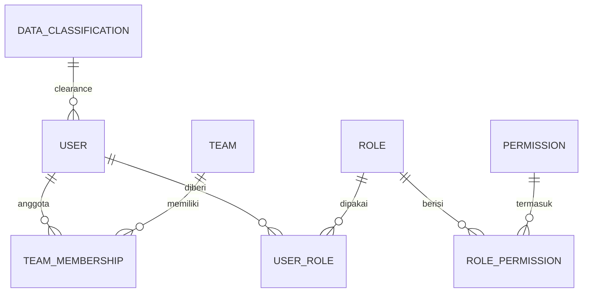
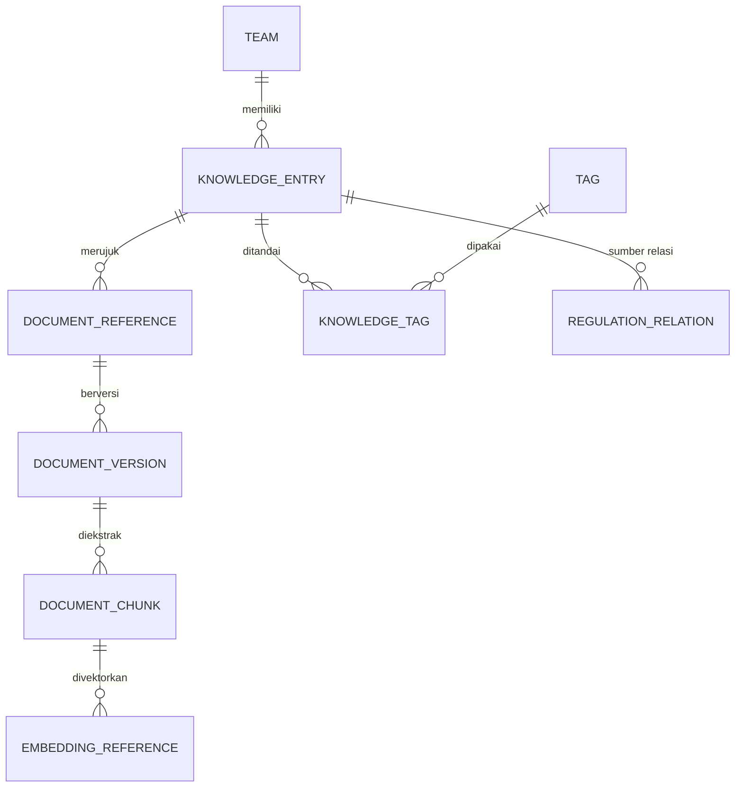
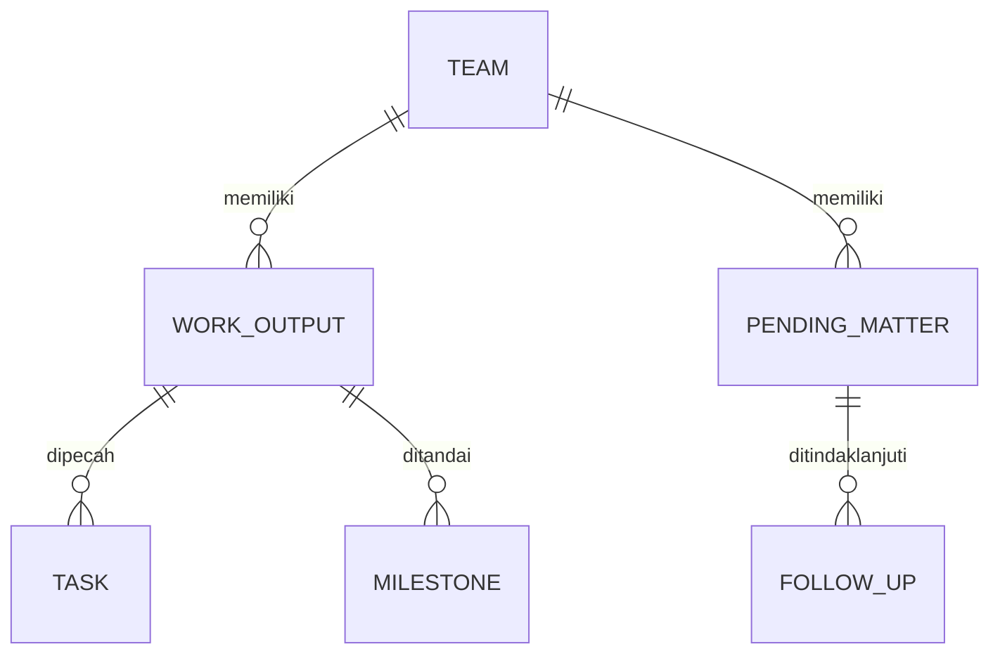
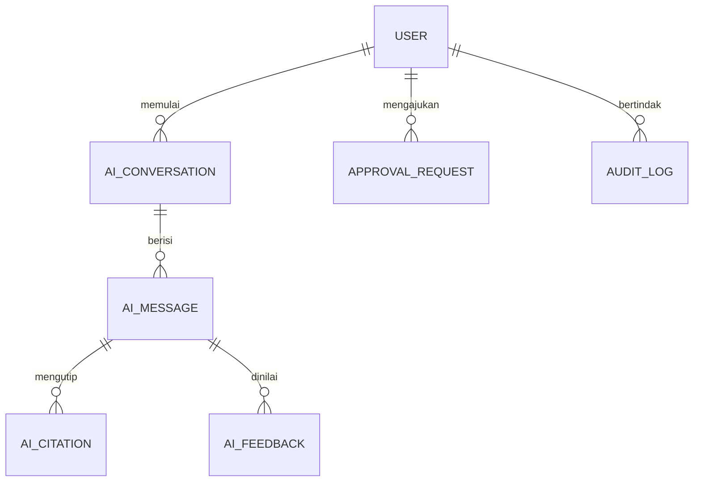

# Conceptual Data Model

**Status:** PROPOSED
**Last Updated:** 2026-10-01

## Purpose
Gambaran entitas utama dan hubungannya tanpa detail kolom. Dibagi per area agar diagram tetap kecil.

## Identitas dan akses

## Knowledge dan dokumen

## Kerja

## Hermes dan tata kelola

Entitas pendukung: `notifications`, `integration_sync_logs`, `data_quality_issues`.

## Catatan
- **OUT OF SCOPE (ADR-013)** Entitas SUN Business (instrumen, lelang, transaksi, yield, setelmen) belum dimodelkan.
- **OPEN QUESTION** Entitas rapat dan pemeriksaan (BPK/BPKP/Itjen) dari blueprint lama belum masuk skema; perlu validasi kebutuhan.

## Related Documents
- [logical-data-model.md](logical-data-model.md)
- [database-schema.md](database-schema.md)
