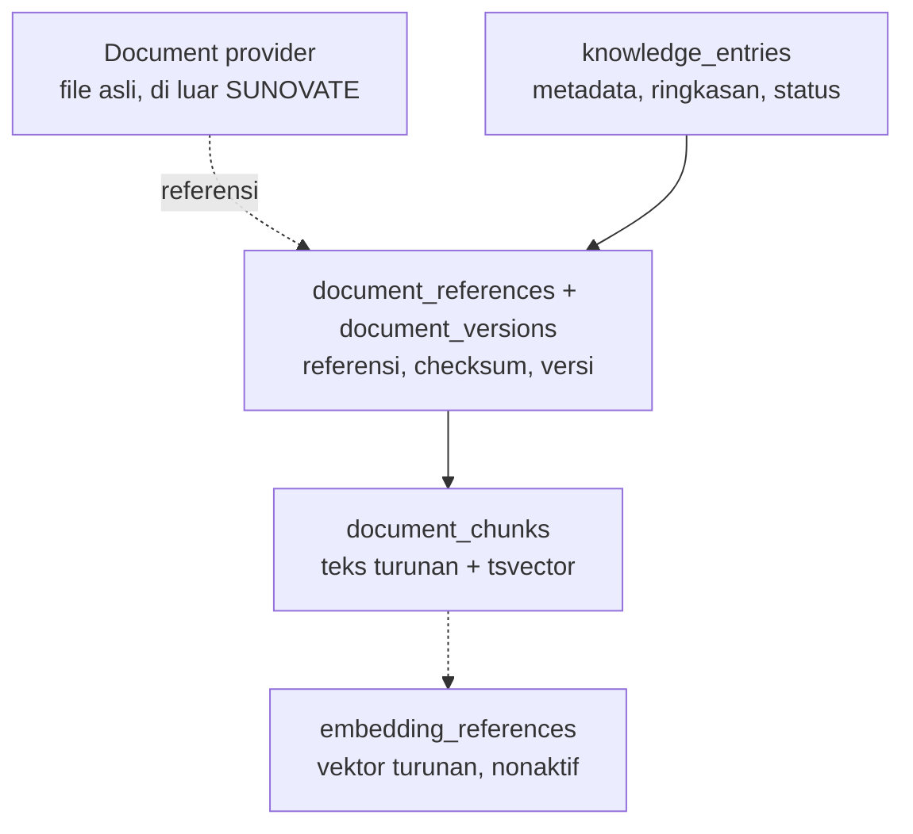

# Data Architecture

**Status:** PROPOSED
**Last Updated:** 2026-10-01

## Purpose
Ringkasan cara SUNOVATE menyimpan, menurunkan, dan melindungi data.

## Confirmed Information
- **CONFIRMED** PostgreSQL + pgvector + full-text search; file tidak disimpan sebagai BLOB (sumber: brief sesi 2026-10-01).
- **CONFIRMED** Seed wajib berlabel `SIMULATED_DATA` (sumber: brief sesi 2026-10-01).
- **CONFIRMED (implementasi)** Skema 30 tabel ada di revisi Alembic `0001_initial_schema` dan tervalidasi pada PostgreSQL sementara (upgrade, `alembic check`, seed dua kali, FTS, trigger append-only, downgrade).

## Lapisan data

## Prinsip
| Prinsip | Implementasi |
|---|---|
| UUID untuk semua kunci | `gen_random_uuid()`; dataset memakai UUIDv5 deterministik (`sid()`) |
| Jejak waktu | `created_at`, `updated_at` di semua tabel |
| Kepemilikan dan klasifikasi | `owner_team_id`, `owner_user_id`, `classification_code` (FK) pada record bisnis |
| Aktor | `created_by`, `updated_by` |
| Concurrency | `revision` (ADR-011) |
| Soft delete | `deleted_at` (ADR-010) |
| Asal data | `data_origin` (`SIMULATED_DATA`, `USER_ENTERED`, `INTEGRATION`) |
| Audit | `audit_logs` append-only via trigger |
| Data turunan | chunk dan embedding dapat dibangun ulang |

## Runtime saat ini
- **PROPOSED (ADR-007)** API memakai store in-memory dari dataset yang sama dengan seed. Repository SQLAlchemy belum diimplementasikan; ini langkah berikut di [future-development.md](../13-handover/future-development.md).

## Related Documents
- [conceptual-data-model.md](conceptual-data-model.md)
- [database-schema.md](database-schema.md)
- [simulated-data-policy.md](simulated-data-policy.md)
