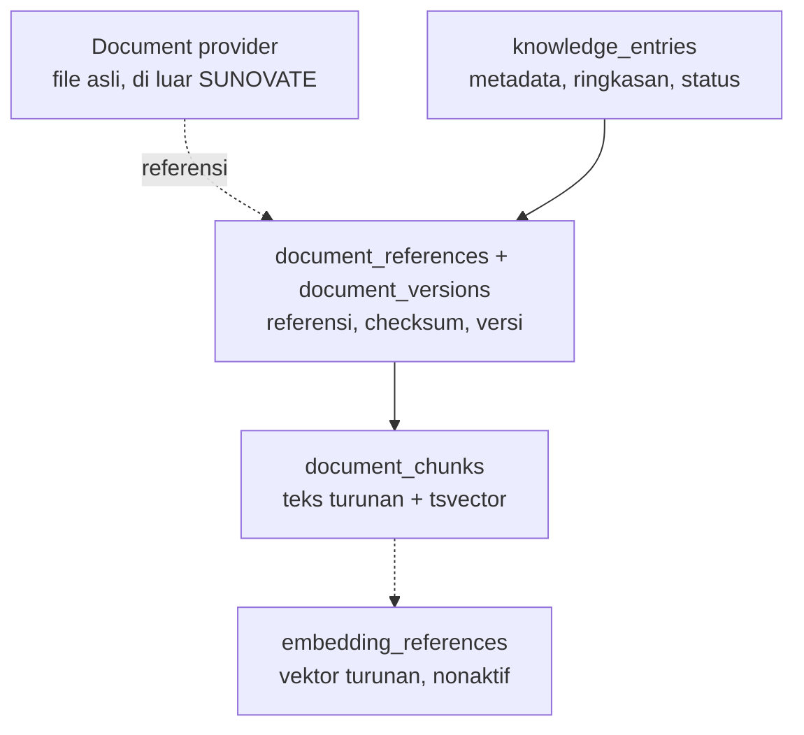

# Data Architecture

**Status:** PROPOSED
**Last Updated:** 2026-10-02

## Purpose
Ringkasan cara SUNOVATE menyimpan, menurunkan, dan melindungi data.

## Confirmed Information
- **CONFIRMED** PostgreSQL + pgvector + full-text search; file tidak disimpan sebagai BLOB (sumber: brief sesi 2026-10-01).
- **CONFIRMED** Seed wajib berlabel `SIMULATED_DATA` (sumber: brief sesi 2026-10-01).
- **CONFIRMED (implementasi)** Skema 31 tabel ada di revisi Alembic `0001_initial_schema`, `0002_ordering_columns`, dan `0003_secure_document_readers`, tervalidasi pada PostgreSQL sementara (upgrade, `alembic check`, seed dua kali, FTS, trigger append-only, downgrade) lewat `pnpm db:check`.

## Lapisan data

## Prinsip
| Prinsip | Implementasi |
|---|---|
| UUID untuk semua kunci | `gen_random_uuid()`; dataset memakai UUIDv5 deterministik (`sid()`) |
| Jejak waktu | `created_at`, `updated_at` di semua tabel |
| Kepemilikan dan klasifikasi | `owner_team_id`, `owner_user_id`, `classification_code` (FK) pada record bisnis |
| Aktor | `created_by`, `updated_by` |
| Concurrency | `revision` (ADR-011) |
| Soft delete | `deleted_at` (ADR-010) |
| Asal data | `data_origin` (`SIMULATED_DATA`, `USER_ENTERED`, `INTEGRATION`) |
| Audit | `audit_logs` append-only via trigger |
| Data turunan | chunk dan embedding dapat dibangun ulang |

## Runtime saat ini
- **PROPOSED (ADR-007, ADR-015)** Runtime memiliki dua backend di belakang satu interface `Repository` (`store/repository.py`), dipilih oleh `DATA_BACKEND`:

| `DATA_BACKEND` | Implementasi | Persistence | Catatan |
|---|---|---|---|
| `simulated` (default) | `store/simulated.py` (`SimulatedStore`) | Tidak; dataset dimuat ulang setiap restart | Ditolak di production |
| `postgres` | `store/postgres.py` (`PostgresRepository`, SQLAlchemy sinkron + psycopg 3) | Ya; data bertahan setelah API di-restart | Butuh `alembic upgrade head` dan seed; diizinkan di production hanya bila dev auth nonaktif |

- **CONFIRMED (implementasi, `pnpm db:test` 2026-10-02)** Seluruh suite API, security, RAG, dan integration lulus pada backend postgres; respons GET per persona identik dengan backend simulated (uji paritas).
- **PROPOSED (ADR-015)** Repository dibuat per request; write hanya di dalam `repo.transaction()`; urutan natural koleksi `(created_at, id)`, urutan audit lewat `audit_logs.seq`, urutan tag lewat `knowledge_tags.position`.
- **PROPOSED (ADR-015)** Otorisasi tetap diputuskan di Python; SQL hanya mempersempit kandidat. Hermes tidak mengakses database; data sampai ke Hermes hanya lewat `HermesGateway`.

## Related Documents
- [conceptual-data-model.md](conceptual-data-model.md)
- [database-schema.md](database-schema.md)
- [simulated-data-policy.md](simulated-data-policy.md)
