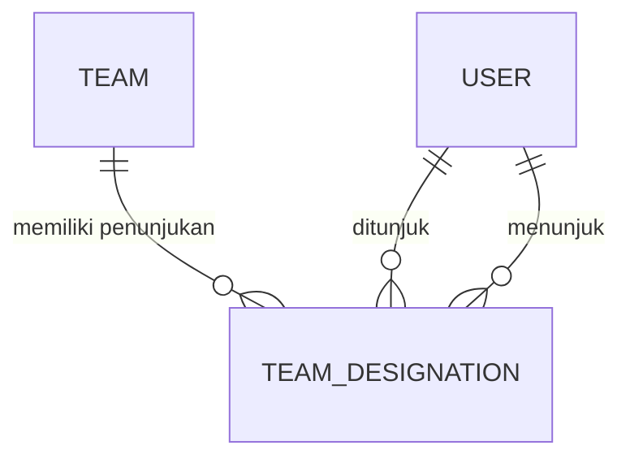

# Logical Data Model

**Status:** PROPOSED
**Last Updated:** 2026-10-11

## Purpose
Atribut kunci, kardinalitas, dan aturan integritas per entitas. Kolom lengkap ada di [database-schema.md](database-schema.md).

## Kolom bersama
- **Semua tabel kecuali `audit_logs`:** `id`, `created_at`, `updated_at`, `data_origin`.
- **Record bisnis ber-governance** (`knowledge_entries`, `document_references`, `work_outputs`, `tasks`, `milestones`, `pending_matters`, `follow_ups`, `approval_requests`, `data_quality_issues`): tambahan `owner_team_id` (wajib), `owner_user_id`, `classification_code` (wajib, FK), `created_by`, `updated_by`, `revision`, `deleted_at`.

## Aturan integritas
| Entitas | Aturan | Ditegakkan oleh |
|---|---|---|
| `team_memberships` | unik (`user_id`, `team_id`) | constraint |
| `user_roles` | unik (`user_id`, `role_id`, `team_id`) | constraint |
| `role_permissions` | unik (`role_id`, `permission_id`) | constraint |
| `knowledge_entries.lifecycle_status` | DRAFT, IN_REVIEW, PUBLISHED, SUPERSEDED, ARCHIVED | CHECK + API |
| `knowledge_entries.sharing_scope` | TEAM, DIRECTORATE | CHECK + API |
| `document_versions` | unik (`document_reference_id`, `checksum_sha256`); checksum 64 hex | constraint + API 409 `DUPLICATE_CHECKSUM` |
| `document_versions.extraction_status` | PENDING, EXTRACTED, FAILED, QUARANTINED, NOT_APPLICABLE | CHECK |
| `document_chunks` | unik (`document_version_id`, `chunk_index`) | constraint |
| `embedding_references` | unik (`document_chunk_id`, `model_name`) | constraint |
| `regulation_relations` | tipe AMENDS, REVOKES, IMPLEMENTS, REFERENCES, SUPERSEDES; tidak boleh ke diri sendiri | CHECK |
| `work_outputs`, `tasks` | status 7 nilai task; `progress` 0 sampai 100 | CHECK |
| `milestones.status` | PLANNED, ACHIEVED, MISSED, CANCELLED | CHECK |
| `pending_matters.status` | OPEN, IN_PROGRESS, RESOLVED, CANCELLED | CHECK |
| `follow_ups.status` | OPEN, DONE, CANCELLED | CHECK |
| `approval_requests` | tipe 4 nilai, status 5 nilai, `decided_by <> requested_by` | CHECK + API 403 `SEPARATION_OF_DUTIES` |
| `ai_messages.role` | USER, ASSISTANT | CHECK |
| `ai_feedback.rating` | HELPFUL, NOT_HELPFUL | CHECK |
| `audit_logs` | tidak boleh UPDATE/DELETE | trigger |

Status work output, milestone, dan pending matter adalah usulan dan menunggu konfirmasi (OQ-15).

## Kardinalitas penting
- Satu pengguna dapat masuk ke beberapa tim; role dapat dicatat per tim (`user_roles.team_id`) atau global (`NULL`). Catatan (diperiksa pada kode 2026-10-06): kolom `team_id` belum memengaruhi resolusi permission; semua role pengguna digabung (lihat bagian "Usulan Desain dari Jawaban Knowledge Owner").
- Satu knowledge entry memiliki nol atau lebih document reference; satu reference memiliki banyak versi; `current_version_id` menunjuk versi aktif.
- Chunk mewarisi kepemilikan dan klasifikasi dari knowledge entry induk melalui `knowledge_entry_id`.

## Kandidat Model Draft Workspace (PROPOSED, belum diimplementasikan)

Rancangan FR-56 memakai tiga entitas kandidat: `work_attachments` untuk lampiran logis dan lifecycle; `work_attachment_versions` untuk versi file immutable beserta checksum serta provider locator; dan `user_permission_grants` untuk delegasi per akun yang dibatasi tim, klasifikasi, dan waktu. Lampiran dapat terkait `work_outputs` atau `tasks`, tetapi aturan tepat satu induk menunggu keputusan.

Integritas minimum yang direncanakan:

- lifecycle hanya `DRAFT`, `SUBMITTED`, `PUBLISHED`, `SUPERSEDED`, atau `WITHDRAWN`;
- `deleted_at` hanya boleh diisi saat DRAFT;
- pasangan (`work_attachment_id`, `version_number`) dan (`work_attachment_id`, `checksum_sha256`) unik;
- versi PUBLISHED tidak dapat UPDATE atau DELETE, ditegakkan API dan trigger database;
- koreksi memakai `replaces_version_id`, bukan menimpa versi;
- grant wajib memiliki team scope, pemberi, alasan, serta masa berlaku dan tidak memberikan override konten kepada system administrator.

Nama kolom lengkap, provider file, retensi, pihak pemberi grant, dan approval chain menunggu OQ-35. Tidak ada migration `0003` yang dibuat. Rincian: [work-file-draft-workspace.md](../02-business/work-file-draft-workspace.md).

## Usulan Desain dari Jawaban Knowledge Owner (PROPOSED, belum diimplementasikan)

Bagian ini **PROPOSED**. Tidak ada tabel, kolom, migrasi, seed, atau uji yang berubah; skema yang berlaku saat bagian ini ditulis adalah 30 tabel (31 tabel sejak `0003_secure_document_readers`) pada revisi `0002_ordering_columns` ([database-schema.md](database-schema.md)). Dasarnya adalah jawaban **CONFIRMED (knowledge owner, deck v1_ slide 24)**: knowledge owner dan reviewer tiap tim adalah ketua tim dan PIC yang ditunjuk (OQ-09), dan yang dapat mengubah data atau mengunggah adalah ketua tim, kasubdit PMP, Kasi MP, dan PIC yang ditunjuk (OQ-05). Pengakuan mentor tertunda (OQ-24); pemetaan ke role sistem adalah OQ-25.

### Keadaan saat ini (diperiksa pada kode)

- `user_roles(user_id, role_id, team_id)` memiliki `team_id` nullable dan unik pada ketiganya. Namun `principal_facts` (backend `simulated` di `store/simulated.py` dan `postgres` di `store/postgres.py`) menggabungkan semua role milik pengguna tanpa memeriksa `team_id`. Akibatnya role berlaku global; lingkup tim datang dari `team_memberships` dan `owner_team_id` record.
- `owner_user_id` pada record governed menunjuk pemilik record, bukan penunjukan ketua tim atau PIC bagi tim.
- Tidak ada entitas yang menyatakan "siapa ketua tim dan PIC tim X, sejak kapan, ditetapkan oleh siapa".

### Opsi untuk merepresentasikan penunjukan

| Aspek | Opsi A: `user_roles` dibatasi tim | Opsi B: tabel `team_designations` |
|---|---|---|
| Gagasan | Role `team_lead` atau `knowledge_owner` hanya berlaku pada `user_roles.team_id` yang terisi | Tabel baru: `team_id`, `user_id`, jenis penunjukan (ketua tim atau PIC), `valid_from`, `valid_until`, `designated_by`, dan status; role tetap memberi kapabilitas dasar |
| Perubahan skema | Tidak ada tabel baru; kolom `valid_from`, `valid_until`, `designated_by` perlu ditambah bila riwayat dibutuhkan | Satu tabel baru (31 tabel), constraint unik penunjukan aktif per (`team_id`, `user_id`, jenis) |
| Perubahan kode | Besar: `Principal.permissions` menjadi bergantung tim, dan `require(...)` memeriksa permission sebelum tim record diketahui | Sedang: `AuthorizationService.can_write` memeriksa penunjukan aktif untuk `owner_team_id` record; permission tetap datar |
| Jejak dan masa berlaku | Lemah kecuali kolom ditambah | Kuat: riwayat, masa berlaku, siapa yang menunjuk, dapat diaudit |
| Risiko | Mencampur "jabatan" dengan "kapabilitas"; semua query principal berubah | Dua sumber kebenaran (role dan penunjukan) harus konsisten |
| Pengujian | Seluruh uji otorisasi yang memakai role global perlu ditinjau | Uji baru untuk penunjukan aktif, kedaluwarsa, dan lintas tim |

- **PROPOSED**: Opsi B lebih kecil risikonya karena tidak mengubah bentuk `Principal` dan sejalan dengan prinsip permission AND team scope AND klasifikasi (ADR-006). Keputusan menunggu OQ-25 dan OQ-24; dokumen ini tidak memilih secara final.
- **PROPOSED**: Nilai jenis penunjukan dan nama kolom di atas adalah usulan teknis, bukan istilah resmi Dit. SUN. Apakah kasubdit PMP dan Kasi MP juga ditunjuk per tim atau bekerja lintas tim (dan apakah memerlukan `scope:all_teams`) adalah OPEN QUESTION (OQ-25).
- **PROPOSED**: Pekerjaan masa depan, tidak dikerjakan di sini: revisi Alembic baru (mis. `0003_team_designations`, nama usulan; `0001` dan `0002` tidak diubah), model SQLAlchemy, perubahan `AuthorizationService`, pembaruan seed `SIMULATED_DATA`, dan uji baru. Setelah itu `pnpm db:sql`, `pnpm db:check`, dan `pnpm db:test` dijalankan ulang serta jumlah tabel pada `tests/integration/test_database_integration.py` diperbarui.

### Dampak PD-1 pada `role_permissions` dan seed

- Katalog saat ini (`authz/catalog.py`) memberi `staff` 15 permission dari total 119 baris `role_permissions` pada 8 role. PD-1 mencabut `knowledge:create`, `knowledge:update`, `knowledge:submit`, dan `document:create` dari `staff`, sehingga `staff` menjadi 11 permission dan total 115 baris. Nasib `approval:request` untuk `staff` masih OPEN QUESTION (OQ-25), sehingga angka bisa menjadi 10 dan 114.
- Seed (`db/seed.py`) memakai `INSERT ... ON CONFLICT DO NOTHING`: ia hanya menambah baris. Mengubah katalog **tidak** menghapus baris `role_permissions` yang sudah ada pada database yang sudah di-seed, termasuk database server pilot. Penerapan PD-1 pada database yang berjalan memerlukan langkah data eksplisit (revisi Alembic data atau SQL terdokumentasi) selain mengubah katalog. Pada `pnpm db:test`, reset per test (TRUNCATE lalu seed) tidak terpengaruh.
- Uji `test_permission_matrix_matches_role_catalog` membandingkan respons `/roles` dengan `ROLE_PERMISSIONS`, sehingga akan tetap lulus setelah katalog berubah; uji 403 untuk `staff` harus ditambah (lihat [security-testing.md](../10-testing/security-testing.md), SEC-40).

### Pengguna simulasi tambahan yang akan dibutuhkan uji (PROPOSED)

Semua fiktif, berdomain `@sunovate.local`, dan hanya memakai sebutan generik (`SIMULATED_DATA`). Saat ini ada 8 pengguna simulasi; tidak satu pun ditambahkan oleh perubahan dokumentasi ini.

| Pengguna simulasi (usulan) | Role | Tim | Tujuan uji |
|---|---|---|---|
| `sim.staff.ppsun` | `staff` | PPSUN | Membuktikan staf satu tim dengan `sim.owner.ppsun` ditolak 403 setelah PD-1, sementara PIC timnya diizinkan |
| `sim.lead.ppsun` | `team_lead` | PPSUN | Ketua tim dan PIC pada tim yang sama (review oleh orang lain, separation of duties) |
| `sim.owner.psun` | `knowledge_owner` | PSUN | PIC tim lain, untuk uji penunjukan terbatas pada timnya |
| `sim.owner.pppsun` | `knowledge_owner` | PPPSUN | PIC pada tim yang memiliki `sim.staff.pppsun`, agar isolasi pilot dapat diuji untuk tiap tim |
| `sim.owner.expired.psun` | `knowledge_owner` | PSUN | Penunjukan kedaluwarsa (hanya bila Opsi B dipilih) |
| `sim.readonly.suntematik` | `read_only` | SUN_TEMATIK | Isolasi keanggotaan tim keenam tanpa menambah perilaku atau data (OQ-01) |

- **PROPOSED**: Menambah pengguna mengubah hitungan di [simulated-data-policy.md](simulated-data-policy.md) (8 pengguna) dan daftar `USERS` pada `tests/security/test_access_control.py`; keduanya diperbarui saat implementasi.

### Indikator yield dan kepemilikan SBN: tidak dimodelkan

- **OUT OF SCOPE (ADR-013)**: Entitas instrumen, lelang, transaksi, yield, dan setelmen tetap tidak dimodelkan. Permintaan knowledge owner (OQ-10) tidak mengubahnya.
- **OPEN QUESTION (OQ-21)**: Sebelum ada entitas atau kolom apa pun harus diketahui: pemilik dan sistem sumber otoritatif; definisi kedua indikator; periode dan frekuensi pembaruan; tingkat agregasi; klasifikasi data dan siapa yang boleh melihat; apakah SUNOVATE boleh menyimpan salinan atau hanya menautkan ke sistem resmi; kebutuhan audit dan retensi. Tidak ada nama kolom, tipe, atau contoh angka yang diusulkan di sini.

## Usulan Desain Relasi Regulasi (PROPOSED, revisi masa depan)

Bagian ini **PROPOSED**. Tidak ada tabel, kolom, migrasi, seed, atau uji yang berubah; skema yang berlaku saat bagian ini ditulis adalah 30 tabel (31 tabel sejak `0003_secure_document_readers`) pada revisi `0002_ordering_columns`. Pekerjaan masa depan: revisi Alembic baru (`0001` dan `0002` tidak diubah), pembaruan model, dan uji baru. Dasarnya adalah telaah Kompilasi Peraturan SUN (ekstraksi teks tanpa OCR, 83 relasi antarnaskah dan 12 riwayat perubahan pihak ketiga yang dinyatakan teks; tidak dibandingkan dengan sumber resmi). Format sumber: `Kompilasi Peraturan SUN, <regulasi>, Pasal X, hal. N`.

### Keadaan saat ini (diperiksa pada model)

- `regulation_relations` memiliki `source_entry_id`, `target_entry_id` (keduanya wajib dan menunjuk `knowledge_entries`), `relation_type`, `note`, dan `created_by`. Constraint unik pada (`source_entry_id`, `target_entry_id`, `relation_type`) dan CHECK `source_entry_id <> target_entry_id`.
- Tidak ada kolom cakupan pencabutan, dasar relasi, atau penanda target yang belum terpetakan.

### Kesenjangan yang terlihat pada kompilasi

| Temuan (CONFIRMED) | Contoh dan sumber | Usulan (PROPOSED) |
|---|---|---|
| Pencabutan sebagian: hanya Pasal/ayat tertentu dicabut | PMK 111/2024 mencabut ketentuan tertentu pada PMK 168/2019, PMK 165/2022, dan PMK 114/2023 (Kompilasi Peraturan SUN, PMK 111/2024, Pasal 30 angka 2 sampai 4, hal. 47) | Kolom cakupan teks (mis. `scope_text`) berisi Pasal/ayat yang dicabut; `NULL` berarti seluruh regulasi. Unique constraint perlu ditinjau agar dua pencabutan sebagian berbeda cakupan dari sumber yang sama tetap dapat dicatat |
| Dasar relasi berbeda: konsiderans, batang tubuh, pasal penutup, peralihan | `SUPERSEDES` terbaca dari Menimbang dan selalu berpasangan dengan `REVOKES` di kompilasi (contoh: PMK 111/2024, Menimbang huruf c, hal. 34, dan Pasal 30 angka 1, hal. 47). Ketentuan peralihan mempertahankan regulasi lama (PMK 168/2019, Pasal 28, hal. 154-155) | Kolom dasar relasi (mis. `basis`: `menimbang`, `mengingat`, `batang_tubuh`, `pasal_penutup`, `peralihan`). Relasi berdasar `peralihan` bukan pencabutan dan tidak dipakai menurunkan status |
| Target tidak dapat dipetakan ke entri | Rujukan tanpa nomor ("peraturan menteri mengenai dealer utama SUN", "Peraturan Direktur Jenderal"), kelas peraturan tak bernama (UU 24/2002, Pasal 21, hal. 9), dan peraturan di luar kompilasi | `target_entry_id` dibuat opsional dengan `target_citation` (teks) dan `target_resolved` (boolean). Pemetaan ke regulasi bernomor tetap PROPOSED (OQ-30, BR-44) |
| Riwayat perubahan pihak ketiga | Teks menyebut "sebagaimana diubah dengan" regulasi yang bukan bagian kompilasi (contoh: UU 6/2009 atas UU 23/1999, PMK 51/2019, Pasal 1 angka 10, hal. 62). Tidak ada regulasi dalam kompilasi yang menyatakan mengubah regulasi lain dalam kompilasi | `AMENDS` antarentri belum punya contoh nyata dari kompilasi; gunakan data `SIMULATED_DATA` untuk pengujian |
| Nama berdekatan | PMK 168/PMK.08/2019 (lelang, hal. 140-167) berbeda dari PMK 168/PMK.08/2021 (Dealer Utama, disebut hal. 47) | Kunci unik regulasi memuat jenis, nomor, kode unit, dan tahun |

- **PROPOSED**: Status hukum tidak diturunkan dari relasi. Relasi `REVOKES` dengan cakupan, relasi `peralihan`, dan ketiadaan relasi masing-masing tidak cukup untuk menyatakan regulasi berlaku atau dicabut; pemilik konten yang menetapkan (BR-40, BR-42, OQ-26, OQ-29).
- **OPEN QUESTION**: Siapa yang memetakan rujukan tak bernomor dan bagaimana tampilannya (OQ-29, OQ-30).
## Related Documents
- [conceptual-data-model.md](conceptual-data-model.md)
- [metadata-schema.md](metadata-schema.md)
- [business-rules.md](../02-business/business-rules.md)
