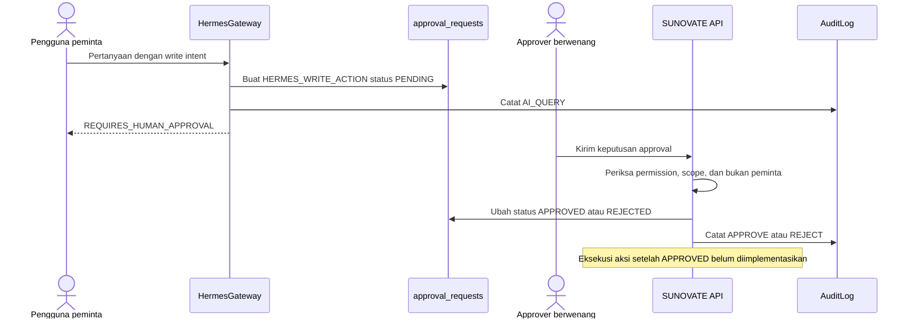

# Human Approval

**Status:** PROPOSED
**Last Updated:** 2026-10-01

## Purpose

Menetapkan bahwa setiap aksi tulis yang diminta melalui Hermes memerlukan persetujuan manusia yang berwenang, serta menjelaskan bagian alur yang sudah dan belum diimplementasikan.

## Confirmed Information

- **CONFIRMED** Write intent yang terdeteksi Hermes menghasilkan decision `REQUIRES_HUMAN_APPROVAL`, membuat approval request berstatus PENDING, dan tidak pernah dieksekusi oleh Hermes (sumber: fact sheet bagian 9).
- **CONFIRMED** Tipe approval request: KNOWLEDGE_PUBLICATION, HERMES_WRITE_ACTION, DOCUMENT_VERSION, ACCESS_EXCEPTION. Status: PENDING, APPROVED, REJECTED, CANCELLED, EXPIRED (sumber: fact sheet bagian 6).
- **CONFIRMED** Hermes tidak mengakses database secara langsung (sumber: brief sesi 2026-10-01).
- **PROPOSED** Approver tidak pernah boleh memutuskan permintaannya sendiri (separation of duties) (sumber: fact sheet bagian 5).

## Alur

## Status implementasi

| Langkah | Status |
|---|---|
| Deteksi write intent oleh `ScopeGuard` | IMPLEMENTED (berbasis aturan) |
| Pembuatan approval request PENDING | IMPLEMENTED |
| Daftar approval `GET /api/v1/approvals` | IMPLEMENTED |
| Keputusan `POST /api/v1/approvals/{id}/decision` dengan permission `approval:decide` | IMPLEMENTED |
| Penolakan keputusan oleh peminta sendiri (separation of duties) | IMPLEMENTED: API 403 `SEPARATION_OF_DUTIES` + CHECK `decided_by <> requested_by` di DB; diuji |
| Audit `APPROVE` dan `REJECT` | IMPLEMENTED |
| Eksekusi aksi oleh SUNOVATE API setelah APPROVED | **NOT IMPLEMENTED**, PROPOSED |
| Kedaluwarsa otomatis menjadi EXPIRED | PROPOSED |
| Notifikasi kepada approver dan peminta | PROPOSED; `NOTIFICATION_PROVIDER=disabled` |

Pada scaffold, approval request berstatus APPROVED tidak memicu perubahan data apa pun. Pengguna perlu melakukan aksi tersebut melalui fitur aplikasi biasa dengan permission yang sesuai.

## Desain eksekusi (PROPOSED)

- Eksekusi dilakukan oleh SUNOVATE API melalui application service yang sama dengan fitur biasa, bukan oleh Hermes.
- Sebelum eksekusi, API memeriksa ulang otorisasi peminta dan approver pada saat eksekusi, bukan hanya saat permintaan dibuat.
- Payload aksi disimpan secara terstruktur pada approval request dan tidak dapat diubah setelah PENDING; perubahan payload memerlukan request baru.
- Pembaruan record target memakai optimistic concurrency `revision`; bila record berubah sejak permintaan dibuat, eksekusi ditolak dengan `REVISION_CONFLICT` (409) (ADR-011).
- Setiap eksekusi dicatat di audit log dengan tautan ke approval request.
- Publikasi knowledge hanya terjadi melalui approval request bertipe `KNOWLEDGE_PUBLICATION` yang disetujui (sumber: fact sheet bagian 5).

## Siapa yang boleh memutuskan

- **PROPOSED** Role dengan `approval:decide`: knowledge_coordinator, team_lead, reviewer (lihat [permission-matrix.md](../06-security/permission-matrix.md)). Keputusan tetap dibatasi team scope dan klasifikasi record target.
- **OPEN QUESTION** Alur persetujuan publikasi knowledge dan siapa yang berwenang memutuskan (OQ-12). Apakah team_lead boleh menerbitkan knowledge juga masih terbuka.
- **OUT OF SCOPE** Dokumen ini tidak menetapkan jabatan, rantai persetujuan, atau kewenangan staf yang sebenarnya.

## Kedaluwarsa (PROPOSED)

- Approval request yang tidak diputuskan dalam jangka waktu tertentu berubah menjadi EXPIRED dan tidak dapat lagi disetujui.
- Peminta dapat membatalkan request miliknya selama PENDING (status CANCELLED).
- Jangka waktu kedaluwarsa belum ditetapkan dan menjadi bagian dari OQ-12.

## Risks

- R-04 Jawaban AI dianggap keputusan.
- R-01 Asumsi proses bisnis tanpa validasi.

## Acceptance Criteria

- Tidak ada perubahan data yang terjadi langsung dari percakapan Hermes.
- Peminta tidak dapat memutuskan request miliknya sendiri.
- Setiap keputusan tercatat di audit log dengan aksi `APPROVE` atau `REJECT`.
- Request EXPIRED, REJECTED, atau CANCELLED tidak dapat dieksekusi.

## Related Documents

- [review-and-approval.md](../12-governance/review-and-approval.md)
- [scope-guard.md](./scope-guard.md)
- [hermes-overview.md](./hermes-overview.md)
- [audit-logging.md](../06-security/audit-logging.md)
- [endpoint-catalog.md](../07-api/endpoint-catalog.md)
