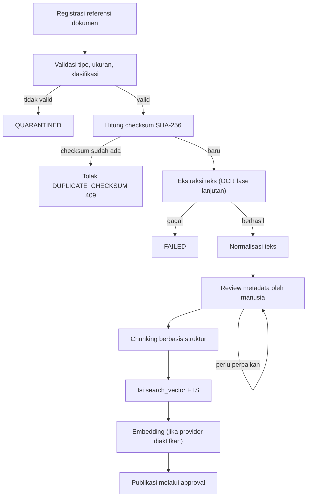

# Ingestion Pipeline

**Status:** PROPOSED
**Last Updated:** 2026-10-15

## Purpose

Menjelaskan alur usulan untuk memasukkan dokumen ke knowledge repository dan indeks retrieval Hermes, mulai dari registrasi referensi sampai publikasi, termasuk penanganan kegagalan.

## Confirmed Information

- **CONFIRMED** File tidak disimpan sebagai BLOB; SUNOVATE hanya menyimpan referensi, metadata, checksum SHA-256, versi, klasifikasi, dan lokasi provider (sumber: ADR-003).
- **CONFIRMED** Duplikasi ingestion diblokir oleh unique constraint (`document_reference_id`, `checksum_sha256`); API mengembalikan `DUPLICATE_CHECKSUM` (409) (sumber: fact sheet bagian 6 dan 9).
- **CONFIRMED** Nilai `extraction_status`: PENDING, EXTRACTED, FAILED, QUARANTINED, NOT_APPLICABLE (sumber: fact sheet bagian 6).
- **CONFIRMED** Hanya knowledge berstatus PUBLISHED yang masuk pencarian default dan retrieval Hermes (sumber: fact sheet bagian 6).
- **CONFIRMED** Duplikasi ingestion termasuk skenario uji wajib (sumber: Proposal v2.4, slide 20).

## Status implementasi

- **IMPLEMENTED** Registrasi versi dokumen melalui `POST /api/v1/documents/{id}/versions` dengan permission `document:version`, penolakan checksum ganda, dan audit `VERSION_REGISTER`.
- **IMPLEMENTED (DEVELOPMENT PREVIEW)** Ekstraksi Python di memori tersedia melalui `POST /api/v1/knowledge/extract-preview` dan layar `/knowledge/ingestion-preview` untuk berkas TXT, MD, PDF, DOCX, XLSX, dan XLS bernama awal `SIMULASI`. Batas umum 2 MB dan 100.000 karakter; PDF maksimal 50 halaman; DOCX maksimal 500 entri/10 MB isi; Excel maksimal 20 lembar, 5.000 baris per lembar, 100 kolom, dan 50.000 sel berisi. PDF terenkripsi, format palsu, konten biner, tipe yang tidak cocok, makro, serta tautan data luar Excel ditolak. Rumus Excel tidak dijalankan dan berkas sumber tidak disimpan.
- **IMPLEMENTED (DEVELOPMENT PREVIEW)** Preview berhasil mengembalikan riwayat `PENDING → EXTRACTED` dan arahan pemeriksaan manusia. Pelanggaran batas/keamanan menghasilkan `QUARANTINED`; kegagalan pembacaan menghasilkan `FAILED`. Status penolakan hanya tercatat pada respons dan audit karena tidak ada file atau versi dokumen yang dipersistenkan.
- **IMPLEMENTED (DEVELOPMENT PREVIEW)** Teks hasil ekstraksi dan teks pada jalur simpan draf diperiksa terhadap indikasi prompt injection setelah normalisasi Unicode. Temuan menghasilkan `QUARANTINED`/`PROMPT_INJECTION_SUSPECTED`, tidak membuat draf atau chunk, dan diarahkan ke pemeriksaan manusia.
- **IMPLEMENTED (DEVELOPMENT PREVIEW)** Pemotongan struktur deterministik dapat dijalankan melalui `POST /api/v1/knowledge/chunk-preview`. Pengguna dengan gabungan kewenangan pemeriksa, pembuat knowledge, pendaftar dokumen, dan pendaftar versi dapat mengesahkan teks hasil pemeriksaan lalu menyimpannya melalui `POST /api/v1/knowledge/chunk-drafts` sebagai `SIMULATED_DATA` berstatus DRAFT. Draf tidak masuk pencarian umum maupun SAVI.
- **IMPLEMENTED (DEVELOPMENT PREVIEW)** Pencarian draf terpisah tersedia pada `/knowledge/drafts` dan `GET /api/v1/knowledge/drafts/search`. Penyaringan pemilik/pemeriksa, tim, dan klasifikasi dilakukan sebelum pencocokan judul, ringkasan, atau bagian. Jalur ini tidak digunakan retrieval SAVI dan audit hanya mencatat panjang kata kunci serta jumlah hasil.
- **PROPOSED** Ekstraksi dokumen resmi/produksi, pemindai malware, penyimpanan objek, review hasil ekstraksi formal, normalisasi produksi, embedding, dan OCR.

## Alur usulan

## Tahapan

1. **Registrasi referensi.** Pengguna dengan `document:create` mendaftarkan referensi, metadata awal, klasifikasi, tim pemilik, dan `sharing_scope`. File tetap di lokasi provider (`DOCUMENT_PROVIDER=local` pada pengembangan).
2. **Validasi.** Tipe file, ukuran, dan klasifikasi diperiksa. Dokumen dengan klasifikasi di atas `HERMES_MAX_CLASSIFICATION` tetap dapat tercatat di repository sesuai hak akses, tetapi tidak diindeks untuk Hermes. Daftar format yang disetujui dan batas ukuran adalah **OPEN QUESTION** OQ-04.
3. **Dedupe checksum.** Checksum SHA-256 dihitung; pasangan referensi dan checksum yang sama ditolak.
4. **Ekstraksi.** Teks diekstrak dari format yang didukung. **PROPOSED** OCR untuk dokumen hasil pindai ditambahkan pada fase lanjutan setelah alat dan lokasi pemrosesan disetujui (OQ-11).
5. **Normalisasi.** Membersihkan header/footer berulang, nomor halaman, kata penyambung halaman, dan spasi; mempertahankan penanda struktur seperti Pasal, ayat, langkah, dan bagian. **PROPOSED** Penanda pada teks ekstraksi tidak dapat diasumsikan bersih: telaah Kompilasi Peraturan SUN menemukan spasi hilang ("Pasal29", "Pasal30", PMK 168/2019, hal. 155; "Pasal42", PMK 215/2019, hal. 112), kata penyambung halaman berulang ("(2) Surat...", UU 24/2002, hal. 5), dan galat karakter. Deteksi penanda Pasal dan ayat karena itu toleran terhadap spasi hilang dan galat OCR, dan hasil deteksi penanda ditinjau manusia sebelum chunking. Rincian pola: [chunking-strategy.md](./chunking-strategy.md).
6. **Review metadata manusia.** Knowledge owner atau reviewer memeriksa judul, jenis knowledge, klasifikasi, tim pemilik, versi, dan relasi regulasi. Pada mode pengembangan, pemeriksa dapat melihat bagian, jumlah kata, isi, dan kode pemeriksaan. Akun yang juga memiliki seluruh kewenangan tulis terkait dapat menyimpan hasil sebagai draf simulasi; tindakan ini bukan persetujuan publikasi. Knowledge owner dan reviewer per tim adalah ketua tim dan PIC yang ditunjuk (**CONFIRMED (knowledge owner, deck v1_ slide 24)**, OQ-09); penunjukan orangnya adalah **OPEN QUESTION**.
7. **Chunking.** Mengikuti [chunking-strategy.md](./chunking-strategy.md).
8. **FTS.** `document_chunks.search_vector` diisi dan diindeks GIN.
9. **Embedding.** Hanya jika `EMBEDDING_PROVIDER` diaktifkan setelah model disetujui; hasil disimpan di `embedding_references` dengan `model_name` dan `dimensions` (ADR-009).
10. **Publikasi.** Knowledge masuk retrieval hanya setelah berstatus PUBLISHED melalui approval request bertipe `KNOWLEDGE_PUBLICATION`.

## Penanganan kegagalan

| Kondisi | Status | Tindak lanjut usulan |
|---|---|---|
| Tipe, ukuran, atau klasifikasi tidak valid | QUARANTINED | Tidak diproses lebih lanjut; dicatat sebagai `data_quality_issues` |
| Teks menyerupai instruksi untuk AI terdeteksi | QUARANTINED | Ditinjau manusia sebelum dipakai (lihat [prompt-injection-defense.md](./prompt-injection-defense.md)) |
| Ekstraksi gagal | FAILED | Dapat diulang setelah perbaikan; tidak masuk indeks |
| Checksum ganda | Ditolak | Respons `DUPLICATE_CHECKSUM` (409) |
| File tanpa teks yang relevan | NOT_APPLICABLE | Referensi tetap ada, tidak diindeks |

Chunk dari dokumen berstatus FAILED atau QUARANTINED tidak pernah masuk retrieval.

Pemeriksaan manusia tidak menjadi nilai baru `extraction_status`. Setelah `EXTRACTED`, teks yang sudah diperiksa hanya dapat disimpan sebagai knowledge `DRAFT`, lalu mengikuti alur `IN_REVIEW` dan `PUBLISHED` yang terpisah.

## Data pengembangan

- **CONFIRMED** Hanya SIMULATED_DATA yang digunakan pada pengembangan; data internal atau keuangan asli tidak boleh dimasukkan (sumber: AGENTS.md, [simulated-data-policy.md](../04-data/simulated-data-policy.md)).
- **CONFIRMED** File sumber PDF/PPTX di root dikecualikan dari git sampai klasifikasinya dikonfirmasi (sumber: ADR-014). Penyimpanan di repository Git adalah **OPEN QUESTION** OQ-18.

## Open Questions

- OQ-04 Dokumen dan format apa yang boleh masuk repository dan RAG.
- OQ-05 Klasifikasi tiap jenis dokumen.
- OQ-06 SharePoint sebagai sumber utama atau hanya referensi.
- OQ-09 Knowledge owner dan reviewer per tim.
- OQ-11 Alat ekstraksi/OCR dan embedding yang diizinkan serta lokasi pemrosesan.
- OQ-30 Pemetaan rujukan tak bernomor dalam regulasi ke regulasi bernomor.
- OQ-31 Regulasi tambahan di luar kompilasi yang perlu dimasukkan dan penyedia teks resminya.
- OQ-32 Validasi teks ekstraksi regulasi terhadap PDF atau sumber resmi, dan apakah teks yang belum divalidasi boleh dikutip Hermes.

## Risks

- R-03 Data asli/sensitif masuk repository atau log.
- R-07 Prompt injection dari dokumen.
- R-11 Kualitas metadata rendah sehingga retrieval buruk.

## Acceptance Criteria

- Unggahan ulang file dengan checksum sama pada referensi yang sama ditolak dengan 409.
- Dokumen FAILED atau QUARANTINED tidak muncul di pencarian maupun Hermes.
- Tidak ada chunk masuk retrieval sebelum knowledge berstatus PUBLISHED.

## Related Documents

- [document-lifecycle.md](../02-business/document-lifecycle.md)
- [metadata-schema.md](../04-data/metadata-schema.md)
- [data-quality.md](../04-data/data-quality.md)
- [chunking-strategy.md](./chunking-strategy.md)
- [rag-architecture.md](./rag-architecture.md)
