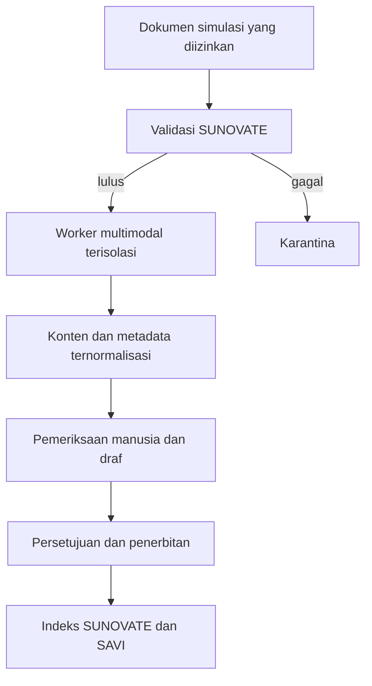

# Pilot RAG-Anything untuk SUNOVATE

**Status:** PROPOSED, NOT ENABLED
**Last Updated:** 2026-10-16

## Tujuan

Menilai RAG-Anything sebagai pemroses dokumen multimodal tambahan untuk SUNOVATE tanpa menggantikan kontrol akses, siklus pemeriksaan, PostgreSQL, atau SAVI AI. Dokumen ini bukan persetujuan memakai data internal dan bukan bukti integrasi produksi.

## Keputusan sementara

- **PROPOSED**: gunakan RAG-Anything hanya sebagai adapter ekstraksi opsional untuk dokumen kompleks seperti PDF, dokumen Office, tabel, gambar, rumus, dan hasil pindai.
- **PROPOSED**: jalankan sebagai proses worker terisolasi. Hasilnya berupa konten dan metadata ternormalisasi yang kembali melewati pemeriksaan SUNOVATE.
- **CONFIRMED**: otorisasi, lingkup tim, klasifikasi, audit, status draf, persetujuan manusia, publikasi, retrieval, dan sitasi tetap menjadi tanggung jawab SUNOVATE (sumber: ADR-003, ADR-004, ADR-006).
- **NOT ENABLED**: paket RAG-Anything belum menjadi dependency aplikasi, belum memproses dokumen SUN, dan tidak memiliki akses ke database atau jaringan eksternal.

## Batas arsitektur

Worker tidak boleh:

1. membaca lokasi file di luar volume input sementara yang ditentukan;
2. menerima referensi gambar Markdown ke path lokal atau URL eksternal;
3. mengirim isi dokumen ke LLM, VLM, OCR, telemetry, atau API eksternal;
4. menulis langsung ke tabel knowledge, chunk, embedding, atau audit;
5. menerbitkan hasil, menentukan klasifikasi, atau melewati pemeriksaan manusia;
6. memakai working directory lokalnya sebagai penyimpanan resmi.

## Versi dan supply chain

- Kandidat awal dikunci minimal ke `raganything==1.4.2`; versi `1.4.1` dilarang karena catatan keamanan upstream mengenai referensi gambar Markdown ke file lokal.
- Versi final harus dikunci secara eksak atau ke commit yang telah ditinjau. Perubahan versi membutuhkan pengujian ulang.
- Sebelum pemasangan: verifikasi lisensi MIT dan notice, buat SBOM, jalankan pemeriksaan dependency, tinjau dependency transitif LightRAG/MinerU, dan catat checksum artefak.
- Status upstream Beta diperlakukan sebagai risiko operasional. SUNOVATE harus memiliki fallback ke ekstraktor Python deterministik yang sudah ada.

## Tahap pilot

| Tahap | Cakupan | Keluarannya | Gate |
|---|---|---|---|
| P0 | Preflight tanpa dependency | Pemeriksaan versi, lokasi input/output, label simulasi, dan kebijakan jaringan | Tidak membaca isi dokumen |
| P1 | Parser-only, tanpa model eksternal | Teks, tabel, struktur halaman, dan metadata dari fixture sanitasi | OQ-11 dan review keamanan |
| P2 | OCR lokal | Hasil dokumen pindai dengan jejak halaman | Alat, host, dan resource disetujui |
| P3 | Elemen visual | Deskripsi tabel/gambar yang dapat ditelusuri ke sumber | VLM lokal atau provider disetujui |
| P4 | Evaluasi opsi graph | Perbandingan kualitas terhadap baseline FTS/hybrid SUNOVATE | Hanya bila metrik membuktikan manfaat |

Knowledge graph penuh, model eksternal, dan penggantian retrieval SAVI tidak termasuk P0 atau P1.

## Dataset dan metrik

Pilot hanya memakai fixture `SIMULATED_DATA` atau dokumen publik yang sudah disanitasi dan disetujui. Minimal mencakup PDF teks, PDF pindai, DOCX, PPTX, XLSX/XLS, tabel lintas halaman, gambar, rumus, dan file rusak.

| Metrik | Gate awal |
|---|---|
| Kebocoran data atau akses path di luar sandbox | 0 |
| Panggilan jaringan tidak diizinkan | 0 |
| Ketertelusuran halaman/sheet sumber | 100% elemen yang diterima |
| Dokumen gagal yang masuk indeks | 0 |
| Hasil tanpa pemeriksaan yang terbit | 0 |
| Akurasi ekstraksi teks/tabel | Dibandingkan baseline dan divalidasi manusia |
| Waktu, RAM, CPU, serta ruang sementara | Dicatat pada komputer target sebelum keputusan adopsi |

## Kasus keamanan wajib

- Markdown image reference ke path absolut, path traversal, symlink, dan URL eksternal.
- File palsu berdasarkan ekstensi, file rusak, PDF terenkripsi, macro, formula, external link, dan embedded object.
- Zip bomb/decompression bomb, jumlah halaman/sheet ekstrem, image bomb, timeout, kehabisan disk, dan penghentian proses.
- Prompt injection dalam teks, tabel, gambar, metadata, dan hidden text.
- Ekstraksi bersamaan, kegagalan parsial, retry, serta jaminan hasil gagal tidak ditandai selesai.

## Kriteria keputusan

Adopsi parser-only dapat dipertimbangkan bila memberi peningkatan terukur pada tabel, layout, OCR, atau ketertelusuran sumber tanpa menurunkan keamanan dan biaya operasional. Full multimodal atau graph tetap ditolak bila manfaatnya tidak melampaui baseline Python + PostgreSQL yang lebih sederhana.

## Rujukan upstream

- Repository: <https://github.com/HKUDS/RAG-Anything>
- Rilis keamanan yang ditinjau: <https://github.com/HKUDS/RAG-Anything/releases/tag/v1.4.2>
- Lisensi: <https://github.com/HKUDS/RAG-Anything/blob/main/LICENSE>

## Related Documents

- [ingestion-pipeline.md](./ingestion-pipeline.md)
- [rag-architecture.md](./rag-architecture.md)
- [prompt-injection-defense.md](./prompt-injection-defense.md)
- [rag-testing.md](../10-testing/rag-testing.md)
- [risk-register.md](../12-governance/risk-register.md)
