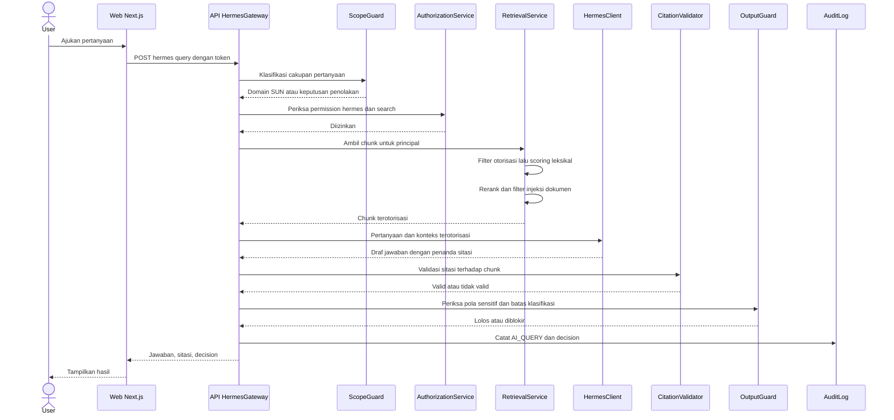
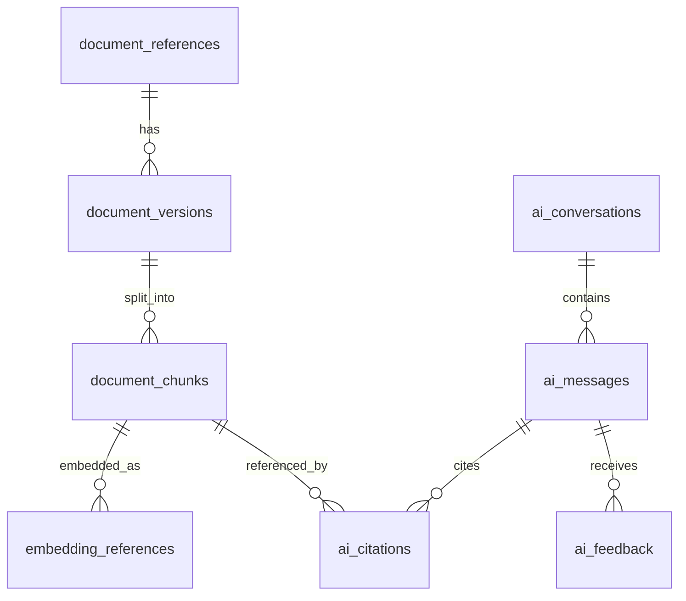

# RAG Architecture

**Status:** PROPOSED
**Last Updated:** 2026-10-02

## Purpose

Menjelaskan arsitektur Retrieval-Augmented Generation (RAG) Hermes: urutan pemrosesan pertanyaan, batas otorisasi, serta desain target penyimpanan di PostgreSQL.

## Confirmed Information

- **CONFIRMED** Arsitektur modular monolith; backend FastAPI + SQLAlchemy 2 + Alembic; penyimpanan tunggal PostgreSQL dengan full-text search dan pgvector (sumber: brief sesi 2026-10-01, ADR-001, ADR-003).
- **CONFIRMED** Hermes tidak mengakses database secara langsung; `HermesGateway` hanya meneruskan konteks yang sudah diotorisasi ke runtime Hermes (sumber: ADR-004).
- **CONFIRMED** Authorization = permission AND team scope AND data classification, deny by default, ditegakkan di API (sumber: ADR-006, prinsip dari brief sesi 2026-10-01).

## Prinsip utama

Hermes hanya menerima konteks yang sudah diotorisasi. Filter otorisasi dijalankan oleh `RetrievalService` sebelum scoring, sehingga chunk yang tidak boleh dibaca pengguna tidak pernah menjadi kandidat, tidak memengaruhi peringkat, dan tidak pernah dikirim ke `HermesClient`. Otorisasi tidak bergantung pada instruksi di prompt.

## Alur RAG (IMPLEMENTED pada scaffold)

Catatan alur:

- Jika `ScopeGuard` menghasilkan keputusan penolakan, alur berhenti dan respons berisi decision `REFUSED_OUT_OF_SCOPE`, `REFUSED_GENERAL_CODING`, atau `REFUSED_POLICY`. Jika terdeteksi write intent, approval request PENDING dibuat dan decision `REQUIRES_HUMAN_APPROVAL` dikembalikan.
- Jika tidak ada chunk terotorisasi yang memadai atau sitasi gagal divalidasi, decision `INSUFFICIENT_EVIDENCE`.
- Jika `OutputGuard` memblokir, decision `BLOCKED_BY_OUTPUT_GUARD`.
- Jika permission tidak dimiliki, API mengembalikan `PERMISSION_DENIED` (403) dan mencatat `ACCESS_DENIED`.

## Status implementasi

| Aspek | Status | Keterangan |
|---|---|---|
| Penyimpanan runtime | IMPLEMENTED | `DATA_BACKEND=simulated`, in-memory store dari dataset SIMULATED_DATA (ADR-007) |
| Retrieval | IMPLEMENTED | Leksikal atas chunk PUBLISHED terotorisasi di simulated store |
| Rerank | IMPLEMENTED | Leksikal |
| Penyusun jawaban | IMPLEMENTED | `development_extractive`, deterministik, tanpa model eksternal dan tanpa jaringan (ADR-008) |
| Filter injeksi, CitationValidator, OutputGuard, audit | IMPLEMENTED | Lihat dokumen terkait |
| Repository berbasis SQLAlchemy | IMPLEMENTED (ADR-015, PROPOSED) | `DATA_BACKEND=postgres`; `simulated` tetap default. Retrieval Hermes tetap leksikal pada kedua backend; FTS dan pgvector belum dipakai runtime |
| Embedding dan semantic retrieval | PROPOSED | `EMBEDDING_PROVIDER=disabled` |
| Hybrid FTS + vektor dengan reciprocal rank fusion | PROPOSED | Lihat [retrieval-strategy.md](./retrieval-strategy.md) |
| Cross-encoder rerank | PROPOSED | Menunggu persetujuan model (OQ-11) |
| LLM yang disetujui | PROPOSED | **OPEN QUESTION** OQ-11 |
| OCR | PROPOSED | Lihat [ingestion-pipeline.md](./ingestion-pipeline.md) |

## Desain target PostgreSQL (PROPOSED)

Tabel terkait berasal dari revisi Alembic `0001_initial_schema` (sumber: fact sheet bagian 6):

- `document_references` dan `document_versions`: referensi file eksternal, metadata, checksum SHA-256, versi, klasifikasi, lokasi provider. File tidak disimpan sebagai BLOB (ADR-003).
- `document_chunks`: potongan teks hasil ekstraksi. Kolom `search_vector` (tsvector) dengan indeks GIN untuk full-text search.
- `embedding_references`: menyimpan `model_name` dan `dimensions`. Kolom vektor tidak bertipe dimensi tetap (untyped) dan belum ada indeks ANN sampai model dan dimensi disetujui (ADR-009).
- `ai_conversations`, `ai_messages`, `ai_citations`, `ai_feedback`: riwayat percakapan, sitasi, dan umpan balik.
- `audit_logs`: append-only, ditegakkan trigger PostgreSQL yang menolak UPDATE/DELETE (ADR-010).

Diagram relasi di atas bersifat konseptual; nama kolom foreign key mengikuti [database-schema.md](../04-data/database-schema.md).

## Open Questions

- OQ-04 Dokumen apa yang boleh masuk repository dan RAG.
- OQ-05 Klasifikasi dan hak akses setiap jenis dokumen.
- OQ-11 Model AI/LLM dan embedding, lokasi pemrosesan, residensi data.

## Risks

- R-02 Kebocoran data melalui pencarian/Hermes.
- R-07 Prompt injection dari dokumen.
- R-10 Simulated store disangka persistence produksi.
- R-11 Kualitas metadata rendah sehingga retrieval buruk.

## Acceptance Criteria

- Tidak ada chunk di luar hak akses pengguna yang muncul pada kandidat retrieval, konteks Hermes, maupun sitasi.
- Runtime Hermes tidak memegang kredensial database.
- Setiap respons memiliki header `X-Request-ID` dan entri audit terkait.

## Related Documents

- [hermes-overview.md](./hermes-overview.md)
- [retrieval-strategy.md](./retrieval-strategy.md)
- [ingestion-pipeline.md](./ingestion-pipeline.md)
- [data-architecture.md](../04-data/data-architecture.md)
- [architecture-decisions.md](../03-architecture/architecture-decisions.md)
- [authorization-rbac.md](../06-security/authorization-rbac.md)
