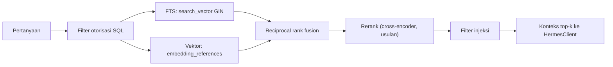

# Retrieval Strategy

**Status:** IN PROGRESS
**Last Updated:** 2026-10-14

## Purpose

Menjelaskan cara Hermes dan pencarian memilih chunk: filter otorisasi, scoring yang berjalan saat ini, desain hybrid yang diusulkan, serta ambang untuk menyatakan bukti tidak cukup.

## Confirmed Information

- **CONFIRMED** Authorization = permission AND team scope AND data classification, deny by default (sumber: ADR-006, brief sesi 2026-10-01).
- **CONFIRMED** Hanya knowledge PUBLISHED yang masuk pencarian default dan retrieval Hermes (sumber: fact sheet bagian 6).
- **CONFIRMED** Filter otorisasi dijalankan sebelum scoring (sumber: fact sheet bagian 9).
- **CONFIRMED** `HERMES_MAX_CLASSIFICATION=RESTRICTED` pada pengembangan; CONFIDENTIAL tidak diproses Hermes pada pengembangan (sumber: fact sheet bagian 4).
- **CONFIRMED** Semantic retrieval masih PROPOSED sampai model embedding disetujui (sumber: ADR-008).

## Filter otorisasi (IMPLEMENTED)

Filter dijalankan sebelum scoring. Chunk yang tidak lolos tidak dihitung skornya, tidak memengaruhi peringkat, dan tidak dikirim ke `HermesClient`. Sebuah chunk menjadi kandidat hanya jika semua syarat berikut terpenuhi:

| Syarat | Aturan |
|---|---|
| Permission | Principal memiliki `hermes:query` dan `search:query` (untuk Hermes) atau `search:query` (untuk `GET /search`). |
| Status | Knowledge induk berstatus `PUBLISHED`. |
| Soft delete | `deleted_at` bernilai null pada knowledge, referensi dokumen, dan versi terkait. |
| Klasifikasi | rank(`clearance_code` pengguna) >= rank(`classification_code` record). |
| Batas Hermes | rank(`classification_code` record) <= rank(`HERMES_MAX_CLASSIFICATION`). |
| Team scope | `owner_team_id` termasuk tim pengguna, atau pengguna memiliki `scope:all_teams`, atau `sharing_scope = DIRECTORATE` dan record PUBLISHED. |

Rank klasifikasi: PUBLIC 0, INTERNAL 1, RESTRICTED 2, CONFIDENTIAL 3 (PROPOSED, NEEDS MENTOR VALIDATION; lihat [document-classification.md](../04-data/document-classification.md)). Kebijakan berbagi lintas tim untuk konten INTERNAL adalah **OPEN QUESTION** OQ-14.

Konsekuensi: pengguna dengan clearance INTERNAL tidak pernah menerima chunk RESTRICTED, meskipun pertanyaannya sangat relevan. Record yang tidak boleh dibaca dikembalikan sebagai 404 pada endpoint detail untuk mencegah kebocoran keberadaan.

## Scoring saat ini (IMPLEMENTED)

- Retrieval SAVI tetap leksikal atas chunk PUBLISHED terotorisasi pada kedua backend; scoring, rerank, dan evidence gate tetap di Python. Berbeda dari retrieval SAVI, endpoint `/search` dan `/knowledge/drafts/search` memakai `search_vector` berindeks GIN sebagai prefilter pada mode PostgreSQL, lalu menjalankan scoring `terms()` yang sama dengan mode simulated. Pemisahan ini mencegah perubahan diam-diam pada kualitas jawaban SAVI sebelum golden set FTS dievaluasi.
- Rerank leksikal terhadap kandidat.
- Evidence gate deterministik memisahkan rerank dari keputusan menjawab. Gate mencatat jumlah kandidat terotorisasi, coverage teratas, skor teratas, alasan keputusan, dan jumlah passage yang lolos pada audit tanpa menyimpan teks pertanyaan.
- Filter injeksi dokumen mengeluarkan chunk yang berisi teks menyerupai instruksi, setelah rerank dan sebelum penyusunan jawaban.
- Tidak ada embedding, tidak ada model eksternal, tidak ada panggilan jaringan.

Nilai yang dipakai kode scaffold saat ini (`hermes/retrieval.py`, `hermes/gateway.py`, semua **PROPOSED** dan dikalibrasi terhadap golden set simulasi):

| Parameter | Nilai | Arti |
|---|---|---|
| Kandidat | 20 | chunk terotorisasi teratas berdasarkan coverage term |
| Coverage | term query yang cocok di judul + label bagian + isi, dibagi jumlah term query | |
| Skor rerank | 0,6 x coverage + 0,4 x coverage isi saja | mencegah kecocokan judul saja dianggap bukti |
| `MIN_COVERAGE` | 0,6 | minimum coverage chunk teratas; dinaikkan 2026-10-11 setelah RAG-21 menemukan sumber umum yang tidak mendukung klaim spesifik |
| Term cocok minimum | 2 (atau 1 bila query hanya satu term) | |
| `MIN_SCORE` | 0,45 | minimum skor rerank chunk teratas dan chunk lain yang dipilih |
| `RELATIVE_CUTOFF` | 0,6 | chunk lain harus >= 60 persen skor teratas |
| `MAX_PASSAGES` | 3 | passage maksimum yang diberikan ke HermesClient |

Implementasi gate berada pada `EvidenceGate` di `hermes/retrieval.py`. Alasan penolakan dibedakan menjadi tidak ada kandidat, coverage tidak cukup, dukungan istilah tidak cukup, skor rerank tidak cukup, atau tidak ada passage yang melewati ambang relatif. Hanya passage berstatus `evidence_sufficient` yang dapat dikirim ke provider jawaban.

Kasus golden set RAG-16 (query yang hanya cocok dengan judul dan label "Langkah" dari SOP lain) memicu penambahan `MIN_SCORE`. RAG-21 memicu kenaikan `MIN_COVERAGE` karena kecocokan istilah umum SUN, regulasi, dan ketentuan belum membuktikan klaim "otomatis menghapus seluruh ketentuan lama".

## Desain hybrid (PROPOSED)

Repository SQLAlchemy sudah tersedia (ADR-015, mode `postgres`). Desain ini berlaku setelah model embedding disetujui (OQ-11) dan kanal FTS diuji tidak menurunkan recall golden set.

- **PROPOSED** Filter otorisasi diterapkan sebagai klausa WHERE pada kedua kanal, bukan pasca-filter.
- **IMPLEMENTED untuk endpoint pencarian, PROPOSED untuk SAVI** Kanal FTS memakai `knowledge_entries.search_vector` dan `document_chunks.search_vector` dengan konfigurasi `simple`. Pemakaian pada retrieval SAVI menunggu evaluasi recall golden set dan keputusan konfigurasi Bahasa Indonesia.
- **PROPOSED** Kanal vektor memakai `embedding_references` dengan `model_name` yang sama dengan embedding pertanyaan. Indeks ANN baru dibuat setelah model dan dimensi disetujui (ADR-009).
- **PROPOSED** Fusi dengan reciprocal rank fusion: skor = jumlah 1 / (k + rank) dari setiap kanal, dengan k = 60 sebagai nilai awal.
- **PROPOSED** Cross-encoder rerank hanya jika modelnya disetujui dan diproses di lokasi yang diizinkan (OQ-11). Tanpa itu, rerank leksikal tetap dipakai.
- **PROPOSED** Boost untuk metadata: kecocokan judul, jenis knowledge, dan relasi regulasi yang masih berlaku.

## Top-k (PROPOSED)

| Parameter | Nilai awal usulan | Catatan |
|---|---|---|
| Kandidat per kanal | 20 | Sebelum fusi |
| Kandidat setelah fusi untuk rerank | 20 | |
| Chunk konteks ke HermesClient | 5 | Dibatasi juga oleh anggaran token model yang disetujui |
| Chunk per dokumen dalam konteks | maksimal 3 | Menjaga keragaman sumber |

Nilai dikalibrasi dengan metrik retrieval hit@k pada [rag-evaluation.md](./rag-evaluation.md).

## Ambang bukti tidak cukup

Hermes mengembalikan `INSUFFICIENT_EVIDENCE` bila:

- **IMPLEMENTED** Tidak ada chunk terotorisasi yang tersisa setelah filter dan filter injeksi.
- **IMPLEMENTED** Jawaban tidak memiliki minimal satu sitasi valid (lihat [citation-policy.md](./citation-policy.md)).
- **IMPLEMENTED** Chunk teratas di bawah `MIN_COVERAGE`, `MIN_SCORE`, atau jumlah term cocok minimum (nilai di tabel di atas, PROPOSED untuk kalibrasi ulang).

Pesan kepada pengguna tidak boleh mengisyaratkan adanya dokumen yang tidak boleh dibaca pengguna. Pesan yang diusulkan: "Hermes belum menemukan sumber yang cukup pada dokumen yang dapat Anda akses untuk menjawab pertanyaan ini."

### Tindak lanjut bukti tidak cukup (IMPLEMENTED 2026-10-14)

- `low_coverage`: SAVI meminta pengguna memperjelas periode, dokumen, proses, atau unit terkait.
- Sitasi tidak valid atau tidak mendukung jawaban: SAVI meminta pemeriksaan pegawai yang berwenang.
- Tindak lanjut hanya berupa panduan pada layar. SAVI tidak otomatis menunjuk PIC, membuat tiket, mengirim notifikasi, mengubah data, atau memasukkan materi baru ke basis pengetahuan.
- Nama PIC, batas waktu layanan, kanal notifikasi, dan kewenangan publikasi tetap menunggu keputusan OQ-36.
- **IMPLEMENTED terbatas 2026-10-14:** jika pencarian pertama gagal dan pertanyaan memuat variasi ejaan yang terdaftar, SAVI mengulang pencarian satu kali. Daftar awal hanya mencakup `setelmen/settlement`, `ritel/retail`, `validasi/validation`, `verifikasi/verification`, dan `rekonsiliasi/reconciliation`.
- Retry mempertahankan seluruh konsep pertanyaan, filter otorisasi, batas klasifikasi, filter injeksi, ambang coverage, ambang score, serta validasi sitasi. Kata pertanyaan tidak dibuang dan ambang bukti tidak diturunkan.
- Jika tidak ada variasi terdaftar, pencarian tidak diulang. Ekspansi sinonim domain, perubahan istilah berbasis model, dan pencarian bebas tetap belum diimplementasikan karena memerlukan glosarium tervalidasi serta evaluasi retrieval.

## Open Questions

- OQ-05 Klasifikasi dan hak akses tiap jenis dokumen.
- OQ-11 Model embedding dan rerank, lokasi pemrosesan.
- OQ-14 Kebijakan `sharing_scope` lintas tim.

## Risks

- R-02 Kebocoran data melalui pencarian/Hermes.
- R-09 Klasifikasi tidak sesuai skema resmi.
- R-11 Kualitas metadata rendah sehingga retrieval buruk.

## Acceptance Criteria

- Kebocoran tanpa otorisasi pada golden set = 0.
- Record dengan klasifikasi di atas clearance pengguna, atau di atas `HERMES_MAX_CLASSIFICATION` untuk Hermes, tidak pernah muncul sebagai kandidat, konteks, maupun sitasi.
- Record dengan `deleted_at` terisi atau status selain PUBLISHED tidak pernah muncul.

## Related Documents

- [rag-architecture.md](./rag-architecture.md)
- [authorization-rbac.md](../06-security/authorization-rbac.md)
- [permission-matrix.md](../06-security/permission-matrix.md)
- [data-classification.md](../06-security/data-classification.md)
- [rag-evaluation.md](./rag-evaluation.md)
