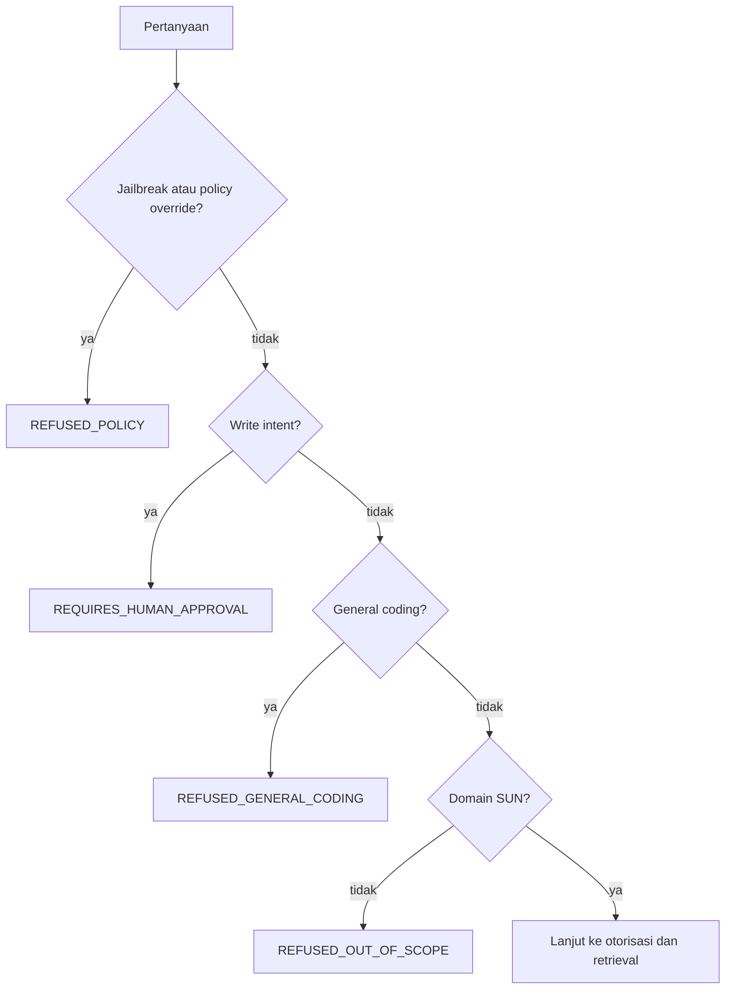

# Scope Guard

**Status:** PROPOSED
**Last Updated:** 2026-10-27

## Purpose

Menjelaskan `ScopeGuard`, lapisan pertama Hermes yang menilai apakah sebuah pertanyaan berada dalam cakupan sebelum retrieval dijalankan.

## Confirmed Information

- **CONFIRMED** `ScopeGuard` dijalankan sebelum otorisasi retrieval dan menilai empat hal: domain SUN, general coding, jailbreak/policy override, dan write intent (sumber: fact sheet bagian 9).
- **CONFIRMED** Write intent menghasilkan `REQUIRES_HUMAN_APPROVAL`, membuat approval request PENDING, dan tidak pernah dieksekusi (sumber: fact sheet bagian 9).
- **CONFIRMED** Jailbreak dan prompt injection termasuk skenario uji wajib (sumber: Proposal v2.4, slide 20).

## Kategori dan decision

| Kategori | Contoh pola | Decision | Lanjut ke retrieval |
|---|---|---|---|
| Domain SUN | Pertanyaan tentang regulasi, SOP, playbook, kajian, bahan rapat, lesson learned, atau pekerjaan tim | Tidak ada penolakan | Ya |
| Di luar domain | Topik umum yang tidak terkait knowledge Dit. SUN | `REFUSED_OUT_OF_SCOPE` | Tidak |
| General coding | Permintaan menulis, memperbaiki, atau menjelaskan kode program | `REFUSED_GENERAL_CODING` | Tidak |
| Jailbreak atau policy override | "abaikan instruksi sebelumnya", meminta system prompt, meminta berperan sebagai sistem lain, meminta melewati batas akses | `REFUSED_POLICY` | Tidak |
| Write intent | Meminta membuat, mengubah, menghapus, menerbitkan, mengirim, atau menyetujui sesuatu | `REQUIRES_HUMAN_APPROVAL` | Tidak; approval request PENDING dibuat |

Permintaan keputusan atau rekomendasi keuangan diperlakukan sebagai di luar cakupan (sumber batas: brief sesi 2026-10-01, SUNOVATE tidak mengambil keputusan keuangan).

## Implementasi saat ini (IMPLEMENTED)

- Berbasis aturan (heuristik pola kata dan frasa), deterministik, tanpa model eksternal.
- Normalisasi NFKC dan penghapusan karakter format Unicode dilakukan sebelum evaluasi untuk menutup variasi zero-width sederhana.
- Penyebutan bahasa pemrograman tidak otomatis ditolak bila pertanyaan memiliki konteks SUN/SUNOVATE; aksi membuat atau memperbaiki kode tetap `REFUSED_GENERAL_CODING`.
- Write intent memakai pola perintah, bukan setiap kemunculan kata kerja. Pertanyaan informasional tentang regulasi yang "menghapus" ketentuan tidak otomatis dibuatkan approval.
- Domain generik memerlukan pasangan konteks yang relevan; frasa seperti "review dokumen CV" tidak dianggap domain SUN hanya karena mengandung kata review dan dokumen.
- Daftar pola berada di modul Hermes pada `apps/api`; dokumen ini tidak menyalin daftar tersebut agar tidak terjadi perbedaan antara dokumen dan kode.
- Setiap keputusan dicatat di audit log bersama decision Hermes.
- **2026-10-21:** Pertanyaan pengguna juga diperiksa dalam bentuk leetspeak yang dinormalisasi (mis. `1gn0r3`), permintaan bermain peran sebagai admin/pengembang, dan muatan terenkode yang diminta untuk di-decode lalu dijalankan. Permintaan nilai rahasia (kata sandi, kredensial, kunci API, isi `.env`, connection string) ditolak dengan alasan `secret_request`. Pola keputusan keuangan mencakup pertanyaan waktu terbaik membeli atau menjual SUN/SBN/ORI/SBR, dan permintaan menulis query SQL diperlakukan sebagai coding umum.
- Aturan khusus pertanyaan tersebut tidak diterapkan pada passage hasil retrieval, sehingga teks SOP biasa tentang kata sandi atau administrator tidak dianggap instruksi dan tidak membuang sumber yang sah. Pertanyaan tentang kebijakan kata sandi tetap diproses sebagai pertanyaan domain.

## Urutan evaluasi (PROPOSED)

Urutan ini mendahulukan kategori yang paling berisiko. Urutan aktual di kode (`apps/api/sunovate_api/hermes/scope_guard.py`): policy override, keputusan keuangan (juga `REFUSED_POLICY`), coding umum, write intent, lalu pemeriksaan domain SUN.

## Keterbatasan yang diketahui

- **False positive.** Pola deterministik masih dapat salah memahami kalimat kompleks. Regresi 2026-10-11 mengurangi false positive kata "menghapus" pada pertanyaan informasional dan penyebutan Python dalam konteks SUNOVATE.
- **False negative.** Parafrase, ejaan tidak baku, campuran bahasa, atau instruksi yang dipecah dapat lolos dari pola.
- **Tanpa konteks percakapan.** Penilaian per pertanyaan; upaya bertahap lintas pesan belum dideteksi.
- **Domain SUN.** Pola domain bergantung pada kosakata; pertanyaan domain yang memakai istilah tidak umum dapat tertolak sebagai di luar cakupan. Sejak 2026-10-26 (BUG-038) kosakata mencakup istilah inti Narasi SUN dan singkatan huruf kapital; kosakata ini hanya menentukan cakupan, bukan pemetaan makna yang tetap diatur OQ-37.

Karena keterbatasan ini, `ScopeGuard` bukan satu-satunya kontrol. Otorisasi di API, filter injeksi, `CitationValidator`, dan `OutputGuard` tetap berlaku (lihat [prompt-injection-defense.md](./prompt-injection-defense.md)).

## Rencana lanjutan (PROPOSED)

- Classifier berbasis model untuk cakupan dan intent, hanya setelah model dan lokasi pemrosesan disetujui (OQ-11). Aturan deterministik tetap dipertahankan sebagai lapisan dasar.
- Pengumpulan kasus false positive dan false negative dari `ai_feedback` ke golden set evaluasi.
- Metrik refusal accuracy dipantau di [rag-evaluation.md](./rag-evaluation.md).

## Contoh pesan penolakan (PROPOSED)

| Decision | Pesan |
|---|---|
| `REFUSED_OUT_OF_SCOPE` | "Pertanyaan ini berada di luar cakupan Hermes. Hermes hanya menjawab pertanyaan terkait knowledge Direktorat Surat Utang Negara yang tersedia di SUNOVATE." |
| `REFUSED_GENERAL_CODING` | "Hermes tidak melayani permintaan pemrograman umum. Silakan ajukan pertanyaan terkait dokumen, regulasi, atau proses kerja Dit. SUN." |
| `REFUSED_POLICY` | "Permintaan ini tidak dapat diproses karena bertentangan dengan kebijakan penggunaan Hermes." |
| `REQUIRES_HUMAN_APPROVAL` | "Hermes tidak menjalankan perubahan data secara langsung. Permintaan Anda telah dicatat sebagai permohonan persetujuan dan menunggu keputusan pihak berwenang." |

Pesan `REFUSED_POLICY` sengaja tidak menjelaskan pola yang terdeteksi agar tidak membantu upaya penghindaran.

## Risks

- R-07 Prompt injection dari dokumen.
- R-04 Jawaban AI dianggap fakta/keputusan.
- R-02 Kebocoran data melalui Hermes.

## Acceptance Criteria

- Seluruh kasus jailbreak dan write intent pada golden set menghasilkan decision yang benar.
- Tidak ada pertanyaan yang ditolak `ScopeGuard` mencapai `RetrievalService` atau `HermesClient`.
- Write intent tidak pernah mengubah data selain membuat approval request PENDING.

## Related Documents

- [hermes-overview.md](./hermes-overview.md)
- [prompt-injection-defense.md](./prompt-injection-defense.md)
- [human-approval.md](./human-approval.md)
- [rag-evaluation.md](./rag-evaluation.md)
