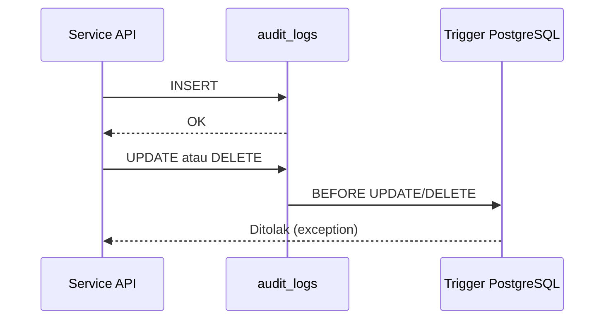

# Audit Logging

**Status:** PROPOSED
**Last Updated:** 2026-10-19

## Purpose

Menjelaskan apa yang dicatat di `audit_logs`, bagaimana integritasnya dijaga, apa yang tidak boleh dicatat, dan siapa yang boleh membacanya. Audit log mendukung ukuran keberhasilan traceability (sumber: Proposal v2.4, slide 23).

## Confirmed Information

- **CONFIRMED** `audit_logs` bersifat append-only; trigger PostgreSQL menolak UPDATE dan DELETE (sumber: ADR-010).
- **CONFIRMED** Audit log termasuk prioritas P0 MVP (sumber: Proposal v2.4, slide 11).
- **CONFIRMED** Action yang dicatat: `LOGIN`, `CREATE`, `UPDATE`, `SUBMIT`, `APPROVE`, `REJECT`, `ACCESS_DENIED`, `AI_QUERY`, `AI_FEEDBACK`, `VERSION_REGISTER`, `SEARCH` (sumber: implementasi `apps/api/sunovate_api/modules/`).
- **CONFIRMED** Penolakan otorisasi dicatat sebagai `ACCESS_DENIED` (sumber: implementasi scaffold sesi 2026-10-01).
- **CONFIRMED** Setiap respons membawa header `X-Request-ID`, dan log aplikasi berformat JSON dengan `request_id` (sumber: fact sheet bagian 9).
- **CONFIRMED** Endpoint `GET /api/v1/audit-logs` membutuhkan `audit:read`, yang dimiliki system_admin dan auditor (sumber: fact sheet bagian 5).
- **CONFIRMED** Pada scaffold, runtime memakai simulated store (`DATA_BACKEND=simulated`); trigger append-only berlaku pada skema PostgreSQL yang sudah divalidasi, sedangkan simulated store hanya di memori (sumber: ADR-007).

## Kapan dicatat

| Action | Pemicu |
|---|---|
| `LOGIN` | Login development berhasil (`SUCCESS`) atau email simulasi tidak dikenal (`DENIED`) |
| `CREATE` | Pembuatan rekaman, mis. knowledge entry |
| `UPDATE` | Perubahan rekaman, mis. knowledge entry atau tugas |
| `SUBMIT` | Knowledge entry diajukan untuk review |
| `APPROVE` | Approval request disetujui |
| `REJECT` | Approval request ditolak |
| `ACCESS_DENIED` | Permission tidak dimiliki, atau rekaman gagal team scope/klasifikasi |
| `AI_QUERY` | Pertanyaan ke Hermes beserta decision-nya |
| `AI_FEEDBACK` | Feedback atas jawaban Hermes |
| `VERSION_REGISTER` | Pendaftaran versi dokumen baru |
| `SEARCH` | Pencarian (hanya panjang query dan jumlah hasil; isi query tidak dicatat) |

Catatan implementasi: isi pertanyaan Hermes juga tidak dicatat di audit; `detail` hanya berisi decision, reason, jumlah sitasi, passage yang dikecualikan, dan panjang pertanyaan (diuji di `apps/api/tests/test_hermes.py`).

## Field (PROPOSED)

Daftar berikut adalah isi minimum yang diusulkan. Nama kolom final mengikuti migrasi `0001_initial_schema` dan [database-schema](../04-data/database-schema.md).

| Field | Isi |
|---|---|
| `id` | UUID |
| `created_at` | Waktu kejadian, UTC |
| actor | User id principal; kosong untuk request tidak terautentikasi |
| `action` | Salah satu action di atas |
| resource type dan resource id | Jenis dan id rekaman yang disentuh |
| outcome / alasan | Mis. kode error untuk `ACCESS_DENIED`, atau decision Hermes |
| request id | Nilai `X-Request-ID` untuk korelasi dengan log aplikasi |
| `classification_code` | Klasifikasi rekaman terkait, bila ada |
| `owner_team_id` | Tim pemilik rekaman terkait, bila ada |
| details | Metadata ringkas (JSON) tanpa konten |
| `data_origin` | `SIMULATED_DATA`, `USER_ENTERED`, atau `INTEGRATION` |

## Yang tidak pernah dicatat

- Secret, password, `DEV_AUTH_SECRET`, token Bearer, isi cookie, atau connection string.
- Isi lengkap dokumen dan isi lengkap chunk.
- Prompt lengkap yang memuat konteks RESTRICTED. Untuk `AI_QUERY` cukup dicatat id pesan, decision, id chunk/sitasi yang dipakai, dan klasifikasi tertinggi konteks.
- Data pribadi di luar identitas akun simulasi yang diperlukan untuk atribusi.

Aturan yang sama berlaku untuk log aplikasi JSON (lihat [observability](../11-operations/observability.md)).

Untuk paket demo, access log Nginx hanya mencatat metode dan path (`$request_method $uri`),
bukan `$request`, `$request_uri`, `$args`, atau `$query_string`. Tujuannya mencegah istilah
pencarian dan parameter URL masuk log proxy. `pnpm demo:preflight` menegakkan invariant ini.
Isi body, header Authorization, cookie, dan respons tidak ditambahkan ke format log.

## Integritas

- **CONFIRMED** Koreksi tidak dilakukan dengan mengubah baris; koreksi dicatat sebagai baris baru (konsekuensi ADR-010).
- **PROPOSED** Role database aplikasi produksi hanya diberi hak INSERT dan SELECT pada `audit_logs`.
- **PROPOSED** Ekspor audit log berkala ke penyimpanan terpisah setelah kebijakan retensi ditetapkan.

## Akses auditor

- **PROPOSED** Auditor membaca audit log lintas tim melalui `audit:read` dan `scope:all_teams`, dengan clearance RESTRICTED pada data simulasi.
- **PROPOSED** Auditor tidak memiliki permission tulis pada knowledge, dokumen, atau approval.
- **PROPOSED** Akses ke audit log juga dapat diaudit (siapa membaca kapan) bila diminta kebijakan.

## Open Questions

- **OPEN QUESTION** OQ-13 Retensi dan penghapusan audit log dan percakapan AI.
- **OPEN QUESTION** Siapa auditor resmi dan apakah pihak di luar Dit. SUN membutuhkan akses.

## Acceptance Criteria

- Setiap action pada daftar di atas menghasilkan baris audit pada skenario uji.
- UPDATE atau DELETE terhadap `audit_logs` di PostgreSQL gagal.
- Tidak ada token, secret, atau isi dokumen dalam audit log maupun log aplikasi pada uji.

## Kebersihan Log Aplikasi
- **CONFIRMED (implementasi, PROPOSED ADR-015)**: Log aplikasi untuk error tak tertangani tidak memuat pesan exception, nilai baris, teks SQL, atau parameter; hanya tipe error, SQLSTATE, dan lokasi stack. Audit log tetap satu-satunya catatan akuntabilitas; lihat [observability.md](../11-operations/observability.md).

## Related Documents

- [data-retention](../04-data/data-retention.md)
- [threat-model](threat-model.md)
- [incident-response](incident-response.md)
