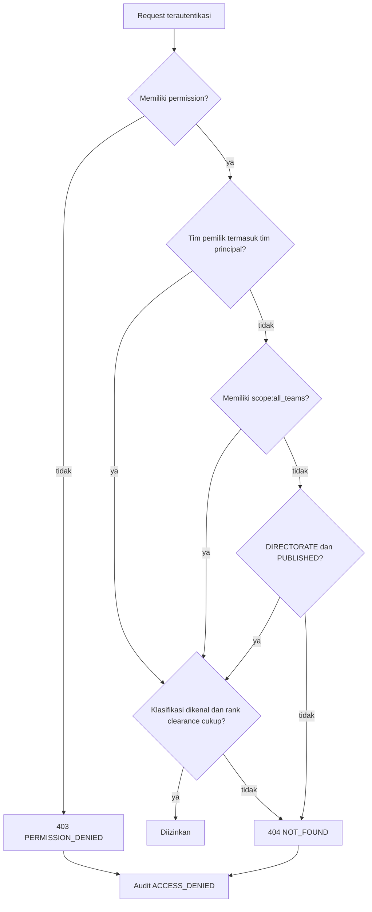

# Authorization dan RBAC

**Status:** PROPOSED
**Last Updated:** 2026-10-02

## Purpose

Menjelaskan model otorisasi SUNOVATE: role ke permission, team scope, klasifikasi data, dan `sharing_scope`, beserta algoritma evaluasi yang dijalankan API pada setiap endpoint terproteksi.

## Confirmed Information

- **CONFIRMED** Otorisasi = permission AND team scope AND data classification, deny by default, ditegakkan di API; penyembunyian menu di frontend hanya kosmetik (sumber: brief sesi 2026-10-01; ADR-006).
- **CONFIRMED** Setiap tim berperan sebagai konteks otorisasi Hermes (sumber: brief sesi 2026-10-01).
- **CONFIRMED** Hermes hanya menerima konteks yang sudah diotorisasi dan tidak memiliki kredensial database (sumber: ADR-004).
- **CONFIRMED** Algoritma evaluasi pada bagian di bawah sudah diimplementasikan pada scaffold (sumber: implementasi scaffold sesi 2026-10-01).
- **PROPOSED** Daftar role, permission, dan matriksnya (sumber: fact sheet bagian 5). Lihat [permission-matrix](permission-matrix.md).

## Model

| Elemen | Keterangan |
|---|---|
| Role | system_admin, knowledge_coordinator, team_lead, knowledge_owner, reviewer, staff, auditor, read_only (PROPOSED) |
| Permission | Kode `resource:action`, mis. `knowledge:read`; diberikan ke role melalui `role_permissions` |
| Principal | Pengguna terautentikasi beserta permission gabungan dari `user_roles`, daftar tim dari `team_memberships`, dan `clearance_code` |
| Team scope | Rekaman dimiliki `owner_team_id`; principal hanya membaca rekaman timnya, kecuali memiliki `scope:all_teams` atau rekaman dibagikan ke direktorat |
| Klasifikasi | `classification_code` dengan rank PUBLIC 0, INTERNAL 1, RESTRICTED 2, CONFIDENTIAL 3 |
| `sharing_scope` | `TEAM` (hanya tim pemilik) atau `DIRECTORATE` (semua tim, hanya saat `PUBLISHED`) |

`scope:all_teams` membuka akses lintas tim, tetapi tetap tunduk pada pemeriksaan klasifikasi.

## Algoritma evaluasi (CONFIRMED, scaffold)

Sebuah aksi pada rekaman diizinkan hanya jika ketiga syarat terpenuhi:

1. Principal memiliki permission yang dibutuhkan endpoint.
2. Team scope terpenuhi, yaitu salah satu dari:
   - `owner_team_id` rekaman termasuk tim principal, atau
   - principal memiliki `scope:all_teams`, atau
   - `sharing_scope` rekaman = `DIRECTORATE` dan rekaman berstatus `PUBLISHED`.
3. rank(clearance principal) >= rank(klasifikasi rekaman). Klasifikasi yang tidak dikenal selalu ditolak.

Hasil penolakan:

| Kondisi | Respons |
|---|---|
| Tidak terautentikasi | 401 `UNAUTHENTICATED` |
| Permission untuk aksi tidak dimiliki | 403 `PERMISSION_DENIED` |
| Rekaman tunggal ada tetapi gagal team scope atau klasifikasi | 404 `NOT_FOUND` (mencegah kebocoran keberadaan rekaman) |
| Daftar (list) | Rekaman yang tidak boleh dibaca tidak ditampilkan. PROPOSED: penyaringan dilakukan sebelum paginasi sehingga `meta.total` hanya menghitung rekaman yang boleh dibaca (verifikasi pada implementasi) |

Setiap penolakan ditulis ke `audit_logs` dengan action `ACCESS_DENIED`.

Catatan: penyaringan daftar menerapkan langkah yang sama per rekaman; rekaman yang gagal tidak ditampilkan, bukan menghasilkan 404.

## Aturan tambahan

- **PROPOSED** Separation of duties: approver tidak pernah memutuskan request miliknya sendiri (sumber: fact sheet bagian 5).
- **PROPOSED** Publikasi knowledge hanya melalui `approval_requests` bertipe `KNOWLEDGE_PUBLICATION` yang disetujui (sumber: fact sheet bagian 5).
- **CONFIRMED** Hanya knowledge `PUBLISHED` yang masuk pencarian default dan retrieval Hermes (sumber: fact sheet bagian 6).
- **CONFIRMED** Retrieval Hermes menyaring chunk yang boleh dibaca principal sebelum scoring, dan konteks dibatasi `HERMES_MAX_CLASSIFICATION=RESTRICTED` pada development (sumber: fact sheet bagian 4 dan 9).

## Usulan Perubahan dari Jawaban Knowledge Owner (PROPOSED, belum diimplementasikan)

**CONFIRMED (knowledge owner, deck v1_ slide 24)** Yang dapat mengubah data atau mengunggah adalah ketua tim, kasubdit PMP, Kasi MP, dan PIC yang ditunjuk (OQ-05). Model otorisasi di atas (permission AND team scope AND klasifikasi) tidak berubah. Yang diusulkan hanyalah isi matriks role ke permission:

- **PROPOSED** `team_lead` = ketua tim; `knowledge_owner` = PIC yang ditunjuk; `knowledge_coordinator` = peran tingkat PMP (kasubdit PMP, Kasi MP), dengan padanan jabatan yang perlu dikonfirmasi (OQ-25).
- **PROPOSED** Mencabut `knowledge:create`, `knowledge:update`, `knowledge:submit`, dan `document:create` dari role `staff`.
- **Belum diimplementasikan.** Saat ini `staff` masih memiliki keempat permission tersebut. Rincian, konsekuensi, dan syarat penerapan ada di [permission-matrix](permission-matrix.md). Pengakuan mentor atas jawaban masih tertunda (OQ-24).

## Lokasi penegakan di kode

| Komponen | Lokasi | Peran |
|---|---|---|
| Principal | `apps/api/sunovate_api/authz/` | Representasi pengguna terautentikasi, permission, tim, clearance |
| `AuthorizationService` | `apps/api/sunovate_api/authz/` | Evaluasi permission, team scope, klasifikasi, `sharing_scope` |
| FastAPI dependencies | `apps/api/sunovate_api/authz/` | Mewajibkan autentikasi dan permission per endpoint |
| Modul domain | `apps/api/sunovate_api/modules/` | Memanggil `AuthorizationService` untuk setiap rekaman dan daftar |
| `HermesGateway` | modul `hermes` | Memeriksa `hermes:query` dan `search:query`, lalu retrieval terotorisasi |

## Open Questions

- **CONFIRMED (knowledge owner, deck v1_ slide 24)** OQ-09 Knowledge owner dan reviewer di tiap tim adalah ketua tim dan PIC yang ditunjuk; pemetaan role dan penunjukan orang OPEN QUESTION (OQ-25).
- **OPEN QUESTION** OQ-12 Alur persetujuan publikasi dan siapa berwenang.
- **OPEN QUESTION** OQ-14 Kebijakan berbagi lintas tim untuk konten INTERNAL.
- **OPEN QUESTION** Apakah team_lead boleh mempublikasikan, dan apakah admin boleh membaca konten (sumber: fact sheet bagian 5).
- **OPEN QUESTION** OQ-01 dan OQ-02 memengaruhi daftar tim yang menjadi team scope.

## Acceptance Criteria

- Tidak ada endpoint terproteksi tanpa pemeriksaan permission di API.
- Rekaman tim lain yang tidak dibagikan menghasilkan 404, bukan 403.
- Pengguna dengan clearance INTERNAL tidak dapat membaca rekaman RESTRICTED, termasuk melalui pencarian dan Hermes.
- Setiap penolakan tercatat sebagai `ACCESS_DENIED`.

## Pemetaan peran rancangan dan kode (2026-10-21)

Peran di blueprint v0.5 adalah usulan. Katalog di `sunovate_api/authz/catalog.py` tetap berlaku sampai matriks peran sebenarnya divalidasi mentor (OQ peran dan akun). Penampil RAHASIA tidak bergantung pada peran: aksesnya diberikan per dokumen.

| Peran rancangan (PROPOSED) | Peran terdekat di kode | Catatan |
|---|---|---|
| PIMPINAN | belum ada padanan | perlu ditetapkan bersama matriks peran |
| KASUBDIT_PMP, KASI_MP | `knowledge_coordinator` | koordinasi pengetahuan lintas tim |
| KETUA_TIM | `team_lead` | |
| KNOWLEDGE_PIC | `knowledge_owner` | |
| STAFF | `staff` | |
| PIC_AUDIT_EKSTERNAL | `auditor` | baca jejak audit |
| ADMIN | `system_admin` | tidak mengubah substansi tanpa alur |

## Related Documents

- [permission-matrix](permission-matrix.md)
- [data-classification](data-classification.md)
- [audit-logging](audit-logging.md)
- [retrieval-strategy](../05-ai-rag/retrieval-strategy.md)
- [architecture-decisions](../03-architecture/architecture-decisions.md)
