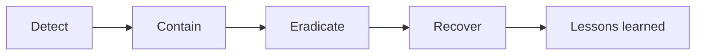

# Incident Response

**Status:** PROPOSED
**Last Updated:** 2026-10-01

## Purpose

Mengusulkan langkah penanganan insiden keamanan SUNOVATE selama pengembangan dan uji, terutama kebocoran data, akses tanpa izin, dan perilaku Hermes yang melanggar kebijakan. Prosedur ini belum disetujui dan harus diselaraskan dengan prosedur insiden resmi instansi.

## Confirmed Information

- **CONFIRMED** Usulan severity bug: P0 kebocoran/kehilangan data memblokir rilis; P1 fungsi utama gagal atau jawaban AI menyesatkan; P2 terganggu dengan workaround; P3 visual/minor (sumber: Proposal v2.4, slide 20).
- **CONFIRMED** Skenario uji wajib: akses tanpa izin, jailbreak, prompt injection, sitasi keliru, duplikasi ingestion, konflik pembaruan (sumber: Proposal v2.4, slide 20).
- **CONFIRMED** Pelaporan kerentanan dijelaskan di `SECURITY.md` pada root repository (sumber: fact sheet bagian 9).
- **CONFIRMED** Scaffold hanya memuat `SIMULATED_DATA`; insiden pada tahap ini umumnya menyangkut kontrol, bukan data asli (sumber: brief sesi 2026-10-01).

## Klasifikasi insiden (PROPOSED)

| Severity | Contoh insiden | Respons |
|---|---|---|
| P0 | Rekaman tim lain atau di atas clearance terbaca; Hermes mengutip konteks yang tidak berhak; secret atau data asli ter-commit; audit log dapat diubah | Hentikan rilis, tangani segera |
| P1 | Hermes memberi jawaban menyesatkan atau sitasi keliru; fungsi otorisasi gagal tertutup sehingga pengguna sah tidak bisa bekerja | Tangani dalam siklus kerja berjalan |
| P2 | Kontrol berjalan dengan workaround, mis. pesan error kurang jelas | Jadwalkan perbaikan |
| P3 | Masalah visual pada halaman keamanan | Backlog |

## Tahapan

| Tahap | Langkah (PROPOSED) |
|---|---|
| Detect | Sumber deteksi: uji otomatis, uji keamanan, review audit log (`ACCESS_DENIED`, `AI_QUERY`), laporan pengguna, `SECURITY.md`. Catat waktu, pelapor, dan `requestId` terkait |
| Contain | Nonaktifkan fitur terdampak (mis. `HERMES_MODE`, provider), cabut akses dengan merotasi `DEV_AUTH_SECRET`, hentikan deployment uji |
| Eradicate | Perbaiki akar masalah, tambahkan uji regresi yang membuktikan kebocoran tertutup, rotasi secret yang terpapar |
| Recover | Jalankan ulang lint, typecheck, test, dan build; aktifkan kembali fitur setelah uji lulus |
| Lessons learned | Catat penyebab, dampak, dan perbaikan di [decision-log](../12-governance/decision-log.md) dan perbarui [risk-register](../12-governance/risk-register.md) serta [threat-model](threat-model.md) |

## Penanganan P0 kebocoran data (PROPOSED)

1. Blokir rilis dan hentikan lingkungan uji yang terdampak.
2. Identifikasi cakupan melalui audit log dan log aplikasi: principal, rekaman, klasifikasi, rentang waktu.
3. Bila menyangkut secret: rotasi segera; bila menyangkut file yang ter-commit: anggap bocor walaupun commit dihapus.
4. Bila ternyata melibatkan data asli (bukan `SIMULATED_DATA`): hentikan pemrosesan, laporkan ke kontak yang ditetapkan, jangan menyalin data tersebut ke kanal lain.
5. Tambahkan uji regresi untuk skenario yang bocor sebelum rilis dibuka kembali.

Rincian severity dan uji ada di [bug-severity](../10-testing/bug-severity.md) dan [security-testing](../10-testing/security-testing.md).

## Kontak

- **OPEN QUESTION** Kontak eskalasi insiden di Dit. SUN dan DJPPR, serta unit keamanan informasi yang harus diberi tahu.
- **OPEN QUESTION** Kewajiban dan batas waktu pelaporan insiden menurut kebijakan instansi.

## Open Questions

- **OPEN QUESTION** OQ-13 Retensi bukti insiden dan audit log.
- **OPEN QUESTION** OQ-20 Lingkungan UAT yang menjadi cakupan prosedur ini.

## Acceptance Criteria

- Setiap insiden P0 memiliki uji regresi yang lulus sebelum rilis berikutnya.
- Setiap insiden tercatat dengan `requestId` atau rujukan audit log.

## Related Documents

- [security-overview](security-overview.md)
- [audit-logging](audit-logging.md)
- [secrets-management](secrets-management.md)
- [bug-severity](../10-testing/bug-severity.md)
