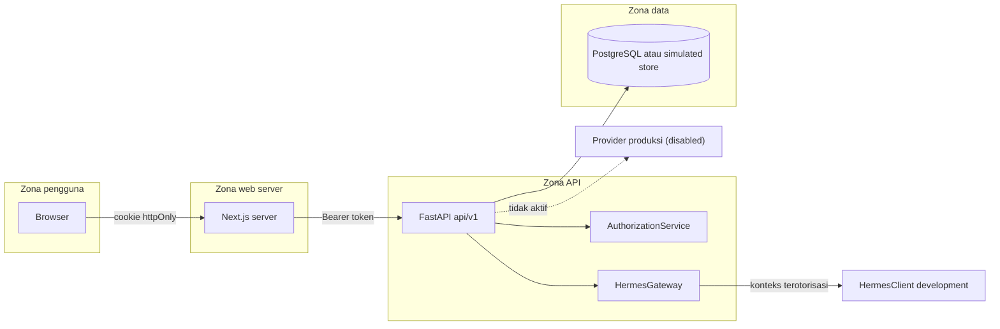

# Security Overview

**Status:** PROPOSED
**Last Updated:** 2026-10-17

## Purpose

Merangkum prinsip keamanan SUNOVATE, batas kepercayaan (trust boundary) antarkomponen, dan posisi kontrol keamanan yang sudah ada pada scaffold dibandingkan dengan yang masih diusulkan. Detail tiap topik berada pada dokumen terkait di folder ini.

## Confirmed Information

- **CONFIRMED** SUNOVATE tidak menggantikan sistem transaksi SUN resmi, tidak mengambil keputusan keuangan, dan tidak memberikan akses dokumen tanpa otorisasi (sumber: brief sesi 2026-10-01).
- **CONFIRMED** Hermes tidak pernah mengakses database secara langsung; seluruh akses melalui application service / tool API yang memeriksa izin pengguna (sumber: brief sesi 2026-10-01; ADR-004).
- **CONFIRMED** Otorisasi = permission AND team scope AND data classification, deny by default, ditegakkan di API pada setiap endpoint terproteksi; penyembunyian menu di frontend hanya kosmetik (sumber: brief sesi 2026-10-01; ADR-006).
- **CONFIRMED** File tidak disimpan sebagai BLOB; database hanya menyimpan referensi, metadata, checksum SHA-256, versi, klasifikasi, dan lokasi provider (sumber: ADR-003).
- **CONFIRMED** Integrasi produksi (identitas, dokumen, notifikasi, AI) dinonaktifkan sampai divalidasi; provider pengembangan bersifat lokal dan deterministik (sumber: ADR-005, ADR-008; fact sheet bagian 9).
- **CONFIRMED** Seluruh data demonstrasi berlabel `SIMULATED_DATA`; respons API membawa `meta.dataLabel` (sumber: fact sheet bagian 9).
- **CONFIRMED (project lead, 2026-10-17)** SUNOVATE beroperasi dengan batas data privat: tidak boleh ada publikasi, pengindeksan publik, atau egress ke AI/agent/telemetry eksternal tanpa persetujuan resmi dan verifikasi keamanan. Data asli masih dilarang.

## Prinsip keamanan

| Prinsip | Penerapan pada SUNOVATE | Status |
|---|---|---|
| Deny by default | Akses ditolak kecuali permission, team scope, dan klasifikasi seluruhnya terpenuhi; klasifikasi tidak dikenal ditolak | CONFIRMED (scaffold) |
| Least privilege | Role pengembangan diberi permission minimum per fungsi; `scope:all_teams` hanya untuk role lintas tim | PROPOSED (matriks menunggu validasi) |
| Defense in depth | Otorisasi API, filter retrieval sebelum scoring, filter prompt injection, `CitationValidator`, `OutputGuard`, audit log | CONFIRMED (scaffold) |
| API-enforced authorization | Frontend tidak menjadi kontrol keamanan; API memeriksa setiap request | CONFIRMED |
| Tanpa data asli | Hanya `SIMULATED_DATA`; tidak ada angka SUN riil, data pribadi, atau dokumen internal | CONFIRMED |
| Secrets di luar repository | `.env` diabaikan git; `.env.example` hanya placeholder | CONFIRMED |
| Audit | Login, perubahan data, keputusan approval, penolakan akses, query dan feedback Hermes dicatat di `audit_logs` yang append-only | CONFIRMED (scaffold) |
| Human approval | Write intent Hermes tidak pernah dieksekusi, hanya membuat approval request `PENDING` | CONFIRMED (scaffold) |
| Private by construction | API menolak konfigurasi public indexing/AI egress/agent eksternal/telemetry egress; web dan API memakai anti-index serta no-store | CONFIRMED (scaffold, ADR-018) |

## Trust boundary

Catatan batas:

- Browser tidak pernah membaca token; token hanya hidup di cookie httpOnly dan di request server-side Next.js ke API.
- `HermesClient` hanya menerima chunk yang sudah lolos otorisasi dan filter; tidak memiliki kredensial database.
- Provider produksi berada di luar batas dan tetap nonaktif (lihat [integration-boundaries](../03-architecture/integration-boundaries.md)).

## Proposed Design

- **PROPOSED** Repository SQLAlchemy menggantikan simulated store dengan aturan otorisasi yang sama; filter otorisasi diterapkan di query, bukan setelah data dimuat (ADR-007).
- **PROPOSED** Login produksi melalui identity provider organisasi setelah OQ-07 dijawab.
- **PROPOSED** Pengujian keamanan wajib: akses tanpa izin, jailbreak, prompt injection, sitasi keliru, duplikasi ingestion, konflik pembaruan (sumber: Proposal v2.4, slide 20).

## Open Questions

- **OPEN QUESTION** OQ-05 Pemetaan klasifikasi ke skema resmi Kemenkeu.
- **OPEN QUESTION** OQ-07 Mekanisme login dan hosting yang disetujui.
- **OPEN QUESTION** OQ-11 Model AI/embedding yang diizinkan dan lokasi pemrosesan.
- **OPEN QUESTION** OQ-13 Kebijakan retensi.

## Risks

R-02 kebocoran data melalui pencarian/Hermes, R-03 data asli masuk repository atau log, R-07 prompt injection dari dokumen, R-09 klasifikasi tidak sesuai skema resmi, R-10 simulated store disangka persistence produksi. Lihat [risk-register](../12-governance/risk-register.md).

## Related Documents

- [authentication](authentication.md)
- [private-data-boundary](private-data-boundary.md)
- [authorization-rbac](authorization-rbac.md)
- [permission-matrix](permission-matrix.md)
- [data-classification](data-classification.md)
- [threat-model](threat-model.md)
- [audit-logging](audit-logging.md)
- [secrets-management](secrets-management.md)
- [incident-response](incident-response.md)
- [security-checklist](security-checklist.md)
- [prompt-injection-defense](../05-ai-rag/prompt-injection-defense.md)
