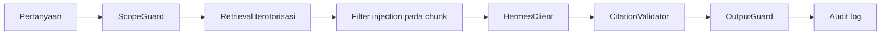

# Threat Model

**Status:** PROPOSED
**Last Updated:** 2026-10-06

## Purpose

Mengidentifikasi ancaman utama terhadap aset SUNOVATE menggunakan kategori STRIDE dan mencatat mitigasi beserta statusnya (Implemented pada scaffold atau Proposed). Model ini mencakup scaffold dengan `SIMULATED_DATA`; ancaman terhadap integrasi produksi dinilai ulang saat integrasi divalidasi.

## Ruang lingkup

- **CONFIRMED** Komponen dalam lingkup: aplikasi web Next.js, API FastAPI, simulated store dan skema PostgreSQL, modul Hermes dengan provider `development_extractive` (sumber: fact sheet bagian 9).
- **OUT OF SCOPE** Integrasi produksi (SSO, SharePoint, Power BI, Telegram, WhatsApp, Kemenkeu Satu, market data) karena belum tersedia (sumber: Proposal v2.4, slide 11).

## Aset

| ID | Aset | Alasan penting |
|---|---|---|
| A1 | Konten knowledge dan metadata dokumen | Institutional memory; dapat bersifat INTERNAL atau RESTRICTED |
| A2 | Permission, role, team membership, clearance | Menentukan siapa membaca apa |
| A3 | Audit log | Bukti jejak akses dan perubahan |
| A4 | Development token dan `DEV_AUTH_SECRET` | Kunci identitas pada development |
| A5 | Konteks Hermes (chunk terotorisasi, prompt, jawaban, sitasi) | Jalur paling mudah untuk kebocoran lintas tim |

## STRIDE

| ID | Kategori | Aset | Ancaman | Mitigasi | Status |
|---|---|---|---|---|---|
| T-01 | Spoofing | A4 | Pemalsuan token pengembangan | Tanda tangan HMAC-SHA256, expiry dalam token, TTL terbatas | Implemented |
| T-02 | Spoofing | A4 | Dev auth aktif di produksi | API menolak start jika `APP_ENV=production` dan `DEV_AUTH_ENABLED=true` | Implemented |
| T-03 | Spoofing | A4 | Pencurian token melalui skrip di browser | Cookie httpOnly SameSite=Lax; panggilan API dari server Next.js | Implemented |
| T-04 | Tampering | A1 | Konflik atau penimpaan pembaruan bersamaan | `revision`; pembaruan basi menghasilkan 409 `REVISION_CONFLICT` | Implemented |
| T-05 | Tampering | A3 | Pengubahan atau penghapusan audit log | Trigger PostgreSQL menolak UPDATE/DELETE pada `audit_logs` | Implemented (skema dan backend `postgres`, ADR-015); mode default `simulated` tidak persisten; `TRUNCATE` tidak dicegah (T-24) |
| T-06 | Tampering | A1 | Duplikasi ingestion dokumen | Unique (`document_reference_id`, `checksum_sha256`); 409 `DUPLICATE_CHECKSUM` | Implemented |
| T-07 | Repudiation | A3 | Pengguna menyangkal aksi | Audit action LOGIN, CREATE, UPDATE, SUBMIT, APPROVE, REJECT, ACCESS_DENIED, AI_QUERY, AI_FEEDBACK, VERSION_REGISTER, SEARCH; `X-Request-ID` | Implemented |
| T-08 | Information disclosure | A1 | IDOR: menebak id rekaman tim lain | Pemeriksaan team scope dan klasifikasi per rekaman; rekaman tak terbaca menghasilkan 404 | Implemented |
| T-09 | Information disclosure | A1, A5 | Kebocoran lintas tim melalui pencarian atau Hermes | Filter otorisasi sebelum scoring; hanya `PUBLISHED`; `HERMES_MAX_CLASSIFICATION` | Implemented |
| T-10 | Information disclosure | A5 | Prompt injection dari isi dokumen | Filter chunk berisi teks bernada instruksi; `CitationValidator`; `OutputGuard` | Implemented (heuristik) |
| T-11 | Information disclosure | A5 | Jailbreak atau policy override oleh pengguna | `ScopeGuard` menghasilkan `REFUSED_POLICY` | Implemented (heuristik) |
| T-12 | Information disclosure | A3, A4 | Kebocoran secret atau konten melalui log | Log JSON hanya berisi metadata; secret, token, dan isi dokumen tidak dicatat; `OutputGuard` memeriksa pola secret | Implemented (sebagian); review log Proposed |
| T-13 | Information disclosure | A1 | Pesan error membocorkan detail internal | Error envelope tanpa stack trace; `INTERNAL_ERROR` generik dengan `requestId` | Implemented |
| T-14 | Denial of service | API | Request berlebihan ke pencarian atau Hermes | `pageSize` maksimal 100; rate limiting | Proposed |
| T-15 | Elevation of privilege | A2 | Eskalasi hak melalui manipulasi frontend | Otorisasi hanya di API; menu frontend kosmetik | Implemented |
| T-16 | Elevation of privilege | A2 | Approver menyetujui request sendiri | Separation of duties pada keputusan approval (API 403 `SEPARATION_OF_DUTIES` + CHECK constraint) | Implemented |
| T-17 | Elevation of privilege | A1 | Hermes mengeksekusi aksi tulis | Write intent menjadi `REQUIRES_HUMAN_APPROVAL`; tidak pernah dieksekusi | Implemented |
| T-18 | Tampering | Supply chain | Dependency berbahaya atau typosquatting | Lockfile (`uv.lock`, pnpm lockfile); versi terkunci; dependency baru harus punya kebutuhan konkret | Implemented (lockfile); audit dependency otomatis Proposed |
| T-19 | Information disclosure | A1 | Data asli masuk repository | Hanya `SIMULATED_DATA`; file sumber PDF/PPTX dikecualikan via `.gitignore` | Implemented |
| T-20 | Elevation of privilege | A1, A2 | Hak ubah/unggah terlalu luas: role `staff` masih dapat membuat, mengubah, dan mengajukan knowledge (jawaban knowledge owner membatasi ke ketua tim, kasubdit PMP, Kasi MP, PIC; OQ-05) | Cabut `knowledge:create/update/submit` dan `document:create` dari `staff` (PD-1); uji 403 (SEC-40); langkah data pada database yang sudah di-seed (SEC-45) | Proposed; belum sesuai pada kode (R-17) |
| T-21 | Elevation of privilege | A2 | Role berlaku global karena `user_roles.team_id` tidak diperiksa; pengguna dengan beberapa keanggotaan tim dapat menulis di semua timnya; penunjukan ketua tim dan PIC tidak tercatat | Penunjukan per tim dengan masa berlaku (opsi di [logical-data-model](../04-data/logical-data-model.md)); `can_write` memeriksa penunjukan; SEC-42, SEC-43 | Proposed; team scope dan klasifikasi sudah berjalan |
| T-22 | Information disclosure | A1, A5 | Cakupan "semua dokumen yang diusulkan tim kerja" (OQ-04) membawa dokumen RESTRICTED atau CONFIDENTIAL atau data pribadi ke repository dan RAG tanpa klasifikasi dan persetujuan (R-14) | Hanya `SIMULATED_DATA` sampai klasifikasi (OQ-05) dan persetujuan eksplisit ada; `HERMES_MAX_CLASSIFICATION`; gerbang intake dan karantina; SEC-50 sampai SEC-53 | Sebagian: plafon klasifikasi Hermes Implemented; gerbang intake Proposed (tidak ada pipeline ingestion, KL-07) |
| T-23 | Spoofing, Tampering, Information disclosure, Denial of service | A1 sampai A4 | Server tunggal khusus (OQ-07, R-13): API atau PostgreSQL terpapar ke jaringan, dev auth terbuka pada `APP_ENV` selain production, secret di host, akses fisik, backup di host yang sama, satu titik kegagalan | NFR-39 sampai NFR-44; reverse proxy dan TLS; port database hanya loopback; dev auth nonaktif; secret di luar repository; backup di luar host dan uji restore; SEC-70 sampai SEC-76 | Proposed; server belum ada. Penolakan start `production` + dev auth atau `simulated` Implemented |
| T-24 | Tampering | A3 | Pengguna dengan hak TRUNCATE pada database menghapus `audit_logs` (trigger hanya menolak UPDATE/DELETE per baris, KL-21); pada server tunggal administrator host dan database kemungkinan orang yang sama | Pemisahan hak database, backup audit di luar host; penutupan celah di luar cakupan saat ini | Accepted limitation (OUT OF SCOPE, KL-21) |
| T-25 | Information disclosure | A1, A5 | Kanal eksternal (Telegram, WhatsApp; OQ-08 "bisa") membawa konten RESTRICTED ke atas keluar jaringan instansi | Tidak diaktifkan (P2); bila dilanjutkan, otorisasi lewat HermesGateway dan tidak ada RESTRICTED ke atas secara default (PD-6); SEC-80, SEC-81 | Proposed; tidak ada kode kanal |
| T-26 | Information disclosure | A1 | Indikator "yield" dan "kepemilikan SBN" (OQ-10) ditampilkan tanpa sumber otoritatif sehingga angka tidak akurat atau dikira resmi (R-15) | Tanpa angka dan tanpa tabel bisnis SUN (ADR-013); placeholder "sumber data belum tersedia"; SEC-60, SEC-61 | Angka tidak ada (Implemented secara struktural); placeholder Proposed |

Status Implemented berarti kontrol ada pada scaffold (sumber: fact sheet bagian 3 dan 9; implementasi scaffold sesi 2026-10-01). Seluruh kontrol berjalan pada simulated store (`DATA_BACKEND=simulated`); kontrol yang sama wajib diterapkan ulang saat repository SQLAlchemy dibuat (ADR-007).

## Alur prompt injection

Detail pertahanan ada di [prompt-injection-defense](../05-ai-rag/prompt-injection-defense.md).

## Proposed Design

- **PROPOSED** Rate limiting per pengguna untuk `/search` dan `/hermes/query`.
- **PROPOSED** Pemindaian dependency dan secret pada CI.
- **PROPOSED** Uji regresi keamanan untuk T-08 sampai T-11 menjadi bagian [security-testing](../10-testing/security-testing.md).
- **PROPOSED** Penilaian ulang threat model sebelum setiap integrasi dari [integration-readiness-checklist](../08-integrations/integration-readiness-checklist.md).

## Open Questions

- **CONFIRMED (knowledge owner, deck v1_ slide 24)** Hosting pilot: komputer tersendiri sebagai server (OQ-07). **OPEN QUESTION** OQ-23 persyaratan server (jaringan, TLS, administrator, akses) dan mekanisme login; ancaman T-23 dinilai ulang saat persyaratan dijawab. Pengakuan mentor tertunda (OQ-24).
- **OPEN QUESTION** OQ-25 Pemetaan peran yang berwenang mengubah/mengunggah; menentukan penutupan T-20 dan T-21.
- **OPEN QUESTION** OQ-11 Model AI dan lokasi pemrosesan; menentukan ancaman exfiltration melalui provider AI.

## Risks

R-02, R-03, R-07, R-10 pada [risk-register](../12-governance/risk-register.md).

## Related Documents

- [security-overview](security-overview.md)
- [authorization-rbac](authorization-rbac.md)
- [audit-logging](audit-logging.md)
- [scope-guard](../05-ai-rag/scope-guard.md)
