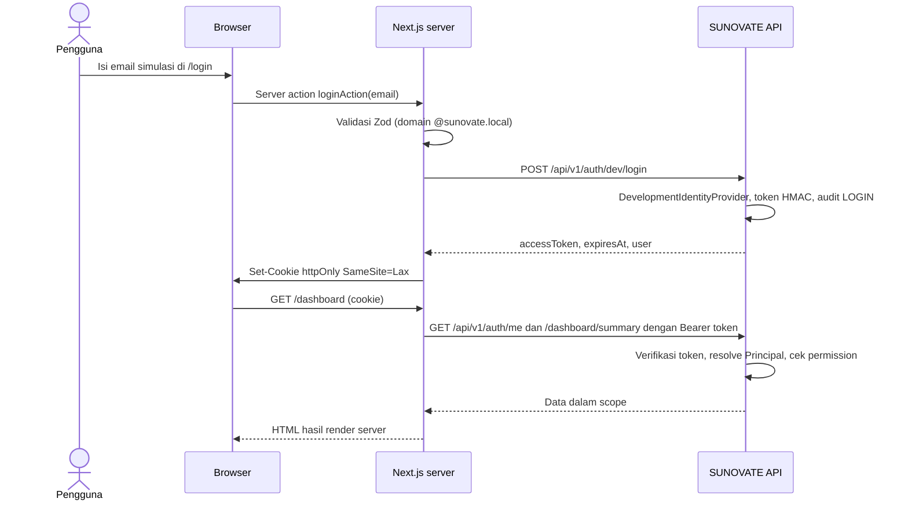

# Authentication Flow

**Status:** PROPOSED (development only)
**Last Updated:** 2026-10-01

## Purpose
Alur autentikasi pengembangan yang diimplementasikan. Mekanisme produksi adalah OPEN QUESTION (OQ-07).

## Login dan pemanggilan API

## Jalur gagal
| Kondisi | Hasil |
|---|---|
| Email bukan pengguna simulasi | 401 `UNAUTHENTICATED`, audit LOGIN `DENIED`, pesan di form |
| `DEV_AUTH_ENABLED=false` | 404 `DEV_AUTH_DISABLED`; semua endpoint terlindungi 401 |
| Token tidak ada, rusak, ditandatangani secret lain, atau kedaluwarsa | 401; web mengalihkan ke `/login` |
| Pengguna tidak aktif | 401 |
| Permission kurang | 403; web mengalihkan ke `/unauthorized` |

## Token
- Format: `base64url(payload).base64url(HMAC-SHA256)`, payload `{sub, iat, exp}`.
- TTL `DEV_AUTH_TOKEN_TTL_MINUTES` (default 480). Secret `DEV_AUTH_SECRET`; bila kosong, secret acak per proses.
- Logout menghapus cookie (server action `logoutAction`). Tidak ada revokasi token di sisi server (PROPOSED untuk produksi).
- Browser tidak pernah membaca token; panggilan Hermes dari browser melalui route handler `/api/hermes` di server Next.js.

## Related Documents
- [authentication.md](../06-security/authentication.md)
- [identity-provider-proposal.md](../08-integrations/identity-provider-proposal.md)
