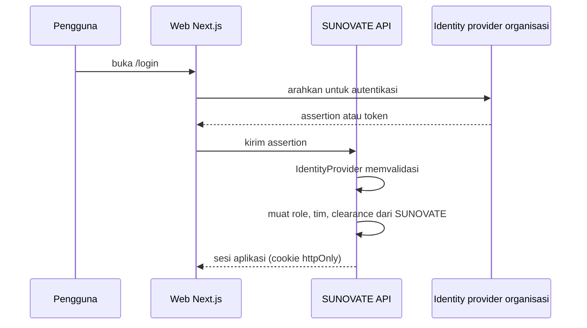

# Identity Provider Proposal

**Status:** PROPOSED | NEEDS MENTOR VALIDATION
**Last Updated:** 2026-10-02

## Purpose

Mengusulkan cara SUNOVATE beralih dari identitas pengembangan ke identitas organisasi (SSO) tanpa mengubah model otorisasi di API.

## Status

- **PROPOSED:** SSO organisasi berada pada prioritas P2, setelah validasi (sumber: Proposal v2.4, slide 11).
- **CONFIRMED (knowledge owner, deck v1_ slide 24):** Hosting dijawab: "pakai computer tersendiri sebagai server" (OQ-07, DEC-20261002-05). Mekanisme login tidak dijawab.
- **OPEN QUESTION:** Mekanisme login yang disetujui (OQ-07 PARTIAL) dan persyaratan server khusus (OQ-23). Tidak diketahui apakah server tersebut dapat menjangkau identity provider organisasi atau apakah akun lokal yang dipakai.
- **CONFIRMED:** Tidak ada identity provider organisasi, client registration, endpoint, atau kredensial yang tersedia untuk SUNOVATE saat ini. Dokumen ini tidak menyatakan bahwa Kemenkeu memakai produk identitas tertentu.

## Current state

- **CONFIRMED:** Interface `IdentityProvider` tersedia di backend (sumber: fact sheet bagian 9).
- **CONFIRMED:** Pengganti pengembangan adalah `DevelopmentIdentityProvider` dengan `IDENTITY_PROVIDER=development`.
- **PROPOSED:** Identitas pengembangan memakai token bertanda tangan HMAC yang diterbitkan `POST /api/v1/auth/dev/login` untuk pengguna SIMULATED hasil seed; dinonaktifkan di luar development; aplikasi menolak start bila `APP_ENV=production` dan dev auth aktif (sumber: ADR-005).
- **CONFIRMED:** Seluruh pengguna pengembangan bersifat fiktif dengan domain `@sunovate.local` (sumber: fact sheet bagian 5).
- **CONFIRMED:** Frontend menyimpan token pada cookie httpOnly; server component memanggil API dengan token tersebut (sumber: fact sheet bagian 9).

## Proposed design

### Provider interface

- **PROPOSED:** Implementasi produksi memenuhi kontrak `IdentityProvider` yang sama: menerima kredensial atau assertion dari identity provider organisasi dan menghasilkan konteks pengguna (id, tim, permission, clearance).
- **PROPOSED:** `AuthorizationService` tidak berubah. Keputusan akses tetap: permission AND team scope AND klasifikasi data, deny by default (sumber prinsip: ADR-006).
- **PROPOSED:** Endpoint `POST /api/v1/auth/dev/login` tetap hanya untuk development dan tidak pernah aktif di produksi.

### Opsi yang perlu dievaluasi

Opsi berikut hanya kemungkinan untuk dievaluasi bersama pengelola TI organisasi, bukan rekomendasi final:

| Opsi | Catatan evaluasi |
|---|---|
| SSO organisasi yang kompatibel dengan OpenID Connect (OIDC) | OPEN QUESTION: ketersediaan dan kebijakan registrasi aplikasi |
| SSO organisasi yang kompatibel dengan SAML | OPEN QUESTION: ketersediaan dan kebijakan registrasi aplikasi |
| Akun lokal SUNOVATE dengan kebijakan kata sandi dan MFA | Hanya dipertimbangkan bila SSO tidak tersedia; memerlukan kajian keamanan. Relevan bila server khusus tidak terhubung ke identity provider organisasi (OQ-23); belum diputuskan |

### Alur autentikasi (usulan umum)

### Pemetaan role dan tim

- **PROPOSED:** Identity provider hanya membuktikan identitas. Role (`system_admin`, `knowledge_coordinator`, `team_lead`, `knowledge_owner`, `reviewer`, `staff`, `auditor`, `read_only`), keanggotaan tim, dan clearance tetap dikelola di SUNOVATE pada tabel `user_roles`, `team_memberships`, dan `users`.
- **OPEN QUESTION:** Apakah role atau tim boleh diturunkan dari grup pada identity provider organisasi, dan siapa yang berwenang mengelola grup tersebut.
- **OPEN QUESTION:** Siapa yang menetapkan clearance pengguna (OQ-05, OQ-09).
- **PROPOSED:** Pengguna yang berhasil login tetapi belum memiliki role di SUNOVATE tidak mendapat akses apa pun (deny by default).

### Sesi dan audit

- **PROPOSED:** Login berhasil dan gagal dicatat pada `audit_logs` dengan aksi `LOGIN` atau `ACCESS_DENIED`.
- **OPEN QUESTION:** Masa berlaku sesi, logout terpusat, dan pencabutan akses saat pegawai berpindah tim.

## Prerequisites

- Keputusan OQ-07 tentang mekanisme login (hosting sudah dijawab sebagian) dan persyaratan server (OQ-23).
- Persetujuan pengelola identitas organisasi untuk registrasi aplikasi.
- Kajian keamanan atas alur autentikasi dan penyimpanan sesi.
- Kredensial aplikasi disimpan di secret store.
- Lingkungan uji dan pengguna uji yang ditunjuk (OQ-20).

## Open Questions

- OQ-05 Klasifikasi dan hak akses.
- OQ-07 Mekanisme login (PARTIAL; hosting dijawab).
- OQ-23 Persyaratan server khusus dan mekanisme login di server tersebut.
- OQ-09 Knowledge owner dan reviewer per tim.
- OQ-12 Siapa berwenang memutuskan publikasi.
- OQ-20 Lingkungan UAT dan pengguna uji.

## Risks

- R-02 Kebocoran data bila pemetaan role keliru.
- R-05 Akses identity provider produksi tidak tersedia selama periode magang.
- R-10 Dev auth terbawa ke lingkungan produksi; dimitigasi dengan penolakan start pada `APP_ENV=production`.

## Readiness criteria

- Seluruh butir pada [Integration Readiness Checklist](integration-readiness-checklist.md) terpenuhi.
- Test membuktikan dev auth tidak dapat aktif pada `APP_ENV=production`.
- Test membuktikan pengguna tanpa role SUNOVATE mendapat 403 atau 404 sesuai kebijakan.
- Matriks permission tidak berubah akibat pergantian provider.

## Related Documents

- [Authentication](../06-security/authentication.md)
- [Authorization RBAC](../06-security/authorization-rbac.md)
- [Permission Matrix](../06-security/permission-matrix.md)
- [Authentication Flow](../07-api/authentication-flow.md)
- [Integration Overview](integration-overview.md)
