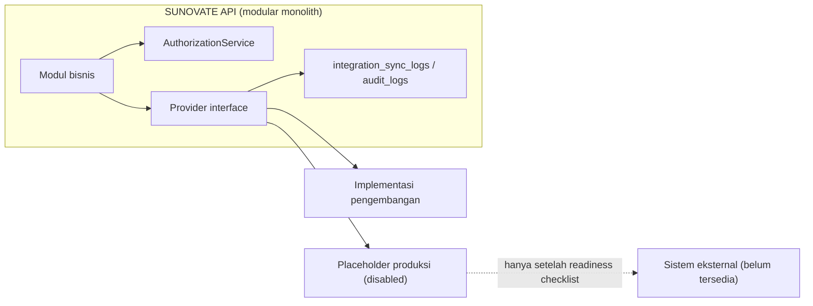

# Integration Overview

**Status:** PROPOSED | NEEDS MENTOR VALIDATION
**Last Updated:** 2026-10-01

## Purpose

Dokumen ini merangkum seluruh rencana integrasi eksternal SUNOVATE, status masing-masing, dan prinsip yang mengikat semua integrasi. Rincian per integrasi ada pada dokumen proposal terkait.

## Status

- **CONFIRMED:** Integrasi produksi (identitas, dokumen, notifikasi, AI, dan sistem eksternal lain) tetap dinonaktifkan sampai divalidasi (sumber: brief sesi 2026-10-01; AGENTS.md).
- **CONFIRMED:** Fondasi integrasi Telegram dan WhatsApp termasuk tujuan fase lanjutan, bukan fase awal (sumber: brief sesi 2026-10-01, tujuan 8).
- **PROPOSED:** Seluruh integrasi pada tabel di bawah berada pada prioritas P2, yaitu dikerjakan setelah validasi dan bukan janji (sumber: Proposal v2.4, slide 11).
- **CONFIRMED:** Tidak ada integrasi yang tersedia saat ini. Dokumen ini tidak menyatakan adanya API, tenant, endpoint, kredensial, atau persetujuan untuk sistem eksternal mana pun.

## Daftar integrasi

| Integrasi | Status | Prioritas | Interface | Pengganti pengembangan |
|---|---|---|---|---|
| SharePoint / document repository | PROPOSED, tidak tersedia | P2 | `DocumentProvider` | `LocalDocumentProvider` (`DOCUMENT_PROVIDER=local`) |
| Identitas organisasi / SSO | PROPOSED, tidak tersedia | P2 | `IdentityProvider` | `DevelopmentIdentityProvider` (token pengembangan bertanda tangan, `IDENTITY_PROVIDER=development`) |
| Power BI | PROPOSED, tidak tersedia | P2 | Belum ada; usulan export read-only | Tidak ada |
| Telegram | PROPOSED, tidak tersedia | P2 | `NotificationProvider` dan channel adapter ke `HermesGateway` | Tidak ada (`NOTIFICATION_PROVIDER=disabled`) |
| WhatsApp | PROPOSED, tidak tersedia | P2 | `NotificationProvider` dan channel adapter ke `HermesGateway` | Tidak ada (`NOTIFICATION_PROVIDER=disabled`) |
| Market data resmi | PROPOSED, tidak tersedia | P2 | `MarketDataProvider` (usulan, belum diimplementasikan) | Tidak ada; tidak ada data pasar yang ditampilkan |
| Kemenkeu Satu (korespondensi resmi) | PROPOSED, tidak tersedia | P2 | Belum ada; usulan nama `CorrespondenceProvider` | Tidak ada |
| Data Bank Indonesia | PROPOSED, tidak tersedia | P2 (bagian dari market data resmi) | `MarketDataProvider` (usulan) | Tidak ada |

Catatan:

- **CONFIRMED:** Kemenkeu Satu adalah sistem korespondensi resmi; SUNOVATE tidak menggantikannya (sumber: `14_NEW_SESSION_HANDOFF_PROMPT.txt`, `20_NEW_CHAT_MASTER_PROMPT.txt`).
- **CONFIRMED:** SharePoint atau document repository menjadi source of truth untuk file bila sesuai; SUNOVATE menyimpan referensi, metadata, checksum SHA-256, versi, klasifikasi, dan lokasi provider, bukan BLOB file (sumber: brief sesi 2026-10-01; ADR-003).
- **CONFIRMED:** Bank Indonesia berperan sebagai agen penatausaha dan agen lelang SUN dalam konteks domain (sumber: Pengayaan Kelas Magang 6 Mei 2026). Peran ini tidak berarti ada akses data untuk SUNOVATE.
- **PROPOSED:** Interface AI (`AIProvider`, `EmbeddingProvider`, `HermesClient`) dibahas di [Hermes Overview](../05-ai-rag/hermes-overview.md) dan [Provider Abstraction](../03-architecture/provider-abstraction.md), bukan di dokumen ini.

## Prinsip integrasi

1. **PROPOSED:** Satu provider interface per sistem eksternal. Modul bisnis hanya memanggil interface, tidak memanggil API eksternal secara langsung. Tidak ada pemanggilan API eksternal yang tersebar di router, service, atau frontend.
2. **CONFIRMED:** Implementasi produksi tetap berupa placeholder yang dinonaktifkan sampai validasi selesai (sumber: brief sesi 2026-10-01; fact sheet bagian 9).
3. **CONFIRMED:** Otorisasi tetap ditegakkan di API: permission, team scope, dan klasifikasi data (sumber: ADR-006). Integrasi tidak boleh menjadi jalur pintas melewati otorisasi.
4. **CONFIRMED:** Hermes tidak mengakses database secara langsung; kanal pesan eksternal masuk melalui `HermesGateway` (sumber: ADR-004).
5. **PROPOSED:** Setiap sinkronisasi atau pemanggilan integrasi dicatat pada tabel `integration_sync_logs`, dan aksi yang relevan bagi keamanan dicatat pada `audit_logs`. Rincian kolom `integration_sync_logs` mengikuti [Database Schema](../04-data/database-schema.md).
6. **PROPOSED:** Kegagalan integrasi tidak boleh menghentikan fungsi inti. Fitur yang bergantung pada integrasi menampilkan status "tidak tersedia", bukan data pengganti yang dikarang.
7. **CONFIRMED:** Tidak menambah Redis, message broker, atau microservice untuk integrasi tanpa kebutuhan yang tervalidasi (sumber: brief sesi 2026-10-01).
8. **PROPOSED:** Setiap integrasi wajib melewati [Integration Readiness Checklist](integration-readiness-checklist.md) sebelum diaktifkan.

## Provider boundary

## Open Questions

- OQ-06 SharePoint sebagai sumber utama atau hanya referensi.
- OQ-07 Mekanisme login dan hosting yang disetujui.
- OQ-08 Izin penggunaan Telegram dan WhatsApp untuk internal.
- OQ-10 Format laporan dan indikator dashboard.
- OQ-11 Model AI dan lokasi pemrosesan data.

Rincian ada di [Open Questions](../00-project/open-questions.md).

## Risks

- R-05 Akses integrasi produksi tidak tersedia.
- R-02 Kebocoran data melalui kanal integrasi.
- R-06 Scope melebihi periode 6 bulan bila integrasi dikerjakan terlalu dini.

Lihat [Risk Register](../12-governance/risk-register.md).

## Acceptance Criteria

- **PROPOSED:** Tidak ada kode modul bisnis yang memanggil API eksternal tanpa melalui provider interface.
- **PROPOSED:** Seluruh provider produksi dinonaktifkan secara default pada `.env.example`.
- **PROPOSED:** Endpoint `GET /api/v1/providers` menampilkan status provider aktif (memerlukan `provider:read`).

## Related Documents

- [Integration Boundaries](../03-architecture/integration-boundaries.md)
- [Provider Abstraction](../03-architecture/provider-abstraction.md)
- [SharePoint Proposal](sharepoint-proposal.md)
- [Identity Provider Proposal](identity-provider-proposal.md)
- [Power BI Proposal](power-bi-proposal.md)
- [Telegram Proposal](telegram-proposal.md)
- [WhatsApp Proposal](whatsapp-proposal.md)
- [Market Data Proposal](market-data-proposal.md)
- [Integration Readiness Checklist](integration-readiness-checklist.md)
