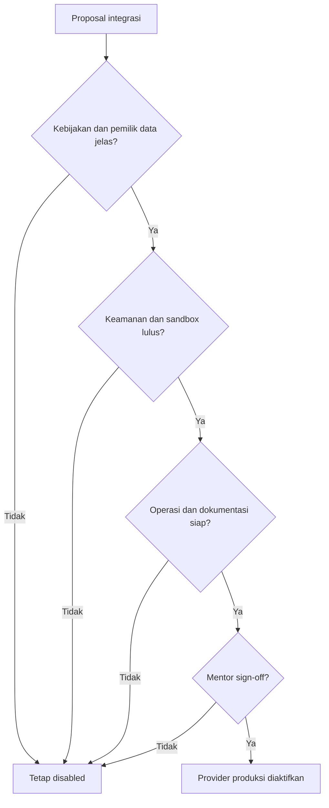

# Integration Readiness Checklist

**Status:** PROPOSED | NEEDS MENTOR VALIDATION
**Last Updated:** 2026-10-01

## Purpose

Daftar periksa wajib sebelum provider produksi mana pun diaktifkan. Checklist ini berlaku untuk seluruh integrasi pada [Integration Overview](integration-overview.md).

## Status

- **CONFIRMED:** Integrasi produksi tetap dinonaktifkan sampai divalidasi (sumber: brief sesi 2026-10-01; AGENTS.md).
- **PROPOSED:** Checklist ini adalah definisi "tervalidasi" untuk keperluan pengembangan. Bentuk persetujuan resmi organisasi adalah OPEN QUESTION.
- **CONFIRMED:** Saat ini tidak ada integrasi yang memenuhi checklist ini.

## Cara pakai

1. Salin bagian Checklist ke catatan keputusan integrasi terkait pada [Decision Log](../12-governance/decision-log.md).
2. Isi bukti untuk setiap butir (tautan dokumen, hasil test, nama pemberi persetujuan sesuai peran, bukan data pribadi di repository bila tidak diizinkan).
3. Provider produksi hanya boleh diaktifkan bila seluruh butir wajib terpenuhi.
4. Butir yang tidak relevan ditandai N/A dengan alasan tertulis.

## Checklist

### A. Kebijakan dan kepemilikan

- [ ] **Persetujuan legal dan kebijakan.** Penggunaan sistem eksternal disetujui sesuai kebijakan organisasi, termasuk perjanjian data bila dibutuhkan.
- [ ] **Pemilik data.** Pemilik data pada sisi sumber dan pada sisi SUNOVATE ditunjuk sesuai peran.
- [ ] **Klasifikasi.** Klasifikasi data yang mengalir ditetapkan dan dipetakan ke skema resmi (OQ-05). Batas klasifikasi per kanal tertulis.
- [ ] **Scope data.** Daftar data yang disinkronkan, yang hanya direferensikan, dan yang dilarang keluar tertulis.

### B. Keamanan dan akses

- [ ] **Kredensial di secret store.** Token, kunci, dan kata sandi tidak ada di Git, `.env.example`, log, atau dokumen (lihat [Secrets Management](../06-security/secrets-management.md)).
- [ ] **Hak minimum.** Identitas layanan hanya memiliki hak yang dibutuhkan.
- [ ] **Jalur jaringan.** Jalur jaringan keluar atau masuk yang dibutuhkan disetujui pengelola infrastruktur.
- [ ] **Kajian keamanan.** Threat model integrasi diperbarui dan ditinjau (lihat [Threat Model](../06-security/threat-model.md)).
- [ ] **Otorisasi tidak dilewati.** Test membuktikan integrasi menerapkan permission, team scope, dan klasifikasi yang sama dengan API.
- [ ] **Webhook.** Bila ada webhook, verifikasi sumber sesuai [Webhook Policy](../07-api/webhook-policy.md) diuji.

### C. Pengujian

- [ ] **Sandbox teruji.** Integrasi diuji pada lingkungan sandbox atau uji yang disetujui (OQ-20), bukan pada data produksi.
- [ ] **Contract test.** Implementasi produksi dan implementasi pengembangan lulus contract test interface yang sama.
- [ ] **Skenario wajib.** Skenario akses tanpa izin, duplikasi, dan konflik pembaruan diuji (sumber skenario: Proposal v2.4, slide 20).

### D. Operasi

- [ ] **Failure mode.** Perilaku saat sistem eksternal lambat, gagal, atau mengembalikan data tidak valid didefinisikan dan diuji. Fungsi inti tetap berjalan.
- [ ] **Monitoring.** Keberhasilan dan kegagalan tercatat pada `integration_sync_logs` dan dapat dipantau (lihat [Observability](../11-operations/observability.md)).
- [ ] **Rollback.** Integrasi dapat dinonaktifkan melalui konfigurasi provider tanpa deploy ulang kode; langkahnya tertulis di [Deployment Runbook](../11-operations/deployment-runbook.md).
- [ ] **Audit.** Aksi yang relevan bagi keamanan tercatat pada `audit_logs` yang append-only.

### E. Dokumentasi dan persetujuan

- [ ] **Dokumentasi diperbarui.** Dokumen proposal integrasi, [Environment Configuration](../11-operations/environment-configuration.md), dan [Endpoint Catalog](../07-api/endpoint-catalog.md) diperbarui.
- [ ] **Status dokumen.** Status proposal diubah dari PROPOSED hanya setelah persetujuan tercatat.
- [ ] **Mentor sign-off.** Mentor atau pejabat yang ditetapkan menyatakan integrasi boleh diaktifkan, tercatat pada Decision Log.

## Alur keputusan

## Open Questions

- OQ-05 Pemetaan klasifikasi ke skema resmi.
- OQ-07 Hosting dan mekanisme login.
- OQ-20 Lingkungan uji yang ditunjuk.
- Bentuk persetujuan resmi organisasi untuk integrasi (belum memiliki ID; perlu ditambahkan ke [Open Questions](../00-project/open-questions.md) bila disepakati).

## Risks

- R-02 Kebocoran data melalui integrasi yang diaktifkan terlalu dini.
- R-05 Akses integrasi produksi tidak tersedia.
- R-08 Ketergantungan pada satu pengembang; checklist yang terisi membantu handover.

## Related Documents

- [Integration Overview](integration-overview.md)
- [Security Checklist](../06-security/security-checklist.md)
- [Integration Testing](../10-testing/integration-testing.md)
- [Change Management](../12-governance/change-management.md)
