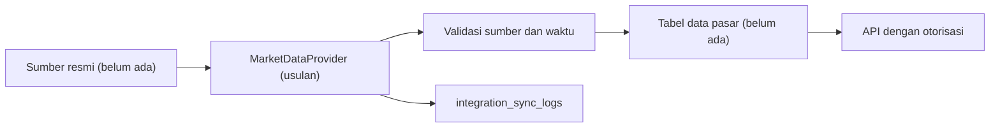

# Market Data Proposal

**Status:** PROPOSED | NEEDS MENTOR VALIDATION
**Last Updated:** 2026-10-01

## Purpose

Menetapkan batas dan usulan awal bila SUNOVATE kelak menampilkan data pasar SUN dari sumber resmi. Dokumen ini tidak mengusulkan tampilan data pasar pada fase saat ini.

## Status

- **PROPOSED:** Market data resmi berada pada prioritas P2, setelah validasi dan bukan janji (sumber: Proposal v2.4, slide 11).
- **CONFIRMED:** SUNOVATE tidak menggantikan sistem transaksi SUN resmi dan tidak mengambil keputusan keuangan (sumber: brief sesi 2026-10-01).
- **CONFIRMED:** Tidak ada sumber data pasar, perjanjian data, API, atau kredensial yang tersedia untuk SUNOVATE saat ini.
- **CONFIRMED:** Tabel SUN Business yang belum tervalidasi (instrumen, lelang, transaksi, yield, setelmen) dihapus dari scaffold skema; SUN Business tetap OPEN QUESTION untuk fase berikutnya (sumber: ADR-013).

## Current state

- **CONFIRMED:** `MarketDataProvider` belum diimplementasikan; tidak ada interface, implementasi pengembangan, maupun placeholder di kode.
- **CONFIRMED:** SUNOVATE tidak menampilkan data pasar dalam bentuk apa pun, termasuk data simulasi yang menyerupai yield, harga, atau hasil lelang.

## Aturan tetap

- **CONFIRMED:** Dokumentasi, seed, test, dan prototype tidak memuat angka SUN asli: tidak ada angka APBN atau pembiayaan, yield, maupun hasil lelang (sumber: fact sheet bagian 0).
- **PROPOSED:** Yield, harga, atau hasil lelang tidak pernah dikarang, diinterpolasi, atau diisi dengan nilai contoh pada antarmuka. Bila sumber tidak tersedia, UI menampilkan status "Sumber data belum tersedia".
- **PROPOSED:** Hermes tidak menjawab pertanyaan nilai pasar terkini kecuali dari sumber resmi yang sudah diotorisasi dan disitasi; tanpa sumber, keputusan Hermes adalah `INSUFFICIENT_EVIDENCE`.

## Proposed design

### Provider interface

- **PROPOSED:** `MarketDataProvider` sebagai satu-satunya pintu data pasar, dengan operasi baca saja. Setiap nilai yang dikembalikan wajib membawa identitas sumber, waktu observasi, waktu pengambilan, dan status lisensi penggunaan.
- **PROPOSED:** Tidak ada implementasi pengembangan yang menghasilkan angka pasar. Untuk test, dipakai fixture yang jelas berlabel SIMULATED_DATA dan tidak ditampilkan sebagai data pasar di UI.

### Kandidat sumber

| Kandidat | Catatan |
|---|---|
| Bank Indonesia | **CONFIRMED:** berperan sebagai agen penatausaha dan agen lelang SUN dalam konteks domain (sumber: Pengayaan Kelas Magang 6 Mei 2026). **OPEN QUESTION:** apakah ada data yang boleh diakses SUNOVATE; memerlukan perjanjian. |
| Sistem internal Dit. SUN atau DJPPR | **OPEN QUESTION:** keberadaan, pemilik, dan izin akses belum diketahui. |
| Penyedia data pihak ketiga | **OPEN QUESTION:** memerlukan perjanjian lisensi dan kajian keamanan. |

### Alur data (usulan)

- **PROPOSED:** Skema tabel data pasar dirancang ulang setelah sumber dan kebutuhan divalidasi, bukan memulihkan tabel yang dihapus pada ADR-013.

## Prerequisites

- Keputusan bahwa data pasar memang dibutuhkan SUNOVATE, dan untuk tim mana.
- Perjanjian penggunaan data dengan pemilik sumber (Bank Indonesia atau pihak lain).
- Penetapan klasifikasi data pasar dan aturan tampilannya.
- Kajian keamanan dan jalur jaringan yang disetujui.

## Open Questions

- OQ-03 Tim dan proses pilot.
- OQ-05 Klasifikasi data.
- OQ-07 Hosting dan jalur jaringan.
- OQ-10 Indikator yang benar-benar dibutuhkan.
- OQ-11 Apakah data boleh keluar dari jaringan instansi.

## Risks

- R-01 Asumsi proses bisnis tanpa validasi.
- R-04 Angka di SUNOVATE dianggap data resmi atau dasar keputusan.
- R-05 Akses sumber resmi tidak tersedia.
- R-06 Scope melebihi periode 6 bulan.

## Readiness criteria

- Seluruh butir pada [Integration Readiness Checklist](integration-readiness-checklist.md) terpenuhi.
- Perjanjian data tertulis tersedia dan tercatat pada [Decision Log](../12-governance/decision-log.md).
- Setiap nilai pada UI menampilkan sumber dan waktu observasi.
- Test membuktikan UI menampilkan status kosong, bukan angka, saat provider tidak tersedia.

## Related Documents

- [SUN Domain Overview](../02-business/sun-domain-overview.md)
- [Scope and Boundaries](../00-project/scope-and-boundaries.md)
- [Citation Policy](../05-ai-rag/citation-policy.md)
- [Integration Overview](integration-overview.md)
