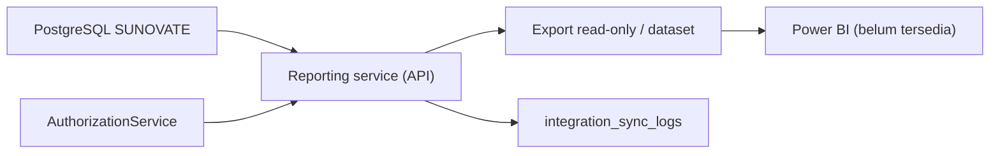

# Power BI Proposal

**Status:** PROPOSED | NEEDS MENTOR VALIDATION
**Last Updated:** 2026-10-01

## Purpose

Mengusulkan cara menyediakan data pelaporan SUNOVATE untuk Power BI, bila dibutuhkan, tanpa membuka database secara langsung dan tanpa melewati otorisasi.

## Status

- **PROPOSED:** Integrasi Power BI berada pada prioritas P2, setelah validasi (sumber: Proposal v2.4, slide 11).
- **PROPOSED:** Reporting dan ekspor di dalam SUNOVATE berada pada P1 (sumber: Proposal v2.4, slide 11). Kebutuhan Power BI dinilai setelah kebutuhan laporan internal jelas.
- **OPEN QUESTION:** Format laporan dan indikator dashboard yang benar-benar dibutuhkan (OQ-10).
- **CONFIRMED:** Tidak ada workspace, dataset, gateway, lisensi, atau persetujuan Power BI yang tersedia untuk SUNOVATE saat ini.

## Current state

- **CONFIRMED:** Belum ada provider interface atau implementasi pengembangan untuk Power BI.
- **CONFIRMED:** Dashboard SUNOVATE memakai endpoint `GET /api/v1/dashboard/summary` dengan data SIMULATED_DATA (sumber: fact sheet bagian 9).

## Proposed design

### Prinsip

- **PROPOSED:** Power BI tidak mendapat koneksi langsung ke PostgreSQL SUNOVATE, baik ke tabel bisnis maupun ke replika.
- **PROPOSED:** Data untuk Power BI disediakan sebagai export read-only atau semantic dataset yang dibentuk oleh API SUNOVATE, berisi agregat atau baris yang sudah difilter otorisasi.
- **PROPOSED:** Indikator dihitung di backend dengan definisi yang sama dengan dashboard SUNOVATE, sehingga angka tidak berbeda antarkanal.
- **PROPOSED:** Konten knowledge, isi dokumen, chunk, dan percakapan Hermes tidak termasuk dataset Power BI.

### Pilihan bentuk data

| Pilihan | Catatan (PROPOSED) |
|---|---|
| Export berkala (mis. CSV) dari endpoint reporting | Paling sederhana; perlu penyimpanan file yang disetujui |
| Endpoint reporting read-only yang dibaca Power BI | Memerlukan autentikasi layanan dan pembatasan scope |
| Semantic dataset yang dikelola pengelola BI | Memerlukan pemilik data dan aturan row-level security |

Pilihan akhir menunggu OQ-10 dan keputusan hosting (OQ-07).

### Alur data

### Keselarasan row-level security

- **PROPOSED:** Setiap dataset menyatakan scope tim dan klasifikasi maksimum. Dataset per tim hanya memuat baris dengan `owner_team_id` tim tersebut; dataset lintas tim hanya untuk pemegang `scope:all_teams`.
- **PROPOSED:** Bila Power BI memakai row-level security, aturannya harus setara dengan aturan SUNOVATE (permission, team scope, klasifikasi). Ketidaksetaraan dianggap temuan keamanan P0.
- **PROPOSED:** Record berklasifikasi CONFIDENTIAL tidak diekspor.

### Model autentikasi

- **PROPOSED:** Akses Power BI ke endpoint atau file export memakai identitas layanan terpisah dengan hak baca minimum; kredensial di secret store.
- **OPEN QUESTION:** Mekanisme autentikasi layanan yang diizinkan organisasi.

## Prerequisites

- Keputusan OQ-10 tentang indikator dan format laporan.
- Pemilik data dan pemilik laporan yang ditunjuk.
- Ketersediaan lisensi dan workspace yang disetujui (belum diketahui).
- Kajian keamanan atas dataset dan row-level security.

## Open Questions

- OQ-05 Klasifikasi dan hak akses.
- OQ-07 Mekanisme login dan hosting.
- OQ-10 Format laporan dan indikator dashboard.
- OQ-13 Retensi data export.
- OQ-15 Definisi status dan ambang jatuh tempo.

## Risks

- R-02 Kebocoran data melalui dataset yang lebih luas daripada hak akses pengguna.
- R-04 Angka dashboard dianggap angka resmi; label SIMULATED_DATA wajib tetap terlihat selama pengembangan.
- R-06 Scope melebihi periode bila Power BI dikerjakan sebelum laporan internal tervalidasi.

## Readiness criteria

- Seluruh butir pada [Integration Readiness Checklist](integration-readiness-checklist.md) terpenuhi.
- Test membuktikan dataset per tim tidak memuat baris tim lain.
- Angka pada dataset sama dengan `GET /api/v1/dashboard/summary` untuk scope yang sama.
- Tidak ada kredensial database yang diberikan kepada Power BI.

## Related Documents

- [Dashboard Requirements](../09-ui-ux/dashboard-requirements.md)
- [Authorization RBAC](../06-security/authorization-rbac.md)
- [Data Classification](../06-security/data-classification.md)
- [Integration Overview](integration-overview.md)
