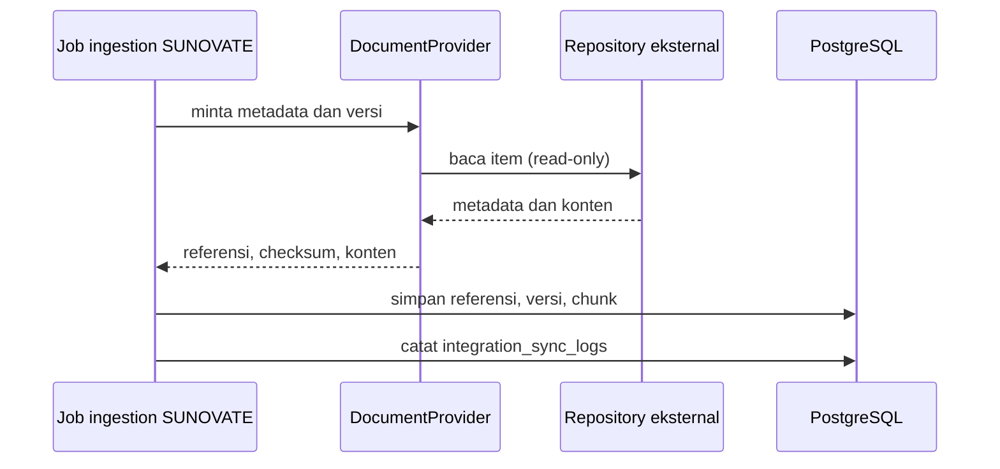

# SharePoint / Document Repository Proposal

**Status:** PROPOSED | NEEDS MENTOR VALIDATION
**Last Updated:** 2026-10-01

## Purpose

Mengusulkan cara SUNOVATE menghubungkan Knowledge Hub dengan document repository organisasi (misalnya SharePoint) tanpa menyalin file ke database SUNOVATE.

## Status

- **PROPOSED:** Integrasi SharePoint production sync berada pada prioritas P2, setelah validasi (sumber: Proposal v2.4, slide 11).
- **OPEN QUESTION:** Apakah SharePoint menjadi sumber utama atau hanya referensi (OQ-06).
- **CONFIRMED:** Tidak ada tenant, site, library, kredensial, atau persetujuan akses SharePoint yang tersedia untuk SUNOVATE saat ini.

## Current state

- **CONFIRMED:** Interface `DocumentProvider` tersedia di backend (sumber: fact sheet bagian 9).
- **CONFIRMED:** Pengganti pengembangan adalah `LocalDocumentProvider` dengan `DOCUMENT_PROVIDER=local` dan `LOCAL_STORAGE_PATH` (sumber: `.env.example` menurut fact sheet bagian 9).
- **CONFIRMED:** Placeholder provider produksi dinonaktifkan.
- **CONFIRMED:** SUNOVATE menyimpan referensi file, metadata, checksum SHA-256, versi, klasifikasi, dan lokasi provider; file tidak disimpan sebagai BLOB (sumber: ADR-003).
- **CONFIRMED:** Duplikasi ingestion dicegah dengan unique (`document_reference_id`, `checksum_sha256`) dan menghasilkan HTTP 409 `DUPLICATE_CHECKSUM` (sumber: fact sheet bagian 6 dan 9).
- **CONFIRMED:** Seluruh data dokumen pada pengembangan adalah SIMULATED_DATA.

## Proposed design

### Provider interface

- **PROPOSED:** Implementasi baru (nama kerja `SharePointDocumentProvider`) memenuhi kontrak `DocumentProvider` yang sama dengan `LocalDocumentProvider`, sehingga modul `documents`, `knowledge`, dan pipeline ingestion tidak berubah.
- **PROPOSED:** Kemampuan minimum yang dibutuhkan: membaca metadata referensi, membaca konten untuk ekstraksi, dan mendeteksi versi baru. Kemampuan menulis ke repository eksternal tidak diusulkan pada fase ini.

### Apa yang disinkronkan dan apa yang direferensikan

| Item | Perlakuan (PROPOSED) |
|---|---|
| File asli | Direferensikan; tetap di repository eksternal |
| Lokasi provider dan identitas item eksternal | Disimpan sebagai referensi pada `document_references` |
| Metadata (judul, tim pemilik, jenis, tanggal) | Disimpan dan dikurasi di SUNOVATE |
| Klasifikasi | Ditetapkan di SUNOVATE, perlu dipetakan ke skema resmi (OQ-05) |
| Checksum SHA-256 dan versi | Disimpan pada `document_versions` |
| Teks hasil ekstraksi dan chunk | Disimpan pada `document_chunks` untuk pencarian dan Hermes |
| Izin akses asli di repository eksternal | OPEN QUESTION: apakah perlu diselaraskan atau cukup otorisasi SUNOVATE |

### Alur data

- **PROPOSED:** Ekstraksi mengikuti status `PENDING`, `EXTRACTED`, `FAILED`, `QUARANTINED`, `NOT_APPLICABLE` (sumber: fact sheet bagian 6). Konten yang mencurigakan ditandai `QUARANTINED`.
- **PROPOSED:** Hanya knowledge berstatus `PUBLISHED` yang masuk pencarian default dan retrieval Hermes.
- **PROPOSED:** Tidak ada mekanisme job queue baru (Redis atau broker); sinkronisasi dijalankan sebagai proses terjadwal dalam monolith bila dibutuhkan.

### Model autentikasi

- **PROPOSED:** Akses aplikasi ke repository eksternal memakai identitas layanan (service identity) dengan hak baca minimum pada lokasi yang disetujui.
- **PROPOSED:** Kredensial disimpan di secret store, tidak di repository Git atau log (lihat [Secrets Management](../06-security/secrets-management.md)).
- **OPEN QUESTION:** Jenis identitas layanan dan mekanisme autentikasi yang diizinkan organisasi (OQ-07).

## Prerequisites

- Keputusan OQ-06 tentang peran SharePoint.
- Daftar dokumen yang boleh masuk repository dan RAG (OQ-04).
- Pemetaan klasifikasi ke skema resmi Kemenkeu (OQ-05).
- Penunjukan pemilik data dan lokasi repository yang disetujui.
- Kajian keamanan atas hak akses identitas layanan.
- Lingkungan uji atau sandbox (OQ-20).

## Open Questions

- OQ-04 Dokumen yang boleh masuk repository dan RAG.
- OQ-05 Klasifikasi dan hak akses per jenis dokumen.
- OQ-06 SharePoint sebagai sumber utama atau referensi.
- OQ-07 Mekanisme login dan hosting.
- OQ-13 Kebijakan retensi dan penghapusan.
- OQ-18 Penyimpanan file sumber di repository Git.

## Risks

- R-02 Kebocoran data bila izin repository eksternal lebih longgar atau lebih ketat daripada otorisasi SUNOVATE.
- R-03 Data asli masuk lingkungan pengembangan sebelum klasifikasi disetujui.
- R-07 Prompt injection dari isi dokumen.
- R-09 Klasifikasi tidak sesuai skema resmi.
- R-11 Metadata berkualitas rendah sehingga retrieval buruk.

## Readiness criteria

- Seluruh butir pada [Integration Readiness Checklist](integration-readiness-checklist.md) terpenuhi.
- Contract test `DocumentProvider` lulus untuk `LocalDocumentProvider` dan implementasi baru.
- Sinkronisasi ulang atas file yang sama tidak membuat versi ganda.
- Item yang dihapus atau dipindahkan di repository eksternal menghasilkan status yang jelas, bukan error diam-diam.

## Related Documents

- [Integration Overview](integration-overview.md)
- [Document Lifecycle](../02-business/document-lifecycle.md)
- [Ingestion Pipeline](../05-ai-rag/ingestion-pipeline.md)
- [Metadata Schema](../04-data/metadata-schema.md)
- [Document Classification](../04-data/document-classification.md)
- [Prompt Injection Defense](../05-ai-rag/prompt-injection-defense.md)
