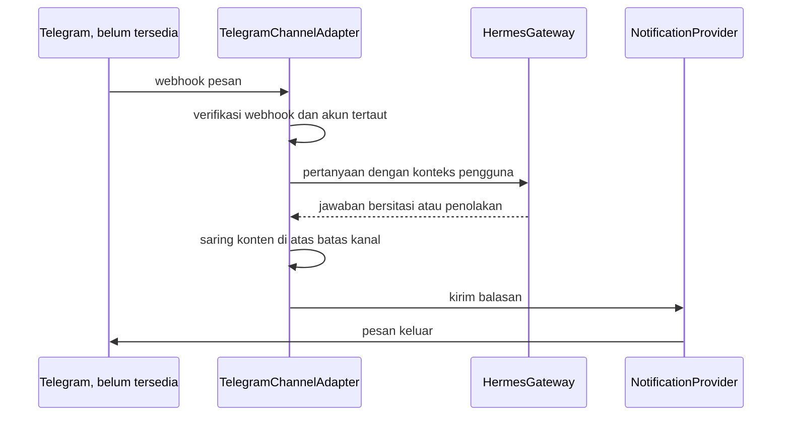

# Telegram Proposal

**Status:** PROPOSED | NEEDS MENTOR VALIDATION
**Last Updated:** 2026-10-02

## Purpose

Mengusulkan fondasi integrasi Telegram untuk notifikasi dan akses Hermes, dengan otorisasi yang sama seperti aplikasi web.

## Status

- **CONFIRMED:** Fondasi integrasi Telegram dan WhatsApp adalah tujuan fase lanjutan (sumber: brief sesi 2026-10-01, tujuan 8).
- **PROPOSED:** Telegram berada pada prioritas P2, setelah validasi (sumber: Proposal v2.4, slide 11).
- **CONFIRMED (knowledge owner, deck v1_ slide 24):** Pertanyaan apakah Telegram diizinkan untuk penggunaan internal (OQ-08) dijawab "bisa" (DEC-20261002-06). Pengakuan mentor masih tertunda (OQ-24).
- **PROPOSED:** Jawaban ini tidak mengubah prioritas P2 dan tidak membuat integrasi tersedia. Kontrol tetap sama: kajian keamanan dan kebijakan organisasi sebelum diaktifkan, penautan akun, dan konten RESTRICTED dan CONFIDENTIAL tidak dikirim ke kanal eksternal secara default. Tidak ada bot, akun, token, webhook, atau persetujuan penyedia.
- **CONFIRMED:** Tidak ada bot, token, webhook, atau persetujuan Telegram yang tersedia untuk SUNOVATE saat ini.

## Current state

- **CONFIRMED:** Interface `NotificationProvider` tersedia di backend; konfigurasi pengembangan `NOTIFICATION_PROVIDER=disabled` (sumber: fact sheet bagian 9).
- **CONFIRMED:** Tidak ada pengganti pengembangan khusus Telegram dan tidak ada channel adapter.
- **CONFIRMED:** Hermes diakses melalui `HermesGateway` dengan alur ScopeGuard, otorisasi, retrieval, CitationValidator, dan OutputGuard (sumber: fact sheet bagian 9).
- **PROPOSED:** Notifikasi dalam aplikasi (tabel `notifications`) berada pada prioritas P1 dan menjadi dasar sebelum kanal eksternal (sumber: Proposal v2.4, slide 11).

## Proposed design

### Komponen

- **PROPOSED:** `TelegramNotificationProvider` memenuhi kontrak `NotificationProvider` untuk pesan keluar.
- **PROPOSED:** `TelegramChannelAdapter` menerima pesan masuk, memverifikasi sumbernya, memetakan akun ke pengguna SUNOVATE, lalu meneruskan pertanyaan ke `HermesGateway`. Adapter tidak memiliki akses database langsung dan tidak memanggil model AI sendiri.

### Penautan akun

- **PROPOSED:** Pengguna menautkan akun Telegram dari dalam SUNOVATE setelah login, misalnya dengan kode sekali pakai berumur pendek. Akun yang belum tertaut tidak mendapat jawaban selain instruksi penautan.
- **PROPOSED:** Penautan dan pencabutan tautan dicatat pada `audit_logs`.
- **OPEN QUESTION:** Data identitas Telegram minimum yang boleh disimpan.

### Otorisasi dan klasifikasi

- **PROPOSED:** Setiap pesan masuk diperlakukan sebagai permintaan pengguna tertaut dengan permission, team scope, dan clearance yang sama seperti di web (`hermes:query`, `search:query`).
- **PROPOSED:** Secara default, konten RESTRICTED dan CONFIDENTIAL tidak pernah dikirim ke kanal pesan eksternal, terlepas dari clearance pengguna.
- **OPEN QUESTION:** Apakah konten INTERNAL boleh dikirim ke Telegram. Sampai diputuskan, pesan keluar hanya berisi pemberitahuan singkat dan tautan ke SUNOVATE, tanpa isi dokumen.
- **PROPOSED:** Permintaan bernuansa tindakan tulis menghasilkan `REQUIRES_HUMAN_APPROVAL` seperti di web dan diselesaikan di aplikasi, bukan di Telegram.

### Alur pesan masuk

### Webhook

- **PROPOSED:** Endpoint webhook mengikuti [Webhook Policy](../07-api/webhook-policy.md): verifikasi sumber, penolakan permintaan tidak sah, idempotensi, dan pencatatan.
- **OPEN QUESTION:** Mekanisme verifikasi yang tersedia dan disetujui untuk Telegram dinilai saat evaluasi; tidak diasumsikan di dokumen ini.
- **PROPOSED:** Endpoint webhook tidak aktif bila `NOTIFICATION_PROVIDER` bukan nilai Telegram yang disetujui.

## Prerequisites

- OQ-08 sudah dijawab knowledge owner ("bisa"); yang masih dibutuhkan adalah pengakuan mentor (OQ-24) dan persetujuan keamanan.
- Kebijakan organisasi tentang penggunaan aplikasi pesan pihak ketiga untuk informasi kedinasan.
- Kajian keamanan atas webhook, penautan akun, dan penyimpanan token bot di secret store.
- Jalur jaringan masuk yang disetujui untuk webhook.
- Notifikasi dalam aplikasi (P1) sudah berjalan.

## Open Questions

- OQ-05 Klasifikasi yang boleh keluar ke kanal eksternal.
- OQ-07 Hosting dan jalur jaringan.
- OQ-08 Izin Telegram dan WhatsApp (ANSWERED, knowledge owner: "bisa").
- OQ-11 Lokasi pemrosesan data.
- OQ-13 Retensi pesan dan log kanal.

## Risks

- R-02 Kebocoran data melalui kanal pesan eksternal.
- R-04 Jawaban singkat di kanal pesan dianggap keputusan resmi.
- R-05 Akses dan persetujuan tidak tersedia.
- R-07 Prompt injection melalui pesan masuk; tetap diperiksa ScopeGuard.

## Readiness criteria

- Seluruh butir pada [Integration Readiness Checklist](integration-readiness-checklist.md) terpenuhi.
- Test membuktikan akun tidak tertaut tidak menerima konten.
- Test membuktikan konten RESTRICTED dan CONFIDENTIAL tidak terkirim.
- Test membuktikan webhook tanpa verifikasi valid ditolak.
- Jawaban di Telegram memakai sitasi yang sama dengan jawaban web.

## Related Documents

- [WhatsApp Proposal](whatsapp-proposal.md)
- [Hermes Overview](../05-ai-rag/hermes-overview.md)
- [Scope Guard](../05-ai-rag/scope-guard.md)
- [Human Approval](../05-ai-rag/human-approval.md)
- [Webhook Policy](../07-api/webhook-policy.md)
- [Integration Overview](integration-overview.md)
