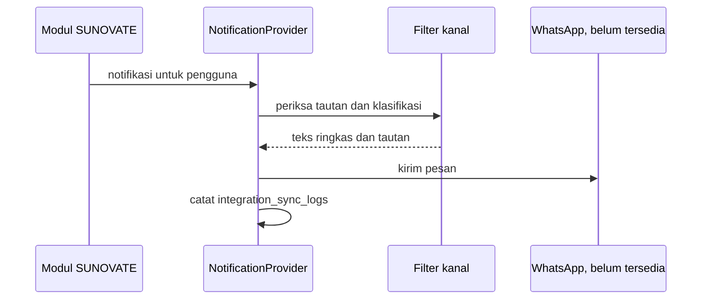

# WhatsApp Proposal

**Status:** PROPOSED | NEEDS MENTOR VALIDATION
**Last Updated:** 2026-10-02

## Purpose

Mengusulkan fondasi integrasi WhatsApp untuk notifikasi dan akses Hermes, dengan otorisasi yang sama seperti aplikasi web. Struktur desain sengaja disamakan dengan [Telegram Proposal](telegram-proposal.md).

## Status

- **CONFIRMED:** Fondasi integrasi Telegram dan WhatsApp adalah tujuan fase lanjutan (sumber: brief sesi 2026-10-01, tujuan 8).
- **PROPOSED:** WhatsApp berada pada prioritas P2, setelah validasi (sumber: Proposal v2.4, slide 11).
- **CONFIRMED (knowledge owner, deck v1_ slide 24):** Pertanyaan apakah WhatsApp diizinkan untuk penggunaan internal (OQ-08) dijawab "bisa" (DEC-20261002-06). Pengakuan mentor masih tertunda (OQ-24).
- **PROPOSED:** Jawaban ini tidak mengubah prioritas P2 dan tidak membuat integrasi tersedia. Kontrol tetap sama: kajian keamanan dan kebijakan organisasi sebelum diaktifkan, penautan akun, dan konten RESTRICTED dan CONFIDENTIAL tidak dikirim ke kanal eksternal secara default. Tidak ada bot, akun, token, webhook, atau persetujuan penyedia.
- **OPEN QUESTION:** Batasan kebijakan layanan WhatsApp untuk bisnis (jenis akun, template pesan, persetujuan penyedia, biaya, dan ketentuan penggunaan) belum dikaji dan tidak diasumsikan di dokumen ini.
- **CONFIRMED:** Tidak ada akun bisnis, nomor, token, webhook, atau persetujuan WhatsApp yang tersedia untuk SUNOVATE saat ini.

## Current state

- **CONFIRMED:** Interface `NotificationProvider` tersedia di backend; konfigurasi pengembangan `NOTIFICATION_PROVIDER=disabled` (sumber: fact sheet bagian 9).
- **CONFIRMED:** Tidak ada pengganti pengembangan khusus WhatsApp dan tidak ada channel adapter.
- **CONFIRMED:** Hermes diakses melalui `HermesGateway` (sumber: ADR-004).

## Proposed design

### Komponen

- **PROPOSED:** `WhatsAppNotificationProvider` memenuhi kontrak `NotificationProvider` untuk pesan keluar.
- **PROPOSED:** `WhatsAppChannelAdapter` menerima pesan masuk, memverifikasi sumbernya, memetakan nomor ke pengguna SUNOVATE, lalu meneruskan pertanyaan ke `HermesGateway`. Adapter tidak memiliki akses database langsung.
- **PROPOSED:** Logika kanal yang sama dengan Telegram (penautan akun, penyaringan klasifikasi, pencatatan) ditempatkan pada satu komponen bersama agar aturan tidak berbeda antarkanal.

### Penautan akun

- **PROPOSED:** Pengguna menautkan nomor dari dalam SUNOVATE setelah login dengan kode verifikasi sekali pakai. Nomor yang belum tertaut tidak menerima konten.
- **PROPOSED:** Nomor telepon diperlakukan sebagai data pribadi; disimpan minimum, tidak ditulis ke log aplikasi, dan tidak dimasukkan ke data seed. Seed hanya memakai data SIMULATED.
- **PROPOSED:** Penautan dan pencabutan tautan dicatat pada `audit_logs`.

### Otorisasi dan klasifikasi

- **PROPOSED:** Setiap pesan masuk diperlakukan sebagai permintaan pengguna tertaut dengan permission, team scope, dan clearance yang sama seperti di web.
- **PROPOSED:** Secara default, konten RESTRICTED dan CONFIDENTIAL tidak pernah dikirim ke kanal pesan eksternal.
- **OPEN QUESTION:** Apakah konten INTERNAL boleh dikirim. Sampai diputuskan, pesan keluar hanya berisi pemberitahuan singkat dan tautan ke SUNOVATE.
- **PROPOSED:** Permintaan tindakan tulis menghasilkan `REQUIRES_HUMAN_APPROVAL` dan diselesaikan di aplikasi.

### Alur pesan keluar (notifikasi)

### Webhook

- **PROPOSED:** Endpoint webhook mengikuti [Webhook Policy](../07-api/webhook-policy.md).
- **OPEN QUESTION:** Mekanisme verifikasi webhook yang tersedia dan disetujui untuk WhatsApp dinilai saat evaluasi.

## Prerequisites

- OQ-08 sudah dijawab knowledge owner ("bisa"); yang masih dibutuhkan adalah pengakuan mentor (OQ-24) dan persetujuan keamanan.
- Kajian kebijakan layanan WhatsApp untuk bisnis dan ketentuan penggunaan oleh instansi.
- Kebijakan perlindungan data pribadi untuk nomor telepon.
- Kajian keamanan atas webhook, penautan akun, dan penyimpanan token di secret store.
- Notifikasi dalam aplikasi (P1) sudah berjalan.

## Open Questions

- OQ-05 Klasifikasi yang boleh keluar ke kanal eksternal.
- OQ-07 Hosting dan jalur jaringan.
- OQ-08 Izin Telegram dan WhatsApp (ANSWERED, knowledge owner: "bisa").
- OQ-13 Retensi pesan dan log kanal.

## Risks

- R-02 Kebocoran data melalui kanal pesan eksternal.
- R-03 Data pribadi (nomor telepon) masuk log atau repository.
- R-05 Persetujuan penyedia atau organisasi tidak tersedia.
- R-07 Prompt injection melalui pesan masuk.

## Readiness criteria

- Seluruh butir pada [Integration Readiness Checklist](integration-readiness-checklist.md) terpenuhi.
- Test membuktikan nomor tidak tertaut tidak menerima konten.
- Test membuktikan konten RESTRICTED dan CONFIDENTIAL tidak terkirim.
- Test membuktikan nomor telepon tidak muncul di log aplikasi.
- Aturan kanal identik dengan Telegram (diuji dengan test bersama).

## Related Documents

- [Telegram Proposal](telegram-proposal.md)
- [Hermes Overview](../05-ai-rag/hermes-overview.md)
- [Webhook Policy](../07-api/webhook-policy.md)
- [Simulated Data Policy](../04-data/simulated-data-policy.md)
- [Integration Overview](integration-overview.md)
