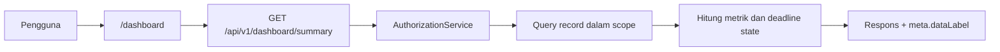

# Dashboard Requirements

**Status:** PROPOSED | NEEDS MENTOR VALIDATION
**Last Updated:** 2026-10-02

## Purpose

Menetapkan persyaratan dashboard SUNOVATE: isi per role, bagian "Perlu perhatian", sumber perhitungan, dan aturan tampilan.

## Status

- **CONFIRMED:** Dashboard sesuai hak akses termasuk tujuan SUNOVATE (sumber: brief sesi 2026-10-01, tujuan 6).
- **PROPOSED:** Kinerja dan pending matters dasar termasuk P0 MVP (sumber: Proposal v2.4, slide 11).
- **OPEN QUESTION:** Indikator dan format laporan yang benar-benar dibutuhkan (OQ-10, PARTIAL). Seluruh indikator di dokumen ini adalah kandidat untuk divalidasi.
- **CONFIRMED (knowledge owner, deck v1_ slide 24):** Indikator yang diminta adalah "yield" dan "kepemilikan SBN" (DEC-20261002-08). Ini hanya indikator yang diminta, tanpa angka, definisi, sumber data, atau format laporan. Pengakuan mentor masih tertunda (OQ-24).
- **OPEN QUESTION:** Sumber data otoritatif dan definisi kedua indikator serta siapa yang boleh melihatnya (OQ-21). Indikator diblokir sampai ada jawaban.
- **CONFIRMED:** Dashboard memakai `GET /api/v1/dashboard/summary` dan data SIMULATED_DATA (sumber: fact sheet bagian 9).

## Aturan umum

1. **PROPOSED:** Seluruh angka dihitung di backend dari record dalam scope yang boleh dibaca pengguna (permission, team scope, klasifikasi). Frontend tidak menghitung ulang dan tidak menyimpan angka statis.
2. **CONFIRMED:** Status tenggat (`SAFE`, `DUE_SOON`, `DUE_TODAY`, `OVERDUE`, `COMPLETED`) hanya dihitung oleh backend (sumber: fact sheet bagian 6).
3. **PROPOSED:** Record yang tidak boleh dibaca pengguna tidak ikut dihitung, sehingga angka agregat tidak membocorkan keberadaan record.
4. **CONFIRMED:** Label SIMULATED_DATA selalu terlihat selama data berasal dari dataset simulasi; respons API membawa `meta.dataLabel` (sumber: fact sheet bagian 9).
5. **PROPOSED:** Tidak ada grafik dekoratif. Grafik hanya dipakai bila menyampaikan informasi yang tidak lebih jelas dalam tabel, dan selalu disertai angka atau tabel alternatif.
6. **PROPOSED:** Tabel didahulukan untuk data operasional. Ringkasan angka berupa satu baris metrik, bukan grid kartu besar.
7. **CONFIRMED:** Dashboard tidak menampilkan data pasar, yield, hasil lelang, atau angka pembiayaan (sumber: fact sheet bagian 0; [Market Data Proposal](../08-integrations/market-data-proposal.md)). Aturan ini tetap berlaku: permintaan indikator "yield" dan "kepemilikan SBN" dari knowledge owner tidak membuka tampilan angka. Tabel bisnis SUN tetap OUT OF SCOPE untuk saat ini (ADR-013). Mengubah aturan ini memerlukan sumber data otoritatif, keputusan cakupan sesuai [change-management](../12-governance/change-management.md), dan klasifikasi akses (OQ-21).
8. **PROPOSED:** Setiap angka dapat ditelusuri ke daftar record yang membentuknya (misalnya tautan ke `/work-monitoring` dengan filter).

## Ringkasan metrik (kandidat)

| Metrik | Definisi kandidat | Validasi |
|---|---|---|
| Output aktif | Output kerja dengan status belum selesai | OQ-15 |
| Jatuh tempo dekat | Tugas atau output berstatus `DUE_SOON` | Ambang `DEADLINE_DUE_SOON_DAYS` (default 7), OQ-15 |
| Terlambat | Berstatus `OVERDUE` | OQ-15 |
| Pending matters | Pending matter yang belum selesai | OQ-10 |

## Indikator yang diminta knowledge owner (belum ada data)

| Indikator | Status | Yang belum diketahui |
|---|---|---|
| Yield | Diminta (CONFIRMED, knowledge owner); diblokir | Sumber data otoritatif, definisi, periode, siapa yang boleh melihat (OQ-21) |
| Kepemilikan SBN | Diminta (CONFIRMED, knowledge owner); diblokir | Sumber data otoritatif, definisi, tingkat agregasi, siapa yang boleh melihat (OQ-21) |

- **PROPOSED:** Sampai OQ-21 dijawab, dashboard tidak menampilkan kedua indikator dan tidak membuat angka contoh berlabel seolah-olah resmi. Bila diperlukan untuk demo tata letak, hanya placeholder kosong berlabel `SIMULATED_DATA` tanpa angka yang menyerupai data nyata.
- **PROPOSED:** Bila sumbernya ternyata sistem resmi di luar SUNOVATE, pola yang mungkin adalah tautan atau referensi, bukan menyalin data (lihat [Power BI Proposal](../08-integrations/power-bi-proposal.md)); belum diputuskan.
- **OPEN QUESTION:** Format laporan yang dibutuhkan belum dijawab (OQ-10).

## Perlu perhatian

- **PROPOSED:** Bagian "Perlu perhatian" berupa tabel dengan kolom Item, Tim, Tenggat, Status, diurutkan: `OVERDUE`, `DUE_TODAY`, `DUE_SOON`.
- **PROPOSED:** Item tambahan sesuai role: approval `PENDING` untuk pemegang `approval:decide` (kecuali permintaan miliknya sendiri, sesuai separation of duties), knowledge `IN_REVIEW` untuk pemegang `knowledge:review`, isu kualitas data untuk pemegang `data_quality:read`.
- **PROPOSED:** Status ditampilkan dengan teks dan warna, bukan warna saja (lihat [Design System](design-system.md)).
- **PROPOSED:** Bila kosong, tampil `EmptyState` dengan pesan yang menyatakan tidak ada item, bukan ruang kosong.

## Isi per role (PROPOSED)

| Role | Fokus dashboard | Scope data |
|---|---|---|
| `system_admin` | Status provider, pengguna, ringkasan audit | Semua tim (`scope:all_teams`), dibatasi clearance INTERNAL pada seed |
| `knowledge_coordinator` | Knowledge `IN_REVIEW`, approval publikasi, isu kualitas data | Semua tim |
| `team_lead` | Output, tugas, pending matters tim; approval yang perlu diputuskan | Tim sendiri |
| `knowledge_owner` | Knowledge milik sendiri per status lifecycle | Tim sendiri |
| `reviewer` | Antrean review dan approval | Tim sendiri |
| `staff` | Tugas milik sendiri dan tenggatnya | Tim sendiri |
| `auditor` | Ringkasan audit dan akses ditolak | Semua tim, read-only |
| `read_only` | Knowledge terbaru yang dipublikasikan | Tim sendiri dan konten DIRECTORATE yang PUBLISHED |

- **OPEN QUESTION:** Apakah admin boleh membaca konten knowledge (fact sheet bagian 5).
- **OPEN QUESTION:** Kebijakan berbagi lintas tim untuk konten INTERNAL (OQ-14).

## Open Questions

- OQ-03 Tim dan proses pilot.
- OQ-10 Indikator dan format laporan (PARTIAL: "yield" dan "kepemilikan SBN" diminta; format laporan belum).
- OQ-21 Sumber data otoritatif dan definisi "yield" dan "kepemilikan SBN".
- OQ-14 Berbagi lintas tim.
- OQ-15 Ambang jatuh tempo dan definisi status.

## Risks

- R-01 Indikator disusun dari asumsi tanpa validasi.
- R-15 Indikator yield dan kepemilikan SBN diminta tanpa sumber data otoritatif.
- R-02 Agregat membocorkan keberadaan record di luar scope.
- R-04 Angka simulasi dianggap angka resmi.
- R-10 Simulated store disangka persistence produksi.

## Acceptance Criteria

- **PROPOSED:** Test API membuktikan dua pengguna dari tim berbeda menerima angka berbeda sesuai scope.
- **PROPOSED:** Test membuktikan record di atas clearance pengguna tidak ikut dihitung.
- **PROPOSED:** Halaman dashboard tidak memuat angka statis di kode frontend.
- **PROPOSED:** Label SIMULATED_DATA terlihat pada viewport 320px tanpa scroll horizontal.

## Related Documents

- [Work Monitoring Flow](../02-business/work-monitoring-flow.md)
- [Business Rules](../02-business/business-rules.md)
- [Design System](design-system.md)
- [Power BI Proposal](../08-integrations/power-bi-proposal.md)
- [Permission Matrix](../06-security/permission-matrix.md)
