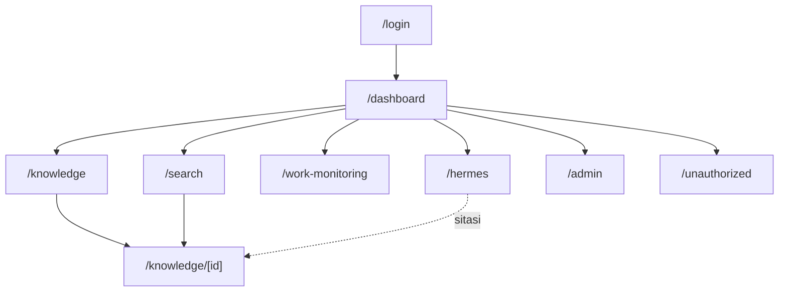
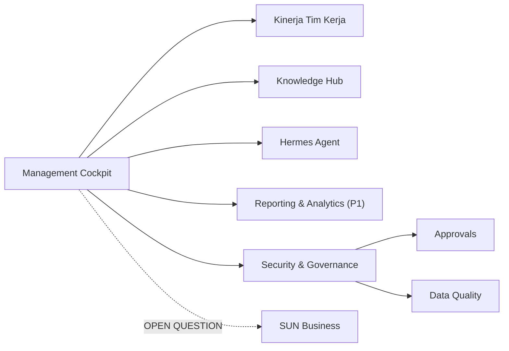

# Information Architecture

**Status:** DRAFT
**Last Updated:** 2026-10-01

## Purpose

Mendokumentasikan struktur halaman SUNOVATE yang sudah ada di scaffold dan membedakannya dari struktur masa depan yang masih usulan.

## Status

- **CONFIRMED:** Route pada bagian "Route yang sudah ada" tersedia di `apps/web` (Next.js App Router) (sumber: fact sheet bagian 9).
- **PROPOSED:** Struktur masa depan berasal dari blueprint lama dan prompt sesi sebelumnya; blueprint lama berstatus PROPOSED dan stack NestJS/Prisma di dalamnya sudah digantikan (sumber: ADR-002).
- **CONFIRMED:** Seluruh data yang tampil adalah SIMULATED_DATA.

## Route yang sudah ada

| Route | Fungsi | Endpoint API terkait (PROPOSED pemetaan) |
|---|---|---|
| `/login` | Login pengembangan untuk pengguna SIMULATED | `POST /api/v1/auth/dev/login` |
| `/dashboard` | Ringkasan kerja dan "Perlu perhatian" | `GET /api/v1/dashboard/summary` |
| `/knowledge` | Daftar knowledge yang boleh dibaca pengguna | `GET /api/v1/knowledge` |
| `/knowledge/[id]` | Detail knowledge, metadata, dokumen terkait | `GET /api/v1/knowledge/{id}`, `GET /api/v1/documents/{id}/versions` |
| `/search` | Pencarian teks | `GET /api/v1/search?q=` |
| `/work-monitoring` | Output kerja, tugas, milestone, pending matters | `GET /api/v1/work-outputs`, `GET /api/v1/tasks`, `GET /api/v1/milestones`, `GET /api/v1/pending-matters` |
| `/hermes` | Pertanyaan ke Hermes dengan sitasi | `POST /api/v1/hermes/query` melalui route handler `/api/hermes` |
| `/admin` | Informasi pengguna, tim, role, provider, audit | `GET /api/v1/users`, `/teams`, `/roles`, `/providers`, `/audit-logs` |
| `/unauthorized` | Pemberitahuan akses ditolak | Tidak ada |

- **CONFIRMED:** Tersedia juga halaman not-found, error, dan loading (sumber: fact sheet bagian 9).
- **CONFIRMED:** Route handler `/api/hermes` meneruskan pertanyaan Hermes ke API; token disimpan di cookie httpOnly (sumber: fact sheet bagian 9).
- **CONFIRMED:** Record yang tidak boleh dibaca pengguna menghasilkan 404, bukan 403, untuk menghindari kebocoran keberadaan record (sumber: fact sheet bagian 9).
- **PROPOSED:** Halaman detail menampilkan not-found untuk respons 404 tersebut, tanpa membedakan "tidak ada" dan "tidak berhak".

## Sitemap saat ini

## Struktur masa depan (PROPOSED)

Delapan area domain dari prompt sesi sebelumnya (sumber: `14_NEW_SESSION_HANDOFF_PROMPT.txt`, `20_NEW_CHAT_MASTER_PROMPT.txt`):

| Area | Status | Catatan |
|---|---|---|
| Management Cockpit | Sebagian ada sebagai `/dashboard` | Indikator menunggu OQ-10 |
| SUN Business | OPEN QUESTION | Tabel SUN Business dihapus dari skema (ADR-013); tidak ada halaman |
| Kinerja Tim Kerja | Sebagian ada sebagai `/work-monitoring` | Definisi status menunggu OQ-15 |
| Knowledge Hub | Ada sebagai `/knowledge` dan `/search` | Pencarian semantik menunggu model embedding (ADR-008) |
| Reporting & Analytics | PROPOSED, P1 | Reporting dan ekspor (Proposal v2.4, slide 11); format menunggu OQ-10 |
| Integrations | PROPOSED, P2 | Lihat [Integration Overview](../08-integrations/integration-overview.md) |
| Hermes Agent | Ada sebagai `/hermes` | Provider pengembangan ekstraktif (ADR-008) |
| Security & Governance | Sebagian ada sebagai `/admin` | Audit log, approval, data quality |

Route kandidat (PROPOSED, nama dapat berubah):

- `/approvals` untuk antrean persetujuan (endpoint `GET /api/v1/approvals` sudah ada).
- `/reports` untuk reporting dan ekspor (P1).
- `/data-quality` untuk isu kualitas data (endpoint `GET /api/v1/data-quality-issues` sudah ada).
- Halaman SUN Business tidak diusulkan sampai OQ-02, OQ-03, dan kebutuhan data divalidasi.

## Prinsip

- **CONFIRMED:** Visibilitas menu tidak menggantikan otorisasi; API menegakkan akses pada setiap endpoint (sumber: ADR-006).
- **PROPOSED:** Satu konsep satu tempat: knowledge dibuka di `/knowledge/[id]` dari mana pun ia ditemukan (pencarian, sitasi Hermes, dashboard).
- **PROPOSED:** Tidak menambah halaman untuk area yang belum tervalidasi; area tersebut cukup tercatat di dokumen ini.

## Open Questions

- OQ-01 Fungsi SUN Tematik dan apakah membutuhkan halaman khusus.
- OQ-02 Daftar dan nama resmi tim kerja.
- OQ-10 Indikator dashboard dan format laporan.
- OQ-15 Definisi status output dan tugas.

## Related Documents

- [Navigation](navigation.md)
- [Dashboard Requirements](dashboard-requirements.md)
- [Endpoint Catalog](../07-api/endpoint-catalog.md)
- [MVP Scope](../01-product/mvp-scope.md)
