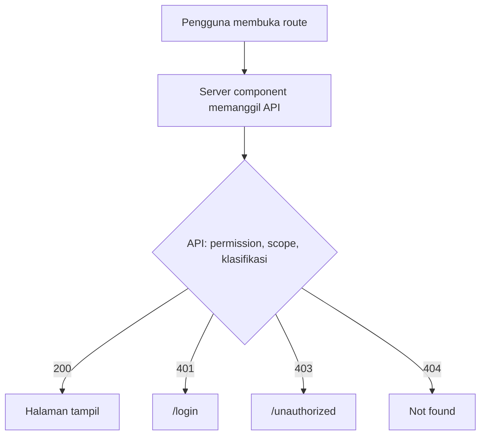

# Navigation

**Status:** DRAFT
**Last Updated:** 2026-10-01

## Purpose

Menjelaskan navigasi utama SUNOVATE, aturan visibilitas menu, breadcrumb, dan navigasi keyboard.

## Status

- **CONFIRMED:** Sidebar memuat enam item navigasi utama (sumber: `apps/web/src/components/app-shell.tsx`).
- **CONFIRMED:** Menyembunyikan menu di frontend bersifat kosmetik; otorisasi ditegakkan oleh API (sumber: ADR-006).
- **PROPOSED:** Aturan visibilitas per permission, breadcrumb, dan skip link pada dokumen ini adalah persyaratan; status implementasinya diverifikasi melalui acceptance criteria di bawah.

## Sidebar

| Label | Route | Permission yang relevan (PROPOSED) |
|---|---|---|
| Dashboard | `/dashboard` | `work:read`, `pending:read` |
| Knowledge Hub | `/knowledge` | `knowledge:read` |
| Pencarian | `/search` | `search:query` |
| Monitoring Kerja | `/work-monitoring` | `work:read` |
| Hermes | `/hermes` | `hermes:query` |
| Administrasi | `/admin` | salah satu dari `user:read`, `role:read`, `audit:read`, `provider:read` |

- **CONFIRMED:** Sidebar menampilkan merek SUNOVATE dan catatan lingkungan pengembangan bahwa seluruh data adalah SIMULATED_DATA (sumber: `app-shell.tsx`).
- **CONFIRMED:** Elemen navigasi memakai `nav` dengan `aria-label="Navigasi utama"` (sumber: `app-shell.tsx`).
- **PROPOSED:** Item aktif ditandai dengan `aria-current="page"` dan penanda visual yang tidak hanya berupa warna (misalnya garis tepi gold dan teks tebal).
- **PROPOSED:** Urutan item tetap; tidak ada menu bertingkat pada fase MVP.

## Visibilitas berbasis permission

- **PROPOSED:** Frontend menyembunyikan item yang permission-nya tidak dimiliki pengguna, berdasarkan data dari `GET /api/v1/auth/me`.
- **CONFIRMED:** Penyembunyian ini tidak menjadi kontrol keamanan. Setiap endpoint tetap memeriksa permission, team scope, dan klasifikasi; deny by default (sumber: ADR-006).
- **PROPOSED:** Bila pengguna membuka route secara langsung tanpa hak, server component menerima 401, 403, atau 404 dari API dan menampilkan `/login`, `/unauthorized`, atau not-found sesuai kode.
- **PROPOSED:** Contoh: `read_only` tidak memiliki `user:read`, `role:read`, `audit:read`, maupun `provider:read`, sehingga item Administrasi tidak tampil (sumber matriks: fact sheet bagian 5).

## Breadcrumb

- **PROPOSED:** Breadcrumb tampil pada halaman dengan kedalaman lebih dari satu, misalnya `Knowledge Hub / Judul knowledge`.
- **PROPOSED:** Breadcrumb memakai `nav` dengan `aria-label="Breadcrumb"`, daftar berurutan, dan `aria-current="page"` pada item terakhir.
- **PROPOSED:** Pemisah breadcrumb dibuat dengan CSS atau teks biasa, bukan karakter ikon Unicode.
- **PROPOSED:** Judul knowledge yang tidak boleh dibaca pengguna tidak pernah muncul di breadcrumb.

## Navigasi keyboard

- **PROPOSED:** Seluruh item navigasi, tombol, dan kontrol formulir dapat dicapai dengan Tab dalam urutan visual.
- **CONFIRMED:** Fokus terlihat dengan outline gold 3px (sumber: `apps/web/src/app/globals.css`, `:focus-visible`).
- **PROPOSED:** Tidak ada keyboard trap; dialog (bila ada kelak) mengembalikan fokus ke pemicunya saat ditutup.
- **PROPOSED:** Setelah navigasi antarhalaman, fokus diarahkan ke judul halaman (`h1`) atau area konten utama.
- **PROPOSED:** Pintasan keyboard khusus tidak ditambahkan pada fase MVP.

## Skip link

- **CONFIRMED:** Area konten utama memiliki `id="main-content"` (sumber: `app-shell.tsx`).
- **PROPOSED:** Skip link "Lewati ke konten utama" menjadi elemen fokus pertama pada setiap halaman, tersembunyi secara visual sampai menerima fokus, dan mengarah ke `#main-content`.

## Topbar

- **CONFIRMED:** Topbar menampilkan konteks halaman dan tautan pengguna (sumber: `app-shell.tsx`).
- **PROPOSED:** Topbar menampilkan nama tampilan pengguna SIMULATED, role, dan tim, serta tombol keluar.

## Open Questions

- OQ-01 Apakah SUN Tematik membutuhkan item navigasi khusus.
- OQ-10 Apakah Reporting menjadi item navigasi tersendiri.

## Acceptance Criteria

- **PROPOSED:** Test end-to-end membuktikan route yang dibuka langsung tanpa hak tidak menampilkan data.
- **PROPOSED:** Test komponen membuktikan item Administrasi tidak tampil untuk `read_only`.
- **PROPOSED:** Skip link adalah elemen fokus pertama dan memindahkan fokus ke `#main-content`.
- **PROPOSED:** Item aktif memiliki `aria-current="page"`.

## Related Documents

- [Information Architecture](information-architecture.md)
- [Accessibility](accessibility.md)
- [Permission Matrix](../06-security/permission-matrix.md)
- [Authorization RBAC](../06-security/authorization-rbac.md)
