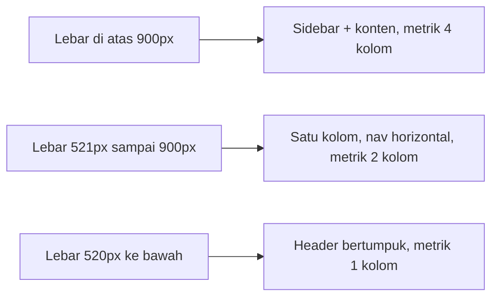

# Responsive Design

**Status:** DRAFT
**Last Updated:** 2026-10-01

## Purpose

Menjelaskan breakpoint yang dipakai di CSS SUNOVATE, perilaku tata letak di setiap breakpoint, dan persyaratan ukuran target sentuh.

## Status

- **CONFIRMED:** Breakpoint `max-width: 900px` dan `max-width: 520px` didefinisikan di `apps/web/src/app/globals.css`.
- **PROPOSED:** Perangkat utama adalah desktop atau laptop kantor; tampilan tablet dan ponsel harus tetap dapat dipakai untuk membaca dan pencarian.
- **OPEN QUESTION:** Apakah penggunaan dari perangkat seluler diizinkan dan pada jaringan apa (terkait OQ-07).

## Breakpoint

| Rentang | Perilaku (sumber: `globals.css`) |
|---|---|
| Di atas 900px | Shell dua kolom: sidebar 248px sticky dan area kerja fleksibel. Konten utama maksimal 1280px. Metrik dalam 4 kolom. |
| 900px ke bawah | Shell satu kolom. Sidebar menjadi statis di atas konten. Navigasi berubah menjadi baris horizontal yang dapat digulir. Catatan lingkungan di sidebar disembunyikan. Metrik menjadi 2 kolom. |
| 520px ke bawah | Padding horizontal `main` menjadi 1rem. Topbar dan page header menumpuk vertikal. Metrik menjadi 1 kolom. Baris tabel berbasis grid (`.table-row`) dan `.detail-grid` menjadi 1 kolom. Formulir pencarian menumpuk vertikal. |

## Tabel

- **CONFIRMED:** Tabel dibungkus `.table-wrap` dengan `overflow-x: auto`, dan elemen `table` memiliki `min-width: 640px` sehingga tabel digulir horizontal pada layar sempit, bukan dipadatkan (sumber: `globals.css`).
- **PROPOSED:** Kolom pertama berisi identitas record (judul atau nama item) agar tetap bermakna saat digulir.
- **PROPOSED:** Area gulir tabel dapat difokuskan dengan keyboard dan memiliki label (lihat [Accessibility](accessibility.md)).
- **PROPOSED:** Tabel tidak diubah menjadi kartu pada layar sempit; konsisten dengan aturan "tabel didahulukan" di [Design System](design-system.md).

## Target sentuh

- **PROPOSED:** Ukuran target minimum 24 x 24 CSS pixel sesuai WCAG 2.2 kriteria 2.5.8 (Target Size Minimum, level AA), atau jarak antartarget yang memadai sesuai kriteria tersebut.
- **PROPOSED:** Kontrol utama (item navigasi, tombol formulir, tombol kirim Hermes) ditargetkan sekitar 44 x 44 CSS pixel pada layar sentuh sebagai praktik yang lebih nyaman.
- **PROPOSED:** Ukuran aktual item navigasi dan tombol diverifikasi pada perangkat nyata atau emulasi perangkat; padding pada `globals.css` belum diukur terhadap ambang ini.

## Persyaratan lain

- **PROPOSED:** Tidak ada scroll horizontal pada level halaman di lebar 320px CSS, kecuali di dalam area tabel.
- **PROPOSED:** Label SIMULATED_DATA tetap terlihat di semua breakpoint.
- **PROPOSED:** Teks tidak terpotong saat zoom 200%.
- **PROPOSED:** Tidak menambah breakpoint baru tanpa kebutuhan konkret.

## Acceptance Criteria

- **PROPOSED:** Test end-to-end Playwright memeriksa route utama pada lebar 1280px, 768px, dan 375px tanpa overflow halaman.
- **PROPOSED:** Navigasi horizontal pada 900px ke bawah dapat dipakai dengan keyboard dan sentuhan.

## Related Documents

- [Design System](design-system.md)
- [Accessibility](accessibility.md)
- [Navigation](navigation.md)
- [Frontend Testing](../10-testing/frontend-testing.md)
