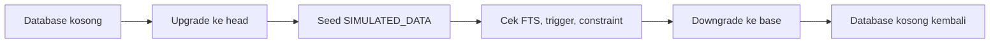

# Pengujian Integrasi Database

**Status:** DRAFT

**Last Updated:** 2026-10-01

## Purpose

Menjelaskan pengujian yang membutuhkan PostgreSQL nyata: migration upgrade dan downgrade, seed SIMULATED_DATA, dan pemeriksaan full-text search.

## Confirmed Information

- **CONFIRMED**: Skema fisik 30 tabel didefinisikan pada revision Alembic `0001_initial_schema` (sumber: fact sheet bagian 6; status skema PROPOSED).
- **CONFIRMED**: PostgreSQL adalah satu-satunya store: relasional, full-text search (tsvector, GIN), dan pgvector (sumber: ADR-003).
- **CONFIRMED**: Suite berlokasi di `tests/integration/` dan hanya berjalan bila `SUNOVATE_TEST_DATABASE_URL` diisi; jika tidak, test dilewati (sumber: implementasi scaffold sesi 2026-10-01).
- **CONFIRMED**: Docker tidak terpasang di mesin pengembangan saat ini. Migration divalidasi memakai PostgreSQL lokal sementara melalui paket Python `pgserver`, yang hanya alat bantu validasi dan bukan dependensi proyek (sumber: implementasi scaffold sesi 2026-10-01).
- **CONFIRMED**: Runtime API belum membaca database; repository SQLAlchemy belum diimplementasikan (sumber: ADR-007). Pengujian ini memvalidasi skema, bukan perilaku endpoint terhadap database.
- **CONFIRMED**: Hasil eksekusi tidak dicatat di sini; lihat laporan validasi terbaru di CHANGELOG.md.

## Cakupan

| Pemeriksaan | Yang dibuktikan | Status |
|---|---|---|
| Upgrade ke head | Semua tabel, constraint, indeks, dan ekstensi pgvector terbentuk | PROPOSED |
| Seed | Dataset SIMULATED_DATA termuat; `data_origin` bernilai `SIMULATED_DATA` | PROPOSED |
| Full-text search | Query tsvector pada knowledge/chunk mengembalikan record yang sesuai | PROPOSED |
| Audit append-only | UPDATE dan DELETE pada `audit_logs` ditolak oleh trigger | PROPOSED |
| Unique checksum | Duplikasi (`document_reference_id`, `checksum_sha256`) ditolak | PROPOSED |
| Downgrade ke base | Semua objek terhapus bersih tanpa sisa | PROPOSED |

## Jalur A: Docker Compose

Prasyarat: Docker terpasang (belum divalidasi di mesin pengembangan saat ini).

```powershell
pnpm compose:check
pnpm db:up
pnpm db:migrate
pnpm db:seed
```

- **CONFIRMED**: `pnpm db:up` menjalankan service `postgres` dengan image `pgvector/pgvector:pg17` dan healthcheck (sumber: implementasi scaffold sesi 2026-10-01).
- **PROPOSED**: Setelah database siap, isi `SUNOVATE_TEST_DATABASE_URL` dengan connection string database uji lalu jalankan pytest untuk `tests/integration/`.
- **PROPOSED**: Gunakan database terpisah untuk pengujian agar data pengembangan tidak tertimpa.

## Jalur B: Tanpa Docker (opsional)

```powershell
pwsh scripts/validation/db-check-pgserver.ps1
```

- **CONFIRMED**: Skrip ini menjalankan migrate, seed, dan downgrade terhadap PostgreSQL sementara tanpa Docker (sumber: implementasi scaffold sesi 2026-10-01).
- **PROPOSED**: Jalur ini hanya untuk validasi skema lokal. Paket `pgserver` tidak boleh ditambahkan sebagai dependensi proyek.

## Render SQL Offline

```powershell
pnpm db:sql
```

- **CONFIRMED**: Merender SQL migration secara offline tanpa koneksi database (sumber: implementasi scaffold sesi 2026-10-01).
- **PROPOSED**: Hasil render dipakai untuk review perubahan skema; lihat [migration-guide.md](../11-operations/migration-guide.md).

## Alur Validasi



## Aturan

- **PROPOSED**: Database uji tidak pernah diarahkan ke database bersama atau produksi.
- **PROPOSED**: Connection string uji tidak di-commit; gunakan variabel lingkungan lokal.
- **PROPOSED**: Kolom vektor belum bertipe dan belum ada indeks ANN sampai model embedding disetujui (sumber: ADR-009); test tidak boleh mengasumsikan dimensi vektor tertentu.

## Open Questions

- OQ-11 Model embedding dan dimensinya; menentukan kapan pengujian pgvector dapat ditambahkan.
- OQ-20 Lingkungan uji bersama, jika ada.

## Related Documents

- [database-schema.md](../04-data/database-schema.md)
- [migration-guide.md](../11-operations/migration-guide.md)
- [local-development.md](../11-operations/local-development.md)
- [backend-testing.md](backend-testing.md)
