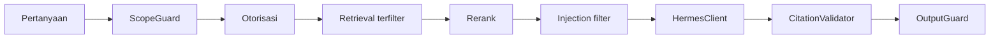

# Pengujian RAG dan Hermes

**Status:** PROPOSED

**Last Updated:** 2026-10-06

## Purpose

Menjelaskan evaluasi retrieval dan jawaban Hermes memakai golden set SIMULATED, metrik yang dipakai, gate kebocoran, dan cara menambah kasus.

## Confirmed Information

- **CONFIRMED**: Golden set berada di `tests/fixtures/rag_golden_set.json` dan suite evaluasi di `tests/rag-evaluation/`; seluruh isinya `SIMULATED_DATA` (sumber: implementasi scaffold sesi 2026-10-01).
- **CONFIRMED**: Provider AI pengembangan bersifat deterministik dan ekstraktif (`development_extractive`); tidak ada model eksternal dan tidak ada akses jaringan (sumber: ADR-008).
- **CONFIRMED**: Embedding provider dinonaktifkan; retrieval saat ini leksikal. Retrieval semantik masih PROPOSED sampai model embedding disetujui (sumber: ADR-008).
- **CONFIRMED**: Hanya knowledge `PUBLISHED` yang masuk retrieval default; filter otorisasi diterapkan sebelum scoring (sumber: implementasi scaffold sesi 2026-10-01).
- **CONFIRMED**: Hasil eksekusi tidak dicatat di sini; lihat laporan validasi terbaru di CHANGELOG.md.

## Alur yang Dievaluasi

## Metrik (PROPOSED)

Metrik diturunkan dari ukuran keberhasilan retrieval, citation, access control, dan traceability (sumber: Proposal v2.4, slide 23). Ambang angka belum ditetapkan dan menunggu validasi mentor.

| Metrik | Definisi | Jenis gate |
|---|---|---|
| Kebocoran (leakage) | Jumlah kasus di mana chunk yang tidak boleh dibaca pengguna muncul di konteks, sitasi, atau jawaban | Mutlak: harus 0 |
| Ketepatan keputusan | Proporsi kasus dengan keputusan Hermes sesuai ekspektasi (`ANSWERED`, `INSUFFICIENT_EVIDENCE`, `REFUSED_*`, `REQUIRES_HUMAN_APPROVAL`, `BLOCKED_BY_OUTPUT_GUARD`) | Ambang OPEN QUESTION |
| Retrieval hit | Proporsi kasus `ANSWERED` di mana minimal satu chunk yang diharapkan masuk hasil top-k | Ambang OPEN QUESTION |
| Validitas sitasi | Proporsi sitasi `[n]` yang memetakan ke chunk terotorisasi yang benar-benar diambil | Mutlak: harus 100 persen |
| Kepatuhan penolakan | Proporsi kasus jailbreak, injection, dan di luar cakupan yang ditolak | Ambang OPEN QUESTION |
| Traceability | Setiap query menghasilkan audit `AI_QUERY` | Mutlak |

## Gate Kebocoran

- **PROPOSED**: Gate kebocoran adalah hard gate. Satu kasus kebocoran menggagalkan suite dan diperlakukan sebagai bug P0 yang memblokir rilis (lihat [bug-severity.md](bug-severity.md)).
- **PROPOSED**: Setiap kasus golden set dijalankan sebagai pengguna simulasi tertentu, sehingga kebocoran diukur terhadap hak akses pengguna tersebut, bukan terhadap seluruh dataset.
- **PROPOSED**: Kasus kebocoran wajib mencakup minimal: record tim lain dengan `sharing_scope` TEAM, record di atas clearance pengguna, record di atas `HERMES_MAX_CLASSIFICATION`, dan record yang belum `PUBLISHED`.

## Kategori Kasus Golden Set (PROPOSED)

| Kategori | Contoh tujuan |
|---|---|
| Jawaban bersitasi | Pertanyaan tentang SOP simulasi yang terbit dan boleh dibaca pengguna |
| Bukti tidak cukup | Pertanyaan dalam domain SUN tanpa dokumen pendukung |
| Kebocoran | Pertanyaan yang jawabannya hanya ada di dokumen terlarang bagi pengguna |
| Di luar cakupan | Pertanyaan di luar domain SUN |
| Pemrograman umum | Permintaan menulis kode umum |
| Jailbreak | Permintaan mengabaikan kebijakan atau mengungkap instruksi |
| Prompt injection | Dokumen simulasi berisi instruksi tersembunyi |
| Niat tulis | Permintaan mengubah atau menerbitkan data |

## Cara Menambah Kasus

1. Tentukan kategori dan pengguna simulasi yang menjalankan kasus (lihat tabel pengguna di [local-development.md](../11-operations/local-development.md)).
2. Jika dokumen pendukung belum ada, tambahkan record SIMULATED ke dataset simulasi yang sama dengan seed, bukan file terpisah, agar store simulasi dan seed database tetap sejalan.
3. Tambahkan kasus ke `tests/fixtures/rag_golden_set.json` mengikuti struktur field yang sudah ada di file tersebut. Sertakan keputusan yang diharapkan dan, untuk `ANSWERED`, rujukan record yang diharapkan.
4. Untuk kasus kebocoran, cantumkan record yang tidak boleh muncul.
5. Jalankan suite `tests/rag-evaluation/` dan `pnpm api:test`.
6. Catat perubahan golden set di CHANGELOG.md.

- **PROPOSED**: Teks kasus tidak boleh memuat angka SUN asli, nama pegawai asli, atau isi dokumen internal.
- **PROPOSED**: Kasus yang gagal karena bug tidak dihapus; perbaiki kodenya, lalu kasus tetap sebagai regresi.

## Rencana Perluasan Golden Set per Tim (PLANNED)

Golden set saat ini berisi 16 kasus (RAG-01 sampai RAG-16) atas delapan knowledge simulasi K1 sampai K8 pada lima tim; SUN_TEMATIK tidak memiliki knowledge (OQ-01). Jawaban knowledge owner: pilot mencakup "6 tim" (OQ-03) dan dokumen yang boleh masuk adalah "semua dokumen yang diusulkan tim kerja" (OQ-04), keduanya **CONFIRMED (knowledge owner, deck v1_ slide 24)**; pengakuan mentor tertunda (OQ-24). Rencana di bawah **PLANNED**, belum ada kasus yang ditambahkan.

| Tim | Kasus yang direncanakan (semua `SIMULATED_DATA`) | Campuran klasifikasi |
|---|---|---|
| PPSUN, PSUN, AKPSUN, PPPSUN, DHTV | Minimal satu kasus `ANSWERED` dari knowledge terbit milik tim, satu kasus `INSUFFICIENT_EVIDENCE` dari tim lain (kebocoran lintas tim), dan satu kasus knowledge non-`PUBLISHED` tim sendiri | PUBLIC, INTERNAL, RESTRICTED masing-masing minimal satu; satu CONFIDENTIAL yang harus tidak pernah muncul |
| SUN_TEMATIK | Hanya kasus isolasi (pengguna tim ini tidak boleh memperoleh sitasi tim lain); tidak ada kasus `ANSWERED` sampai fungsinya dikonfirmasi | Tidak ada knowledge, sehingga tidak ada campuran |
| Lintas tim | Pasangan pengguna dan pertanyaan sama dengan hasil berbeda menurut tim dan clearance; `sharing_scope` DIRECTORATE terbit versus TEAM | Sesuai kebutuhan kasus |

- **PLANNED**: Setiap kasus mencatat `category`, pengguna, tim, dan klasifikasi; aturan kasus baru di bagian "Cara Menambah Kasus" tetap berlaku (dataset simulasi yang sama dengan seed, tanpa angka SUN asli).
- **PLANNED**: Bila pengguna simulasi tambahan ditambahkan (usulan di [logical-data-model.md](../04-data/logical-data-model.md)), kasus dijalankan sebagai PIC dan ketua tim tiap tim agar kebocoran diukur terhadap hak akses peran yang benar-benar menulis.
- **Keterbatasan**: Knowledge yang dibuat lewat API tidak memiliki chunk (belum ada pipeline ingestion, KL-07); retrieval Hermes bekerja pada chunk. Kasus `ANSWERED` baru memerlukan chunk dari dataset simulasi, bukan dari unggahan lewat API.
- **PLANNED**: Gate kebocoran tetap nol. Kasus tim yang ditambahkan ikut gate; satu kebocoran adalah bug P0 (bug-severity).

## Prosedur Pengujian dengan Dokumen Asli (hanya setelah persetujuan)

Prosedur ini **PROPOSED** dan tidak berlaku sekarang. Sampai semua syarat terpenuhi, hanya `SIMULATED_DATA` yang dipakai (AGENTS.md).

1. Persetujuan eksplisit tertulis atas dokumen tertentu dari pihak yang berwenang (siapa: OPEN QUESTION, OQ-05 dan OQ-24), dengan klasifikasi resmi yang sudah ditetapkan (OQ-05). "Semua dokumen yang diusulkan tim kerja" (OQ-04) tidak menggantikan persetujuan per dokumen.
2. `CONFIDENTIAL` dikecualikan dari Hermes dan dari uji RAG (BR-22).
3. Lingkungan uji terpisah dari repository Git (dokumen asli tidak pernah menjadi fixture, seed, atau commit; ADR-014); lingkungan dan hostnya mengikuti OQ-20 dan OQ-23.
4. Hasil uji dicatat tanpa isi dokumen: hanya id kasus, keputusan Hermes, jumlah sitasi, dan ada atau tidaknya kebocoran. Jawaban yang dihasilkan tidak disalin ke register bug atau CHANGELOG.
5. Setelah uji, data asli di lingkungan uji dihapus sesuai kebijakan retensi yang berlaku (OQ-13) dan penghapusan dicatat.
6. Kebocoran, bagaimanapun kecilnya, diproses sebagai P0 dan insiden ([incident-response.md](../06-security/incident-response.md)).

## Batasan Evaluasi Saat Ini

- **CONFIRMED**: Karena provider ekstraktif dan retrieval leksikal, hasil evaluasi saat ini tidak mencerminkan kualitas model bahasa atau retrieval semantik (sumber: ADR-008).
- **OPEN QUESTION**: Evaluasi ulang dibutuhkan setelah model AI dan embedding disetujui (OQ-11).
- **OPEN QUESTION**: Dokumen apa yang boleh masuk RAG menentukan isi golden set lanjutan (OQ-04).

## Related Documents

- [rag-evaluation.md](../05-ai-rag/rag-evaluation.md)
- [citation-policy.md](../05-ai-rag/citation-policy.md)
- [retrieval-strategy.md](../05-ai-rag/retrieval-strategy.md)
- [security-testing.md](security-testing.md)
