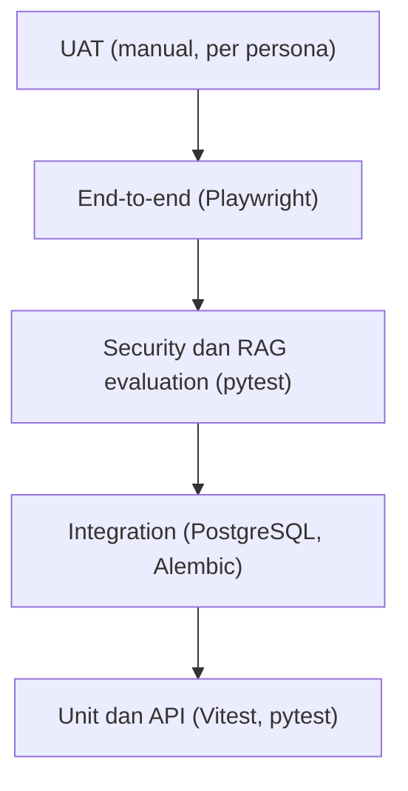
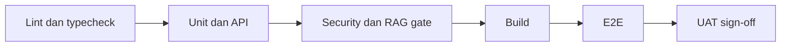

# Piramida Pengujian

**Status:** PROPOSED

**Last Updated:** 2026-10-01

## Purpose

Menjelaskan susunan lapisan pengujian SUNOVATE, panduan proporsi jumlah pengujian, dan lokasi setiap lapisan di repository.

## Diagram Lapisan

Lapisan bawah paling banyak, paling cepat, dan dijalankan pada setiap perubahan. Lapisan atas paling sedikit dan paling mahal.

## Panduan Proporsi

| Lapisan | Proporsi indikatif | Frekuensi | Status |
|---|---|---|---|
| Unit dan API | Mayoritas pengujian | Setiap perubahan, lewat `pnpm test` | PROPOSED |
| Integration | Sedikit, fokus pada skema dan query | Saat migration atau query berubah | PROPOSED |
| Security dan RAG evaluation | Satu kasus per skenario wajib, ditambah kasus regresi | Setiap perubahan pada otorisasi, search, atau Hermes | PROPOSED |
| End-to-end | Hanya alur utama | Sebelum rilis atau perubahan alur halaman | PROPOSED |
| UAT | Per persona dan per alur bisnis | Fase implementasi (roadmap Bulan 6) | PROPOSED |

- **PROPOSED**: Angka proporsi tidak dikunci. Prinsipnya, logika otorisasi dan Hermes diuji di lapisan unit/API karena lebih cepat dan deterministik, lalu dikonfirmasi oleh sedikit e2e.
- **PROPOSED**: Pengujian negatif otorisasi (akses ditolak) diperlakukan setara dengan pengujian positif; setiap endpoint terlindungi minimal memiliki satu kasus ditolak.
- **CONFIRMED**: UAT, security test, dan bug fixing direncanakan pada Bulan 6 roadmap (sumber: Proposal v2.4, slide 21; status rencana PROPOSED).

## Lokasi Setiap Lapisan

| Lapisan | Lokasi | Perintah |
|---|---|---|
| Unit frontend | `apps/web/src/**/*.test.tsx` | `pnpm test` |
| Unit dan API backend | `apps/api/tests/` | `pnpm api:test` |
| Integration | `tests/integration/` | Lihat [integration-testing.md](integration-testing.md) |
| Security | `tests/security/` | Lihat [security-testing.md](security-testing.md) |
| RAG evaluation | `tests/rag-evaluation/` | Lihat [rag-testing.md](rag-testing.md) |
| Fixture | `tests/fixtures/` | Dipakai oleh suite Python |
| End-to-end | `apps/web/e2e/` | `pnpm e2e` |
| UAT | Di luar repository | Lihat [uat-plan.md](uat-plan.md) |

- **CONFIRMED**: Lokasi di atas mengikuti struktur scaffold (sumber: implementasi scaffold sesi 2026-10-01).
- **CONFIRMED**: Pengujian integration database hanya berjalan bila `SUNOVATE_TEST_DATABASE_URL` diisi; jika tidak, dilewati (sumber: implementasi scaffold sesi 2026-10-01).
- **CONFIRMED (implementasi)**: `pnpm api:test` menjalankan `apps/api/tests` dan seluruh `tests/` di root (`testpaths` di `apps/api/pyproject.toml`). `pnpm test` menjalankan Vitest lalu pytest.

## Gate per Lapisan

- **PROPOSED**: Kegagalan pada satu gate menghentikan gate berikutnya.
- **PROPOSED**: Gate kebocoran RAG bersifat mutlak; satu kebocoran memblokir rilis (P0, lihat [bug-severity.md](bug-severity.md)).

## Related Documents

- [test-strategy.md](test-strategy.md)
- [frontend-testing.md](frontend-testing.md)
- [backend-testing.md](backend-testing.md)
