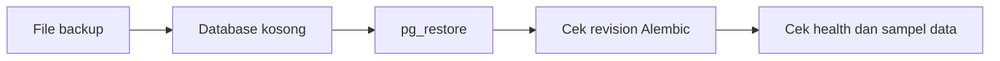

# Backup dan Restore

**Status:** DRAFT

**Last Updated:** 2026-10-19

## Purpose

Menjelaskan latihan backup dan restore yang sudah diotomasi untuk database uji berisi
`SIMULATED_DATA`, serta mencatat hal yang masih terbuka untuk produksi.

## Status

- **CONFIRMED (implementasi)**: `pnpm db:restore-drill` membuat backup custom sementara,
  memulihkannya ke database kosong yang berbeda, lalu membandingkan seluruh jumlah baris,
  revision Alembic, asal data, dan trigger append-only audit.
- **CONFIRMED (batas validasi)**: Alat dan 11 uji pengamannya tersedia, tetapi latihan aktual
  belum dijalankan di lingkungan ini karena PostgreSQL/Docker yang dapat dipakai tidak tersedia.
- **CONFIRMED (knowledge owner, deck v1_ slide 24)**: Hosting pilot adalah komputer tersendiri sebagai server (OQ-07, DEC-20261002-05). Pada satu host, disk yang rusak dapat menghilangkan database dan backup sekaligus bila backup disimpan di host yang sama (R-13).
- **OPEN QUESTION**: Kebijakan backup produksi (frekuensi, retensi, lokasi di luar host, enkripsi, penanggung jawab) bergantung pada persyaratan server (OQ-23) dan kebijakan retensi (OQ-13).

## Confirmed Information

- **CONFIRMED**: Database adalah PostgreSQL dengan pgvector; file dokumen tidak disimpan di database. Database hanya menyimpan referensi, metadata, checksum SHA-256, versi, klasifikasi, dan lokasi provider (sumber: ADR-003).
- **CONFIRMED**: Default runtime memakai store simulasi in-memory (`DATA_BACKEND=simulated`); pada mode ini data yang dibuat lewat API hilang ketika API dihentikan dan tidak tercakup backup database (sumber: ADR-007).
- **CONFIRMED (implementasi)**: Dengan `DATA_BACKEND=postgres`, data yang dibuat lewat API disimpan di PostgreSQL `DATABASE_URL` dan tercakup backup database (ADR-015, PROPOSED).
- **CONFIRMED**: Database lokal dapat dibentuk ulang kapan saja dari migration dan seed SIMULATED_DATA (`pnpm db:migrate`, `pnpm db:seed`).

## Cakupan Backup

| Objek | Lokasi | Dicakup backup database | Catatan |
|---|---|---|---|
| Skema dan data relasional | PostgreSQL | Ya | Termasuk `audit_logs` |
| Indeks full-text dan embedding | PostgreSQL | Ya | Embedding dapat dibuat ulang setelah model disetujui |
| File dokumen | Provider dokumen | Tidak | Tanggung jawab provider (OQ-06) |
| Konfigurasi dan rahasia | Environment | Tidak | Dikelola terpisah; lihat [secrets-management.md](../06-security/secrets-management.md) |

## Latihan Otomatis untuk Data Simulasi

Prasyarat:

- `pg_dump` dan `pg_restore` tersedia pada `PATH`;
- database sumber hanya memuat `SIMULATED_DATA` dan sudah memiliki migration serta seed;
- database tujuan sudah dibuat, benar-benar kosong, berbeda dari sumber, dan namanya memuat
  kata `restore`;
- kedua host bersifat lokal/private. Nama host internal seperti `postgres` harus dimasukkan
  secara eksplisit pada `SUNOVATE_BACKUP_ALLOWED_HOSTS`.

Isi variabel berikut melalui shell atau penyimpanan rahasia lokal. Jangan memasukkan URL nyata
ke Git atau riwayat perintah bersama.

| Variabel | Nilai yang diwajibkan |
|---|---|
| `APP_ENV` | `test` |
| `SUNOVATE_BACKUP_DRILL_CONFIRM` | `SIMULATED_DATA_ONLY` |
| `SUNOVATE_BACKUP_SOURCE_URL` | URL database sumber dengan skema `postgresql+psycopg` atau `postgresql+asyncpg` |
| `SUNOVATE_BACKUP_RESTORE_URL` | URL database kosong dan terpisah; nama database memuat `restore` |
| `SUNOVATE_BACKUP_ALLOWED_HOSTS` | Opsional; allowlist nama host internal, dipisahkan koma |
| `SUNOVATE_BACKUP_ALLOWED_SOURCE_DATABASE` | Opsional; nama database sumber persis bila namanya tidak memuat `test`, `simul`, `demo`, atau `restore` |

Jalankan:

```bash
pnpm db:restore-drill
```

Alat menolak database sistem, parameter query pada URL, host publik yang tidak diizinkan,
sumber dan target yang sama, target yang sudah berisi tabel, sumber kosong, serta baris dengan
`data_origin` selain `SIMULATED_DATA`. Kredensial diteruskan kepada klien PostgreSQL melalui
environment proses, bukan argumen, dan tidak ditampilkan. File backup sementara dibuat di luar
repository lalu dihapus otomatis. Alat tidak melakukan `DROP`, `TRUNCATE`, atau penghapusan
otomatis pada database tujuan.

## Alur Restore



## Pemeriksaan yang Diotomasi

Backup dianggap valid hanya bila pernah berhasil di-restore. Langkah uji:

1. Restore ke database terpisah, bukan database yang sedang dipakai.
2. Pastikan revision Alembic sama dengan revision saat backup dibuat.
3. Pastikan trigger append-only `audit_logs` masih aktif.
4. Bandingkan jumlah baris tabel utama dengan sumber.
5. Pastikan semua tabel berkolom `data_origin` hanya memuat `SIMULATED_DATA`.
6. Catat jumlah tabel/baris, ukuran backup, durasi dump/restore/verifikasi, dan revision tanpa
   mencatat URL atau kredensial.

Pemeriksaan health API dan penyimpanan backup di luar host tetap langkah operasional manual.
Setelah restore lulus, baseline pencarian PostgreSQL dapat dijalankan terhadap database hasil
restore dengan `pnpm search:eval:postgres`; lihat
[integration-testing.md](../10-testing/integration-testing.md).

## Kebutuhan Produksi (OPEN QUESTION)

- Recovery point objective dan recovery time objective.
- Lokasi penyimpanan backup di luar komputer server dan enkripsi (server tunggal, R-13; OQ-23).
- Retensi backup dan hubungannya dengan retensi audit log dan percakapan AI (OQ-13).
- Pihak yang berwenang melakukan restore.
- Koordinasi backup database dengan backup provider dokumen (OQ-06).

## Risks

- R-03 Data asli atau sensitif masuk repository atau log; alat latihan sengaja menolak
  `data_origin` non-simulasi dan tidak mempertahankan file dump.
- R-10 Simulated store disangka persistence produksi.
- R-13 Backup pada host yang sama tidak melindungi dari kegagalan host; alat latihan bukan
  kebijakan backup produksi atau bukti penyimpanan off-host.

## Related Documents

- [data-retention.md](../04-data/data-retention.md)
- [migration-guide.md](migration-guide.md)
- [deployment-runbook.md](deployment-runbook.md)
