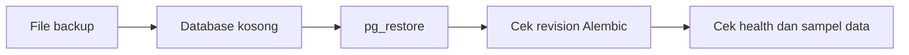

# Backup dan Restore

**Status:** PROPOSED

**Last Updated:** 2026-10-02

## Purpose

Mengusulkan pendekatan backup dan restore database SUNOVATE untuk pengembangan lokal, serta mencatat hal yang masih terbuka untuk produksi.

## Status

- **PROPOSED**: Seluruh prosedur di dokumen ini adalah usulan dan belum diotomasi dalam skrip proyek.
- **CONFIRMED (knowledge owner, deck v1_ slide 24)**: Hosting pilot adalah komputer tersendiri sebagai server (OQ-07, DEC-20261002-05). Pada satu host, disk yang rusak dapat menghilangkan database dan backup sekaligus bila backup disimpan di host yang sama (R-13).
- **OPEN QUESTION**: Kebijakan backup produksi (frekuensi, retensi, lokasi di luar host, enkripsi, penanggung jawab) bergantung pada persyaratan server (OQ-23) dan kebijakan retensi (OQ-13).

## Confirmed Information

- **CONFIRMED**: Database adalah PostgreSQL dengan pgvector; file dokumen tidak disimpan di database. Database hanya menyimpan referensi, metadata, checksum SHA-256, versi, klasifikasi, dan lokasi provider (sumber: ADR-003).
- **CONFIRMED**: Default runtime memakai store simulasi in-memory (`DATA_BACKEND=simulated`); pada mode ini data yang dibuat lewat API hilang ketika API dihentikan dan tidak tercakup backup database (sumber: ADR-007).
- **CONFIRMED (implementasi)**: Dengan `DATA_BACKEND=postgres`, data yang dibuat lewat API disimpan di PostgreSQL `DATABASE_URL` dan tercakup backup database (ADR-015, PROPOSED).
- **CONFIRMED**: Database lokal dapat dibentuk ulang kapan saja dari migration dan seed SIMULATED_DATA (`pnpm db:migrate`, `pnpm db:seed`).

## Cakupan Backup

| Objek | Lokasi | Dicakup backup database | Catatan |
|---|---|---|---|
| Skema dan data relasional | PostgreSQL | Ya | Termasuk `audit_logs` |
| Indeks full-text dan embedding | PostgreSQL | Ya | Embedding dapat dibuat ulang setelah model disetujui |
| File dokumen | Provider dokumen | Tidak | Tanggung jawab provider (OQ-06) |
| Konfigurasi dan rahasia | Environment | Tidak | Dikelola terpisah; lihat [secrets-management.md](../06-security/secrets-management.md) |

## Pendekatan Lokal (PROPOSED)

Untuk lokal, backup biasanya tidak diperlukan karena database dapat dibangun ulang dari migration dan seed. Bila ingin menyimpan keadaan tertentu:

- Backup: gunakan `pg_dump` format custom terhadap database lokal yang ditunjuk `DATABASE_URL`, lalu simpan file hasil di luar folder repository.
- Restore: buat database kosong, lalu gunakan `pg_restore` dengan file backup tersebut.
- Bila PostgreSQL berjalan di Docker Compose, jalankan alat tersebut di dalam container service `postgres` atau dari klien PostgreSQL di host dengan versi yang kompatibel dengan pg17.

- **PROPOSED**: File backup tidak pernah di-commit dan tidak dibagikan, walaupun isinya SIMULATED_DATA.
- **PROPOSED**: Opsi perintah `pg_dump` dan `pg_restore` mengikuti dokumentasi resmi PostgreSQL; skrip proyek untuk ini belum ada.

## Alur Restore

## Uji Restore (PROPOSED)

Backup dianggap valid hanya bila pernah berhasil di-restore. Langkah uji:

1. Restore ke database terpisah, bukan database yang sedang dipakai.
2. Pastikan revision Alembic sama dengan revision saat backup dibuat.
3. Pastikan trigger append-only `audit_logs` masih aktif.
4. Bandingkan jumlah baris tabel utama dengan sumber.
5. Arahkan `DATABASE_URL` ke database hasil restore dan periksa `GET /api/v1/health/database`.
6. Catat tanggal, ukuran, durasi, dan hasil uji.

## Kebutuhan Produksi (OPEN QUESTION)

- Recovery point objective dan recovery time objective.
- Lokasi penyimpanan backup di luar komputer server dan enkripsi (server tunggal, R-13; OQ-23).
- Retensi backup dan hubungannya dengan retensi audit log dan percakapan AI (OQ-13).
- Pihak yang berwenang melakukan restore.
- Koordinasi backup database dengan backup provider dokumen (OQ-06).

## Risks

- R-03 Data asli atau sensitif masuk repository atau log; file backup berisiko serupa bila disimpan di folder repository.
- R-10 Simulated store disangka persistence produksi.

## Related Documents

- [data-retention.md](../04-data/data-retention.md)
- [migration-guide.md](migration-guide.md)
- [deployment-runbook.md](deployment-runbook.md)
